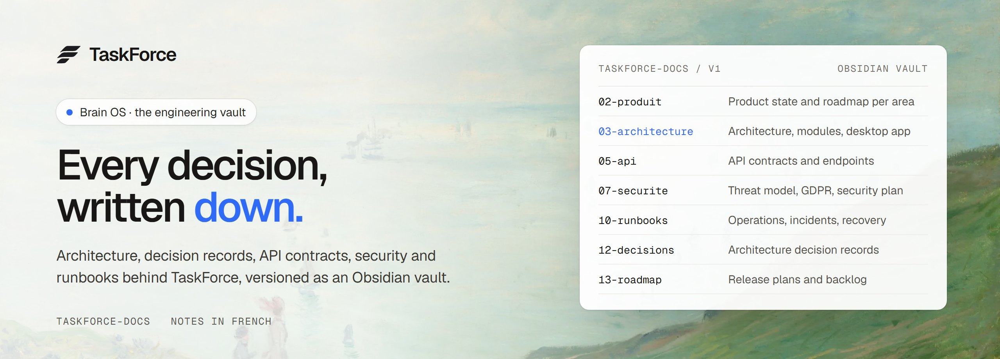

<p align="center">
  <a href="./Brain_OS.md">
    
  </a>
</p>

<p align="center">
  <b>Brain OS is the engineering knowledge base behind <a href="https://github.com/taskforce-project/taskforce-fullstack">TaskForce</a>, the open source desktop app for working with AI coding agents.</b><br />
  Architecture, decision records, API contracts, security and runbooks, versioned like the code they describe.
</p>

<p align="center">
  <a href="./Brain_OS.md"><b>Start here</b></a>
  &nbsp;·&nbsp;
  <a href="https://github.com/taskforce-project/taskforce-fullstack"><b>Product</b></a>
  &nbsp;·&nbsp;
  <a href="https://taskforce-project.fr"><b>Website</b></a>
  &nbsp;·&nbsp;
  <a href="https://docs.taskforce-project.fr"><b>User documentation</b></a>
</p>

<p align="center">
  <a href="https://github.com/taskforce-project/taskforce-fullstack"></a>
  
</p>

> The notes are written in French. Coding assistants start with [AGENTS.md](./AGENTS.md), people with the
> [Brain OS hub](./Brain_OS.md).

<br />

## Why a vault

Most projects document after the fact, and the documents drift away from the code. Brain OS works the other way
round: it is where decisions are made and kept.

- **Decisions before code.** Structural choices are recorded as architecture decision records: the context, the
  options, the choice and its consequences.
- **Claims traced to the code.** Technical statements point to the files that prove them, and a gap between the notes
  and the code is flagged instead of being hidden.
- **Read by people and by agents.** People open it as an Obsidian vault. AI agents follow [AGENTS.md](./AGENTS.md),
  a contract that tells them where to look, how to pick the next action and how to keep the notes up to date.

## What is inside

| Area | Start with |
| --- | --- |
| Product state | [Product status by area](./v1/02-produit/README.md): what ships, what is in progress, what is next |
| Architecture | [Architecture](./v1/03-architecture/Architecture.md), [modules](./v1/03-architecture/Modules.md) and the [desktop app specification](./v1/03-architecture/Specification_App_Desktop.md) |
| API | [API contracts](./v1/05-api/API.md) |
| Security | [Security](./v1/07-securite/): STRIDE threat model, security policy, data protection impact assessment, GDPR register, secure development plan |
| Operations | [Runbooks](./v1/10-runbooks/README.md), [business continuity and recovery](./v1/11-pca-pra/) |
| Decisions | [Decision journal](./v1/12-decisions/Journal_Decisions_ADR.md): 21 architecture decision records |
| Roadmap | [Open source release plan](./v1/13-roadmap/Plan_Release_Open_Source.md) and the [backlog](./v1/13-roadmap/Roadmap_Backlog.md) |
| Known issues | [Known problems](./v1/09-audits/Problemes_Connus.md), with their cause and their fix |
| Research | [Research lab](./recherche/README.md): experiments, references, reviews and draft decisions |
| Everything | [Documentation catalog](./v1/Catalogue_Documentation.md) |

## Structure

```text
taskforce-docs/
├── Brain_OS.md      the hub: a map of every document
├── AGENTS.md        the contract for AI agents: orientation and upkeep
├── v1/              the product as it is today, in 18 numbered areas
├── v2/              the future target, kept apart from v1
├── recherche/       the research lab
├── frameworks/      procedures shared across versions
├── templates/       document templates
└── assets/          diagrams, mockups and images
```

`v1/` describes what exists, `v2/` what is planned. A document never mixes the two, as set out in the
[documentation conventions](./v1/04-engineering/Conventions_Documentation.md).

## Use it

- **Read.** Open this folder as a vault in [Obsidian](https://obsidian.md): the configuration is included, and the
  graph view colors the notes by area. Every note is also plain Markdown, readable here on GitHub.
- **Contribute.** Start from a [template](./templates/), keep the front matter, and follow the
  [development procedure](./frameworks/SOP_Developpement.md). Commits read `docs(scope): description`. A document is
  never deleted: it moves to the [archive](./v1/20-archive/README.md).

## Support the project

<p align="center">
  <a href="https://github.com/taskforce-project/taskforce-fullstack/stargazers">
    
  </a>
</p>

If these notes help you build or understand TaskForce, star
[taskforce-fullstack](https://github.com/taskforce-project/taskforce-fullstack) and this repository, and watch the
releases (Watch, then Custom, then Releases) to follow the project.

---

<p align="center">
  <sub>Written by <a href="https://github.com/Miche1-Pierre">Pierre Michel</a> · final project of a level 6 RNCP degree, Metz Numeric School · 2025-2026</sub>
</p>
