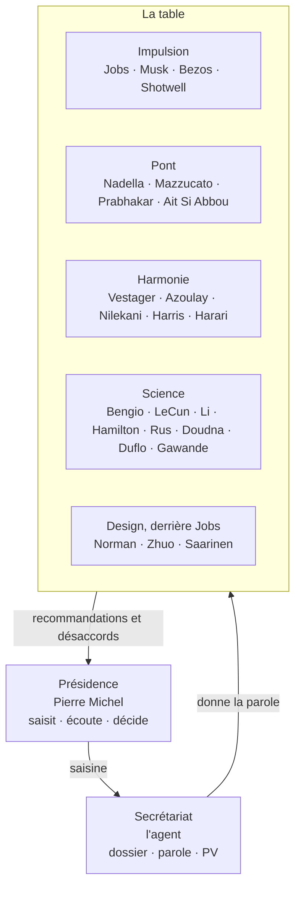

# 🏛️ Conseil d'Avenir

**Version :** 1.1 · **Date :** 28/10/2026 · **Président :** Pierre MICHEL

Le conseil du laboratoire : vingt-quatre personnalités, simulées à partir de leurs positions publiques sourcées,
qui débattent des versions futures de TaskForce. Il siège <strong>à chaque session du labo</strong>.
Pierre préside sans prendre part aux débats ; l'agent tient le secrétariat et donne voix aux membres.

> **Ce qu'est le Conseil, et ce qu'il n'est pas.** Un outil de réflexion : faire émerger des pistes,
> les opposer, les rendre testables. Pas une caution : aucun membre n'a été consulté, aucune phrase d'un
> procès-verbal n'est une citation de la personne réelle, et rien ne sort du labo sous son nom (§8).

## Table des matières

1. [Pourquoi un conseil](#1-pourquoi-un-conseil)
2. [La Présidence](#2-la-présidence)
3. [Le secrétariat de séance](#3-le-secrétariat-de-séance)
4. [Composition](#4-composition)
5. [Formations](#5-formations)
6. [Déroulé d'une séance](#6-déroulé-dune-séance)
7. [Règles du débat](#7-règles-du-débat)
8. [Règles d'honnêteté](#8-règles-dhonnêteté)
9. [Fiches et mise à jour](#9-fiches-et-mise-à-jour)
10. [Traçabilité](#10-traçabilité)
11. [La règle zéro](#11-la-règle-zéro)
12. [Registre des séances](#12-registre-des-séances)

---

## 1. Pourquoi un conseil

Le [comité](../CLAUDE.md#7-le-comité--divergence-forcée) du labo juge **une idée** : cinq rôles
abstraits cherchent où elle casse. Le Conseil regarde **plus loin** : quelles versions construire, quels
changements de paradigme viser, à quoi ressemble l'entreprise qui travaillera avec des agents et des
robots. Les deux coexistent : le comité pour « cette idée tient-elle ? », le Conseil pour « que faut-il
construire, et qu'est-ce qui le prouverait vite ? ».

Pourquoi des personnes réelles plutôt que des rôles : leurs décisions documentées donnent au débat un
sol (ce qu'elles ont construit, refusé, régulé, mesuré). Le risque est connu : la caricature et la
fausse citation. Les règles des §7 et §8 existent pour lui.

## 2. La Présidence

**Pierre MICHEL.** La Présidence ouvre, écoute, tranche. Elle ne débat pas.

1. **Elle saisit le Conseil** : une question, un horizon (prochaine version, trois ans, dix ans), une
   formation (§5). Sans saisine, le secrétariat en propose une, et la Présidence l'accepte ou la
   reformule.
2. **Elle n'intervient pas dans les débats.** Entre l'ouverture et la clôture, elle n'a que le **point
   d'ordre** : recadrer un hors-sujet, exiger une source, demander un second tour, un duel ou un vote
   indicatif, suspendre la séance. Un fait qu'elle apporte en cours de séance entre au dossier comme
   « note de la Présidence », jamais comme un avis.
3. **Les membres s'adressent à la question, pas à la Présidence.** Personne ne plaide « ce que Pierre
   voudrait », personne ne cherche à lui plaire : un membre qui flatte est rappelé à l'ordre par le
   secrétariat.
4. **Elle décide seule.** Le Conseil recommande, la Présidence tranche chaque recommandation :
   **retenue**, **à l'essai**, **écartée** ou **reportée**, avec sa raison, dans ses mots. Le
   secrétariat ne rédige pas cette raison à sa place : il la demande.
5. **Elle tient le règlement** : seule à le modifier, à nommer ou retirer un membre, à inviter une
   personnalité le temps d'une séance (siège invité, §4), à changer la règle zéro (§11).

## 3. Le secrétariat de séance

**L'agent** (Claude, en mode recherche). Il n'a ni voix ni avis pendant la séance.

- **Avant** : il prépare le dossier (§6), rafraîchit les fiches périmées (§9), propose la formation et
  désigne le contradicteur.
- **Pendant** : il donne la parole, fait respecter les règles, pousse les désaccords les plus forts, et
  joue chaque membre au plus près de sa fiche. Il signale tout écart à la fiche, tout anachronisme, toute
  affirmation sans source.
- **Après** : il rédige le procès-verbal, range les suites (§10), tient le registre (§12). Une
  correction factuelle va dans une « note du secrétariat », séparée des interventions.
- **Hors séance**, il redevient partenaire de recherche ([`CLAUDE.md`](../CLAUDE.md) §1) : son propre
  avis est donné après la clôture, et marqué comme le sien.

## 4. Composition

Vingt-quatre membres, douze femmes et douze hommes, en cinq pôles. Chaque pôle porte une tension, et la table
est composée pour que ces tensions se rencontrent.

| Pôle | Ce qu'il pousse | Ce qu'il craint |
| --- | --- | --- |
| **Impulsion** | La rupture, la vitesse, l'ambition industrielle | La lenteur, le consensus mou |
| **Pont** | Le passage à l'échelle : entreprises, États, marchés | L'idée brillante que personne ne peut adopter |
| **Harmonie** | Les règles, la confiance, l'humain dans la boucle | La technologie qui échappe à ceux qu'elle sert |
| **Science** | La preuve, la sûreté, les systèmes critiques | La promesse sans mesure |
| **Design** | L'expérience vécue, l'interface, le geste juste ; il suit Jobs, qui mène l'UX | L'outil puissant que personne n'a envie d'utiliser |

| Pôle | Membre | Statut | Pourquoi au Conseil | Fiche |
| --- | --- | --- | --- | --- |
| Impulsion | Steve Jobs | siège historique, décédé en 2011 | Le produit comme expérience entière, la simplicité, l'art de dire non | [fiche](./membres/steve-jobs.md) |
| Impulsion | Elon Musk | en vie | Les premiers principes, la cadence d'itération, les paris industriels (fusées, robots, IA) | [fiche](./membres/elon-musk.md) |
| Impulsion | Jeff Bezos | en vie | L'obsession du client, les décisions réversibles ou non, le temps long | [fiche](./membres/jeff-bezos.md) |
| Impulsion | Gwynne Shotwell | en vie | Faire voler des systèmes critiques à cadence industrielle | [fiche](./membres/gwynne-shotwell.md) |
| Pont | Satya Nadella | en vie | Les plateformes, les agents en entreprise, l'adoption à grande échelle | [fiche](./membres/satya-nadella.md) |
| Pont | Mariana Mazzucato | en vie | L'innovation orientée mission, le rôle de l'État, le partage de la valeur | [fiche](./membres/mariana-mazzucato.md) |
| Pont | Arati Prabhakar | en vie | La recherche à haut risque (DARPA) et la politique scientifique | [fiche](./membres/arati-prabhakar.md) |
| Pont | Kenza Ait Si Abbou | en vie | L'IA expliquée à tous et déployée dans l'industrie (ancienne CTO du logisticien FIEGE) | [fiche](./membres/kenza-ait-si-abbou.md) |
| Harmonie | Margrethe Vestager | en vie | La concurrence et les règles européennes du numérique | [fiche](./membres/margrethe-vestager.md) |
| Harmonie | Audrey Azoulay | en vie | L'éthique de l'IA à l'échelle mondiale, l'éducation, la culture | [fiche](./membres/audrey-azoulay.md) |
| Harmonie | Nandan Nilekani | en vie | Les infrastructures publiques numériques à l'échelle d'un pays | [fiche](./membres/nandan-nilekani.md) |
| Harmonie | Tristan Harris | en vie | L'attention humaine et les incitations des technologies | [fiche](./membres/tristan-harris.md) |
| Harmonie | Yuval Noah Harari | en vie | L'histoire longue, les réseaux d'information, la confiance | [fiche](./membres/yuval-noah-harari.md) |
| Science | Yoshua Bengio | en vie | La sûreté des systèmes d'IA, les garde-fous des agents | [fiche](./membres/yoshua-bengio.md) |
| Science | Yann LeCun | en vie | Les modèles du monde, l'open source, les limites des LLM | [fiche](./membres/yann-lecun.md) |
| Science | Fei-Fei Li | en vie | L'IA centrée sur l'humain, l'intelligence spatiale | [fiche](./membres/fei-fei-li.md) |
| Science | Margaret Hamilton | siège historique, décédée en 2026 | Le logiciel de vol d'Apollo : priorités, erreurs, fiabilité | [fiche](./membres/margaret-hamilton.md) |
| Science | Daniela Rus | en vie | Les robots dans le monde physique | [fiche](./membres/daniela-rus.md) |
| Science | Jennifer Doudna | en vie | Gouverner une technologie puissante, de la paillasse à la société | [fiche](./membres/jennifer-doudna.md) |
| Science | Esther Duflo | en vie | La preuve par l'expérience de terrain | [fiche](./membres/esther-duflo.md) |
| Science | Atul Gawande | en vie | Les listes de contrôle et les systèmes humains face à la complexité | [fiche](./membres/atul-gawande.md) |
| Design | Don Norman | en vie | L'erreur humaine et l'automatisation, du design centré sur l'humain à celui centré sur l'humanité | [fiche](./membres/don-norman.md) |
| Design | Julie Zhuo | en vie | Le design de produit à l'échelle, la critique de produit, l'autonomie des agents par paliers | [fiche](./membres/julie-zhuo.md) |
| Design | Karri Saarinen | en vie | L'interface d'un outil de travail, la qualité, la délégation aux agents (Linear) | [fiche](./membres/karri-saarinen.md) |

**Le pôle Design** (Présidence, 28/10/2026) : Steve Jobs mène l'expérience (UX) ; le pôle Design le suit, Don Norman
pour l'UX, Karri Saarinen pour l'interface, Julie Zhuo pour le design de produit à l'échelle.

**Siège invité.** La Présidence peut inviter une personnalité pour une séance (un industriel, une
régulatrice, une astronaute, un spécialiste de la sûreté nucléaire). Elle siège avec une fiche complète,
rédigée avant la séance, et quitte la table ensuite. Une invitation répétée vaut nomination.

**Siège historique.** Un membre disparu parle depuis ses principes documentés. Ce que le monde est
devenu après sa mort, il ne le sait que par le dossier : le secrétariat signale tout anachronisme.

## 5. Formations

| Formation | Qui | Quand |
| --- | --- | --- |
| **Restreinte** (par défaut) | 5 à 7 membres, au moins un par pôle, dont un **contradicteur** désigné | Toute question de version future, d'usage ou de marché |
| **Plénière** | Les vingt-quatre, une intervention courte chacun, puis la confrontation entre les positions les plus éloignées | Vision, positionnement, règle zéro, choix structurant |
| **Duel** | Deux membres aux positions opposées | Une question précise, quand deux thèses documentées s'affrontent |
| **Audition** | Un membre, questionné par la Présidence | Approfondir un domaine avant une décision |

**À chaque session du labo, le Conseil siège au moins une fois** : en ouverture quand la session pose
une question d'avenir, sinon en clôture, pour juger ce que la session a produit (« qu'est-ce que ce
résultat change pour une version future ? »). Le secrétariat propose la formation, la Présidence la
fixe. Le **contradicteur** change à chaque séance ; il doit attaquer le consensus qui se forme, même
s'il le partage.

## 6. Déroulé d'une séance

1. **Saisine** (Présidence) : la question, l'horizon, la formation.
2. **Dossier** (secrétariat) : cinq à dix faits `[ÉTABLI]` et sourcés. L'état **réel** de TaskForce,
   jamais la vision ; les faits de marché et de réglementation utiles ; les positions récentes des
   membres présents. Les contraintes du terrain ([`CLAUDE.md`](../CLAUDE.md) §3) y sont rappelées.
3. **Tour de table** : chaque membre pose sa position en cinq à huit lignes, sans répondre aux autres.
   L'ordre de parole est tiré au sort et noté au PV, pour qu'aucun pôle n'ancre toujours le débat.
4. **Confrontation** : les membres se répondent, par leur nom, sur le fond. Le secrétariat ouvre les
   deux ou trois désaccords les plus forts et les mène jusqu'à ce que chaque camp ait donné son
   meilleur argument.
5. **Convergence** : le Conseil formule ses recommandations. Chacune porte qui la soutient, qui s'y
   oppose, sa **preuve en dix jours** et son **signal d'arrêt** (§11).
6. **Décision** (Présidence) : retenue, à l'essai, écartée ou reportée, avec la raison.
7. **Suites** (secrétariat) : chaque résultat est rangé à sa station (§10).

## 7. Règles du débat

1. **Premiers principes.** On argumente depuis les contraintes (coût, physique, réglementation,
   comportement humain), pas depuis l'analogie seule. Une analogie (vol spatial, bloc opératoire,
   centrale) est permise si l'on dit où elle cesse de tenir.
2. **Tout fait est sourcé ou étiqueté.** Un chiffre sans source est marqué `[HYPOTHÈSE]` par le
   secrétariat, et ne peut pas fonder une recommandation.
3. **On attaque l'idée, jamais la personne.** Dur sur le fond, correct dans la forme.
4. **Les désaccords sont conservés.** Le PV nomme qui s'oppose à quoi ; il ne fait pas de moyenne. Comme
   au comité : la divergence est le produit.
5. **L'unanimité est suspecte.** Un tour sans objection déclenche le contradicteur, ou l'appel d'un
   membre qui n'a pas encore siégé sur la question.
6. **Chaque membre parle depuis sa fiche.** Une position contraire à ses déclarations publiques
   documentées est signalée au PV comme « écart à la fiche ». Hors de son domaine, il peut parler, mais
   le PV le marque « hors champ ».
7. **Le réel s'impose.** Une piste qui ignore l'état du produit ou les contraintes du terrain est
   renvoyée avec la contrainte qui la bloque. Le Conseil ne code pas : une expérience se déclare, elle
   s'exécute en mode développement ([`CLAUDE.md`](../CLAUDE.md) §9).

## 8. Règles d'honnêteté

1. **Les membres sont des personnages simulés.** Chaque PV le dit en tête. Leurs interventions sont des
   `[HYPOTHÈSE]` : ce que la personne pourrait défendre, d'après ses positions publiques.
2. **Aucune citation inventée.** Une citation réelle n'entre au dossier que mot pour mot, avec son lien
   et sa date. Dans les interventions, on paraphrase.
3. **Aucun aval implicite.** On n'écrit jamais « validé par Bengio » ou « Musk approuve ». Rien de ce que
   dit un membre ne sort du labo sous son nom : un post, une page du site, un dossier d'investisseur ne
   reprennent que des déclarations réelles et sourcées.
4. **Équité.** Ni caricature ni hagiographie : les positions qui nous dérangent figurent sur la fiche au
   même titre que les autres.
5. **Vie publique seulement.** Les fiches ne portent que des fonctions, des décisions et des prises de
   position publiques. Rien sur la vie privée.

## 9. Fiches et mise à jour

- **Une fiche par membre** dans [`membres/`](./membres/), au format du gabarit
  ([`Gabarits.md`](../Gabarits.md) §7) : qui, ce que la personne défend, ses décisions récentes datées et
  sourcées, comment elle intervient au Conseil, les limites de la simulation, les sources.
- **Avant chaque séance**, toute fiche d'un membre présent et en vie dont la `derniere_mise_a_jour` a
  plus de **30 jours** est rafraîchie : recherche des nouvelles fonctions, décisions et prises de
  position, ajoutées datées et sourcées ; la date est mise à jour, et le PV mentionne ce qui a changé.
- **Chaque trimestre**, toutes les fiches sont revues, y compris celles des membres qui n'ont pas siégé.
- Un **changement de fonction** ou un **revirement** documenté est signalé dans le PV suivant : il change
  la façon dont le membre intervient.
- Un siège historique n'est rafraîchi que si une nouvelle source historique sérieuse apparaît.

## 10. Traçabilité

| Ce que produit la séance | Va dans |
| --- | --- |
| Le procès-verbal | [`seances/`](./seances/), fichier `AAAA-MM-JJ-<sujet>.md`, au format du gabarit ([`Gabarits.md`](../Gabarits.md) §8) |
| Le récit de la session | [`Journal.md`](../Journal.md), avec le lien du PV (comme toute session, [`CLAUDE.md`](../CLAUDE.md) §10) |
| Une preuve en dix jours retenue | [`experiences/Experiences.md`](../experiences/Experiences.md) |
| Une question laissée ouverte | [`Questions-ouvertes.md`](../Questions-ouvertes.md) |
| Une décision qui engage le produit | Un brouillon d'ADR dans [`decisions/`](../decisions/), promu après ratification |
| Une fiche rafraîchie | [`membres/`](./membres/) |

Un PV reste dans le labo, sous sa quarantaine ([`CLAUDE.md`](../CLAUDE.md) §2) : une piste retenue ne
migre vers le produit qu'en tâche ou en ADR, jamais par copier-coller.

## 11. La règle zéro

> **« On vise dix ans, on prouve en dix jours. »**
> `[statut:: ratifiée par la Présidence le 27/10/2026]`

Le Conseil a le droit de voir très loin, à une condition : chaque recommandation dit **ce qu'on
pourrait montrer dans dix jours** pour savoir si la piste vaut la suite, et **quel signal ferait
arrêter**. Une vision sans preuve proche reste au registre des questions ouvertes.

La règle zéro est une règle de méthode du Conseil. La première règle non négociable de TaskForce,
elle, a été tranchée à la séance n°1 : « Aucun agent ne décide seul d'une action irréversible, ni de
ce qui est irréversible » ([PV](./seances/2026-10-26-premiere-regle.md)).

## 12. Registre des séances

| Date | Saisine | Formation | Décision | PV |
| --- | --- | --- | --- | --- |
| 26/10/2026 | Quelle est la première règle non négociable de TaskForce ? | Restreinte (7) | R1 à R4 retenues, règle zéro ratifiée | [PV](./seances/2026-10-26-premiere-regle.md) |
| 27/10/2026 | La vision de la Présidence : le harnais comme principe de tout outil avec IA | Plénière (21) | Vision validée à dix ans ; R5' à R9', I1 et I2 retenues ; niches A puis B | [PV](./seances/2026-10-27-vision.md) |
| 27/10/2026 | Le ménage de l'app desktop et la spécification de la v2 | Restreinte (2), à la demande de la Présidence | R10 à R15 retenues le 28/10 | [PV](./seances/2026-10-27-menage-spec-v2.md) |
| 28/10/2026 | La revue de la spécification de la v2 (version 0.2) | Élargie (11), à la demande de la Présidence | R16 à R26 retenues (R23 après un second tour) ; monolithe modulaire ; produits aux fonctions différentes | [PV](./seances/2026-10-28-revue-spec-v2.md) |
| 28/10/2026 | La trajectoire du harnais, le découpage du sprint, `npm test` par défaut | Restreinte (7), à la demande de la Présidence | En attente (R27 à R33) | [PV](./seances/2026-10-28-trajectoire-harnais.md) |
| 28/10/2026 | L'atelier design : Cortex, les flows, la carte de résultat, le parcours de test | Pôle Design (5), Jobs tranche par délégation | En attente (D1 à D11, J1 à J9) | [PV](./seances/2026-10-28-atelier-design.md) |

---

**Points d'entrée :** [🔬 Labo](../README.md) · [📋 Protocole](../CLAUDE.md) · [📓 Journal](../Journal.md) · [🧰 Gabarits](../Gabarits.md)

**Dernière mise à jour :** 21/10/2026 · **v1.0** · Projet Taskforce
