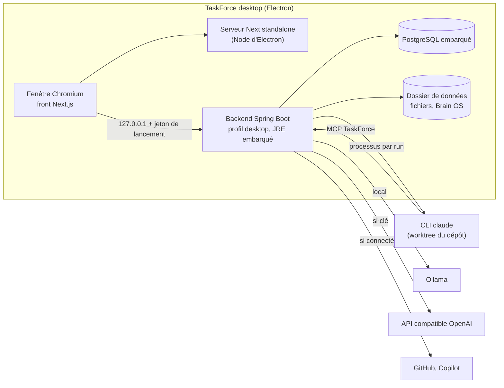

# Spécification de l'application desktop

**Version :** 0.4 (essai OSS-D.1 fait ; Claude Code et GitHub de bout en bout ; versions 1.0.0 à 1.0.2 publiées ;
récupération du compte ; lots D.3, D.6 et D.8 en cours)
**Date :** 20/10/2026
**Auteur(s) :** Pierre MICHEL

> Décision de cap : [[Journal_Decisions_ADR#ADR-021 - Application desktop locale, sur le modèle de Claude Desktop|ADR-021]].
> Ce document dit ce que l'app desktop fait, ce qu'elle ne fait pas ou mal, comment elle est construite, et ce que
> l'édition serveur (la webapp) pourrait combler. Les ordres de grandeur non mesurés sont signalés comme tels ; l'essai
> OSS-D.1 les remplace par des mesures.

## 0. En bref

- Une app desktop pour Windows, macOS et Linux, sur le modèle de Claude Desktop : un compte TaskForce gratuit pour se
  connecter (hébergé), aucun serveur pour les projets, données sur le disque, IA locale (Ollama) ou par clé d'API.
- Même code que la webapp : un profil `desktop` remplace les briques serveur par des équivalents locaux.
- Architecture visée : coque Electron, front Next.js et backend Spring Boot existants lancés en local, base PostgreSQL
  embarquée. Claude Code est lancé directement par l'app.
- Ce qui disparaît : travail à plusieurs, notifications par e-mail, intégrations entrantes. Le compte reste, hébergé
  (décision du CEO du 19/10/2026, §10).
- La webapp peut rester, sans nouveaux développements, comme édition serveur pour les équipes (recommandé, §7).

## 1. Objectifs et principes

TaskForce desktop est un poste de pilotage personnel : on décrit le travail, on le découpe, on le confie à un agent
(Claude Code, Copilot) ou on le fait soi-même, et la mémoire du projet (Brain OS) reste sur sa machine.

Principes :

- **Comme Claude Desktop** : on installe, on se connecte, ça marche. Un compte gratuit, aucun serveur pour les projets,
  pas de Docker.
- **Local d'abord** : données, fichiers et mémoire sur le disque de l'utilisateur ; l'app marche hors ligne, sauf pour
  ce qui appelle un service distant (modèle par clé d'API, GitHub, Copilot).
- **IA à la mesure de la machine** : modèle local par Ollama, ou clé d'API ; rien ne bloque sans IA.
- **Même code que la webapp** : un profil `desktop` remplace les briques serveur par des équivalents locaux.
- **Pas de fissure** : ce que le desktop ne sait pas faire est retiré de son interface, pas laissé en panne.

Hors objectifs de la 1re version : collaboration à plusieurs, synchronisation entre machines, application mobile,
modèles d'IA embarqués dans l'installateur.

## 2. Parcours de référence

1. Téléchargement depuis le site, installation, premier lancement (écran d'attente pendant le démarrage).
2. Premier lancement : nom et avatar ; détection d'Ollama et choix d'un modèle, ou saisie d'une clé d'API, ou
   « plus tard ».
3. Création d'un espace et d'un projet ; dossier de dépôt git facultatif.
4. Rédaction d'issues, page Brain OS, découpage par Cortex.
5. Délégation d'une issue à Claude Code : la chronologie suit le run en direct ; une demande d'autorisation apparaît,
   l'utilisateur accorde ou refuse ; la PR ou le commentaire de réponse s'affiche, l'issue passe en revue.
6. Mise à jour proposée par l'app au lancement suivant.

## 3. Périmètre fonctionnel

Légende : **Gardé** (identique), **Adapté** (change de forme), **Retiré** (absent du desktop), **Limité** (marche, avec
une contrainte).

| Domaine | Desktop | Ce qui change |
| ------- | ------- | ------------- |
| Compte, connexion, mot de passe, 2FA, connexion GitHub ou Google | Adapté | Compte TaskForce obligatoire et gratuit, hébergé : créé au premier lancement, ou compte existant de la webapp ; connexion par les pages de la webapp dans le navigateur (`/auth/desktop`), jamais par une page Keycloak ; mot de passe, 2FA, GitHub, Google ou passkey. Les projets restent sur la machine. |
| Onboarding | Adapté | Nom, choix du fournisseur d'IA (Ollama détecté ou clé), dossier de dépôt optionnel. Plus d'invitations. Sauté pour un compte déjà configuré sur la webapp, dont l'app reprend les réglages, sans visite guidée (§10, précision du 20/10). |
| Workspaces et projets | Gardé | Plusieurs espaces et projets pour une même personne. |
| Issues (tableau, liste, backlog, cycles, roadmap, sous-tâches, relations, checklists, commentaires, temps passé) | Gardé | |
| Pièces jointes | Adapté | Fichiers dans un dossier de l'app au lieu de MinIO. |
| Brain OS (arbre de pages, éditeur, recherche, ingestion) | Gardé | Données locales ; recherche sémantique si un modèle d'embeddings est disponible, sinon plein texte (lot 4). |
| Cortex (chat IA avec outils) | Limité | Qualité selon le modèle et la machine (§5.4). |
| Analyses IA, insights, suggestions de compétences | Limité | Idem ; désactivées proprement sans IA. |
| Smart Assign | Adapté | Voir §6 : plus de collègues à départager. |
| Analytics (débit, burndown, capacité) | Gardé | Capacité et charge réduites à une personne et ses agents. |
| Notifications dans l'app, « My work » | Gardé | Notifications du système (centre de notifications de l'OS) en plus. |
| Notifications par e-mail | Retiré | Pas de serveur de courrier dans l'app. Les e-mails de service (annonces, fermeture de la webapp) partent du côté hébergé (Brevo). |
| Membres, équipes, invitations, rôles | Retiré | Mono-utilisateur. Revient avec l'édition serveur (§7). |
| Temps réel (mises à jour poussées) | Gardé | Courtier en mémoire de Spring, déjà utilisé en prod ; il n'y a pas de présence. |
| Délégation à Claude Code | Gardé, simplifié | Lancé directement par l'app (§5.5). |
| Délégation à Copilot | Limité | Réseau requis ; suivi par interrogation, pas par webhook. |
| Intégration GitHub (dépôts, PR, issues) | Limité | Connexion par device flow ; rafraîchissement par interrogation (le code n'a pas de webhook GitHub entrant aujourd'hui). |
| Intégration Slack | Limité ou retiré | La connexion OAuth de Slack demande une adresse de retour enregistrée ; voir §5.6. |
| Intégration Plane, connecteurs à clé d'API | Gardé | Appels sortants seulement. |
| Serveurs MCP (Cortex) | Adapté | Distants et, nouveau, locaux en stdio (§5.5). |
| Webhooks sortants | Limité | Envoyés seulement quand l'app est ouverte. |
| Export, import, RGPD | Adapté | Export complet (fichier). De la webapp, l'app ne reprend que la configuration du compte ; les projets passeront d'un côté à l'autre à la demande, dans les deux sens (§10, précision du 20/10). Le compte se supprime côté hébergé. |
| Journal d'audit | Retiré | Pertinent à plusieurs ; l'historique des issues reste. |
| Palette de commandes, raccourcis, thèmes, accessibilité | Gardé | |
| Retours (« Give feedback »), statistiques d'usage | Adapté | Lien vers les issues GitHub ; aucune télémétrie par défaut. |

## 4. Ce qu'on ne peut pas faire, ou mal

- **Travailler à plusieurs** sur les mêmes données : impossible sans serveur d'équipe ou synchronisation (§7).
- **Recevoir des événements** de l'extérieur (webhooks, retours OAuth sur une adresse publique) : l'app n'a pas
  d'adresse publique et n'est pas toujours allumée. On interroge à la place, quand l'app est ouverte.
- **Envoyer des e-mails depuis l'app** : pas de serveur de courrier local ; les e-mails de compte et de service partent du
  côté hébergé.
- **Ouvrir ses données depuis une autre machine ou un téléphone.**
- **IA lourde sur une petite machine** : sans GPU ni 16 Go de RAM, Cortex avec outils est lent et peu fiable ; la
  parade est une clé d'API.
- **Agents en arrière-plan quand l'app est fermée** : un run s'arrête avec l'app (reprise au relancement à prévoir).
- **Diffusion sans friction sans signature de code** : voir §5.8.

## 5. Technique

### 5.1 Architecture des processus

La coque Electron démarre les processus dans l'ordre (base, backend, serveur Next), attend que `/readyz` réponde,
puis ouvre la fenêtre. À la fermeture, elle arrête tout proprement. Chaque processus écoute sur 127.0.0.1, sur un port
libre tiré au lancement.

### 5.2 Briques serveur et leur remplaçant

Inventaire du code du 18/10/2026 (backend, front et IA, en lecture seule).

| Brique | Rôle aujourd'hui | Profil `desktop` | Effort |
| ------ | ---------------- | ---------------- | ------ |
| Keycloak | Connexion, inscription, jetons de l'API et du WebSocket, connexion GitHub ou Google, identité des runners. Le mot de passe, le prénom et le nom n'existent que chez lui (retirés de `users` en V2) : `/api/users/me` l'appelle à chaque lecture du profil | Connexion obligatoire au compte hébergé, par les pages de la webapp (`/auth/desktop` : accord, code à usage unique et PKCE, retour sur 127.0.0.1, RFC 8252), session de l'app (`tfa_`, 90 jours glissants, V100) dans le trousseau ; l'API locale garde le filtre du jeton de lancement (§5.7). L'identité (`KeycloakService`, `KeycloakAuthService`) passe derrière une interface. Après la première connexion, l'app marche aussi hors ligne (décision du 19/10) | Le plus gros chantier backend |
| PostgreSQL + pgvector | Tout le stockage ; recherche de Brain OS | PostgreSQL embarqué (§5.3) | Moyen (empaquetage) |
| RabbitMQ | Rien par défaut : le relais STOMP est facultatif, la prod tourne déjà avec le courtier en mémoire de Spring | Rien | Nul |
| Redis | Limites de débit, cache des analytics, garde-débit IA (prod seulement) | Rien : chaque usage a déjà un repli local | Nul |
| MinIO | Pièces jointes des issues (liens présignés), avatars et fichiers Brain (servis par le backend) | Dossier local derrière `MinioService`, pièces jointes servies par une route du backend | Faible |
| SMTP | Codes d'inscription et de réinitialisation, bienvenue, invitations, notifications, demandes RGPD, retours | Coupé dans l'app ; inscription, réinitialisation et e-mails de service restent côté hébergé (Keycloak, Brevo) | Faible |
| Service Python (`ai-service`) | Simple relais : `POST /v1/chat` (compatible OpenAI, paliers, `/no_think` pour Qwen) et `POST /v1/embeddings` (même fournisseur ou un autre, Ollama par défaut ; plus de repli lexical depuis le lot 4) ; aucune dépendance de ML | Porté en Java : le backend appelle Ollama ou l'API directement | Faible |
| Tâches planifiées (4) | Purge des comptes (4 h), nettoyage (3 h 30), alertes d'échéance (8 h) et de surcharge (8 h 30) | Rattrapage au démarrage pour les échéances ; purge et surcharge sans objet pour une personne | Faible |
| Retours OAuth (GitHub, Slack, MCP, fournisseurs Keycloak) | Retour après consentement, sur une adresse publique | Device flow pour GitHub, retour sur 127.0.0.1 pour le MCP ; un secret d'application ne reste pas secret dans une app installée | Moyen |
| Runner et clients Keycloak | Délégation à Claude Code depuis un serveur distant | L'app lance l'agent elle-même (§5.5) | Moyen |
| `TF_ENCRYPTION_KEY` | Chiffrement des jetons et clés en base | Générée au premier lancement, gardée dans le trousseau | Faible |
| Serveur Next.js | Sert le front ; aucune donnée côté serveur (pas de route d'API, pas de middleware, tout passe par le navigateur) | Serveur `standalone` lancé par la coque (§5.1) | Moyen |

Côté front, l'export statique n'est pas possible sans refonte : 7 segments dynamiques sans `generateStaticParams`
(`[workspace]`, `[id]`, `[issueId]`…), 2 redirections côté serveur, `next/image` avec le chargeur par défaut. Le serveur
`standalone` actuel suffit. En revanche, l'URL de l'API est figée au build (`NEXT_PUBLIC_API_URL`, lue par 7 fichiers)
ainsi que les origines de la CSP : avec des ports tirés au lancement, elle doit devenir une configuration lue à
l'exécution (script injecté par le layout racine, ou relais same-origin par la coque). À trancher pendant l'essai.

### 5.3 Données et stockage

**Emplacement** : le dossier de données de l'app (`app.getPath('userData')` d'Electron : `%APPDATA%\TaskForce` sous
Windows, `~/Library/Application Support/TaskForce` sous macOS, `~/.local/share/TaskForce` sous Linux). Il contient la
base, les fichiers (pièces jointes, avatars, Brain OS), les journaux et les réglages. Version du Microsoft Store :
`%LOCALAPPDATA%\Packages\<famille du paquet>\LocalState`, écrit directement (`desktop/src/paths.ts`, `storeDataDir`) ;
dans `%APPDATA%`, Windows redirigerait les écritures d'une app empaquetée vers ce dossier, hors de la vue de
l'Explorateur, et mêlerait la base à celle de la version du site si les deux sont installées. Windows l'efface quand on
désinstalle l'app.

**Base : PostgreSQL embarqué**, lancé par l'app comme un processus enfant. C'est le choix qui change le moins de code :
les 86 migrations, les 7 types enum natifs, le JSONB (y compris les requêtes `->>` des intégrations), les tableaux
`text[]`, la quinzaine de requêtes natives (CTE, `generate_series`, `FILTER`, `date_trunc`, `ON CONFLICT`) et les
verrous de ligne restent tels quels. SQLite ou H2 obligeraient à réécrire tout cela.

**pgvector, le point dur.** Une seule colonne vectorielle sert (`knowledge_nodes.embedding vector(1024)`, index HNSW,
recherche de Brain OS) ; les colonnes `vector(384)` de V32 et V33 ne sont lues ni écrites par aucun code. Mais
l'extension est créée par les migrations V32, V33, V52 et V59 : **sans pgvector dans la base embarquée, les migrations
échouent**. Deux sorties : livrer l'extension compilée pour les trois OS, ou une variante desktop de ces migrations, la
recherche restant alors en plein texte (lot 4). C'est la première question de l'essai (§8).

**Sauvegarde.** Quand la version de l'app change, la coque copie la base (`pg_dump -Fc`) dans
`<dossier du compte>/backups` avant que le backend ne la migre (Flyway), et garde les trois copies les plus récentes
(`desktop/src/backup.ts`, version notée dans `app-version`). Une copie impossible n'empêche pas le démarrage : la
version n'est pas notée, la copie est retentée au lancement suivant. Réglages > Privacy & Data ouvre le dossier. La
restauration se fait à la main (`pg_restore`, app fermée). La base n'est pas chiffrée sur le disque : on recommande le
chiffrement du disque de l'OS ; les secrets, eux, sont dans le trousseau (§5.7).

**Portabilité : le fichier de projet (20/10/2026).** Un projet entier tient dans un zip (`modules/transfer`,
`ProjectBundle`) : `project.json` porte ses lignes table par table, telles que PostgreSQL les rend
(`row_to_json`), les personnes qu'elles citent, le format (`taskforce-project`, version 1) et la version du schéma ;
`files/<id>` porte le contenu de chaque pièce jointe. Voyagent le projet, ses statuts, types, labels, cycles et pages,
et tous ses tickets (sous-tickets et archivés compris) avec labels, commentaires, historique, checklist, temps passé,
liens entre tickets, cycles, pièces jointes et liens GitHub. Restent : membres et équipes de l'espace, Brain OS (il
voyage avec le fichier d'espace, ci-dessous), connexions et clés (chiffrées pour une seule instance), historique des
agents.

- **Import.** Chaque ligne est recréée par `json_populate_record`, qui convertit chaque valeur dans le type de sa colonne
  (énumérations, dates, tableaux) : dates et numéros de tickets gardés, sans passer par les services (ni notification, ni
  webhook, ni historique en plus). Le fichier n'est jamais cru sur parole : identifiants renumérotés, clés étrangères
  passées par la table de correspondance (une ligne qui cite ce qui n'est pas venu reste de côté, une clé étrangère
  inconnue du format prend sa valeur par défaut), seules les colonnes qui existent dans la base cible sont écrites,
  archive bornée entrée par entrée (`project.json` 128 Mo, pièce jointe 100 Mo, total 2 Go, 50 000 entrées, envoi
  512 Mo). Tout ou rien : un échec annule l'import et efface les pièces jointes déjà rangées. La personne qui importe
  mène le projet (LEAD), l'identifiant est rendu unique dans l'espace (APO → APO2), le compteur de tickets repart après
  le plus grand numéro, et `ProjectCreatedEvent` écrit la fiche du projet dans le Brain OS.
- **Personnes** (`ImportedPeople`). Sur le serveur : le membre de l'espace qui a la même adresse, sinon la personne
  qui importe ; aucun compte n'est créé (un compte inactif bloquerait l'inscription de cette adresse). Dans l'app : la
  personne locale qui a la même adresse, sinon un utilisateur inactif `imported:<uuid>` qui garde son nom, que rien ne
  peut connecter.
- **API.** `GET /api/workspaces/{slug}/projects/{id}/bundle` (qui voit le projet) et
  `POST /api/workspaces/{slug}/projects/import` (membre de l'espace, corps `application/zip`). Pour l'app, avec sa
  seule session (`tfa_`, profil `!desktop`) : `POST /api/auth/desktop/transfer/projects` (espaces et projets visibles),
  `/bundle` et `/import?workspace=` (session dans l'en-tête `X-TaskForce-Session`) ; 401 si la session est finie.
- **Interface.** Menu Export d'un projet : « TaskForce project file (.zip) » ; New project > « From a file ». Dans l'app :
  Projects > « From the web app » (un espace encore vide le propose de lui-même), et Export > « Copy to the web app ».
  La coque fait le trajet (`desktop/src/transfer.ts`) : la session ne passe jamais par la page, 10 minutes par étape.
- **Limites connues.** Un lien vers une pièce jointe écrit dans une description garde l'ancien identifiant ; les valeurs
  de l'historique restent du texte ; un projet copié deux fois donne deux projets (pas d'identifiant stable entre
  instances).

**Portabilité : le fichier d'espace (20/10/2026).** Tout le travail d'une personne passe d'un côté à l'autre espace par
espace (`WorkspaceBundleService`). Le zip porte `workspace.json` (la ligne de l'espace, son Brain OS : `brain_workspaces`,
`knowledge_nodes` sans `embedding` ni `embedding_model`, `knowledge_edges` entre pages exportées ; les personnes citées,
la liste des projets et des fichiers des pages), un fichier de projet par projet sous `projects/<id>/` (le format
ci-dessus) et les fichiers que montrent les pages sous `brain-files/<nom>`.

- **Export.** Réservé aux membres de l'espace. Seuls voyagent les projets que la personne voit, et les pages qui
  décrivent un projet, un ticket ou un cycle d'un projet qu'elle ne voit pas restent de côté.
- **Import.** Crée toujours un **nouvel** espace : nom, description et activité du fichier, adresse rendue unique, la
  personne en propriétaire. Chaque projet est recréé comme un fichier de projet, sans `ProjectCreatedEvent` : la fiche
  du projet vient avec le Brain OS du fichier, l'écouteur la réécrirait. Puis le Brain OS : pages avec un `uuid` neuf,
  parents reposés après coup, références (projet, ticket, cycle) passées par la correspondance des projets importés
  (une référence sans correspondance est retirée), même chose pour `projectId`, `issueId` et `cycleId` du `metadata`,
  auteurs par `ImportedPeople`, adresses `/api/files/brain/<espace>/<nom>` réécrites vers le nouvel espace, liens
  entre pages importées. Les vecteurs de recherche sont recalculés en tâche de fond (`BrainEmbeddingIndexer`). Mêmes
  bornes que le fichier de projet, tout ou rien, fichiers rangés effacés si l'import échoue.
- **API.** `GET /api/workspaces/{slug}/bundle` (membre) et `POST /api/workspaces/import` (corps `application/zip`). Pour
  l'app : `POST /api/auth/desktop/transfer/workspace` (`{token, workspace}`) et
  `POST /api/auth/desktop/transfer/workspace-import` (session dans `X-TaskForce-Session`).
- **Interface.** Réglages > General, carte « Move or back up this workspace » : « Workspace file » (téléchargement),
  « Import a workspace file » et, dans l'app, « Copy to the web app ». Dans l'app, Projects > « From the web app » :
  « Copy everything » copie chaque espace pas encore copié, l'un après l'autre ; « Copy the whole workspace » en copie
  un seul. La coque fait le trajet (`bringWorkspace`, `sendWorkspace` dans `desktop/src/transfer.ts`).
- **Ne voyagent pas.** Membres, équipes et invitations ; connexions, intégrations, webhooks et clés ; conversations
  avec l'assistant, graphiques enregistrés, cartes du tableau de bord et historique des analyses IA.
- **Instance hébergée.** L'API de prod passe par un tunnel Cloudflare : un envoi vers la webapp au-delà de sa limite
  (100 Mo sur les offres Free et Pro) est refusé en 413, une réponse trop lente coupée en 524, sans message de l'API.
  La coque traduit ces deux cas (envoyer les projets un par un ; vérifier la webapp avant de réessayer, l'import peut
  finir), le front dit d'un 413 que le fichier est trop gros. Le sens webapp vers app (téléchargement) n'a pas cette
  limite.

### 5.4 IA sur la machine de l'utilisateur

**Fournisseurs.** Deux voies, choisies au premier lancement et modifiables dans les réglages :

- **Ollama** (local, gratuit, privé) : l'app le détecte sur `http://127.0.0.1:11434`, liste les modèles installés et
  propose d'en télécharger un si besoin. L'app n'embarque pas de modèle ni Ollama lui-même (plusieurs Go).
- **Clé d'API compatible OpenAI** (OpenAI, Groq, Mistral, OpenRouter, LM Studio, vLLM…) : URL de base, clé, modèle.
  La clé va dans le trousseau du système (§5.7).

Sans fournisseur, l'app reste pleinement utilisable en gestion de projet ; les fonctions IA affichent « IA non
configurée » au lieu d'échouer (OSS-4.4).

**Paliers de matériel.** Mesures réelles sur le poste de dev (RTX 5070, 8 Go de VRAM, 32 Go de RAM,
[[Benchmark_Modeles_IA]] §4bis) : un modèle 8B répond en environ 18 s, régulier, JSON propre ; un 14B déborde en RAM et
prend de 60 à 170 s, très variable. Ordres de grandeur pour la spec, à re-mesurer pendant l'essai :

| Machine | Modèle de chat conseillé | Ce qui marche bien | Ce qui marche mal |
| ------- | ------------------------ | ------------------ | ----------------- |
| Sans GPU, 8 Go de RAM | 3-4B quantifié, ou une clé d'API | Résumés courts, reformulation | Cortex avec outils (lent, appels d'outils peu fiables) |
| Sans GPU, 16 Go | 7-8B quantifié | Chat, résumés, découpage simple | Réponses en dizaines de secondes |
| GPU 8 Go ou Apple Silicon 16 Go | 8B | Cortex avec outils, analyses | Les 14B et plus (débordement mémoire) |
| GPU 12 Go et plus, ou Apple Silicon 32 Go | 14B | Raisonnement et découpage plus fins | |

**Choix des modèles par défaut.** Le palier « rapide » compte plus que la taille : mesure du 07/2026 (archives QA),
un scoring JSON prend environ 52 s avec `qwen3:8b` contre environ 2,4 s avec `qwen2.5:7b-instruct`. Le desktop part
donc d'un modèle rapide sans mode « réflexion » pour le palier rapide (lot 4).

Mesure du 18/10/2026 après le lot 4 (machine de dev, Ollama, modèle déjà chargé, même scoring JSON de trois
candidats) : `qwen2.5:7b-instruct` 1,5 s ; `qwen3:8b` sans réflexion (`/no_think`) 8,9 s ; `qwen3:8b` avec réflexion
15,1 s. Changer de modèle coûte 6 à 8 s de chargement. La webapp garde un seul modèle par défaut (`qwen3:8b` pour les
deux paliers, sans rechargement) ; le modèle du palier rapide du desktop reste à choisir pendant l'essai.

**Embeddings.** Recherche sémantique de Brain OS et des issues : un petit modèle d'embeddings local (taille et choix à
fixer pendant l'essai ; `bge-m3` actuel pèse environ 1,2 Go). Sans modèle d'embeddings, la recherche passe en
plein texte PostgreSQL. **Corrigé au lot 4** : le repli lexical, dont `EmbeddingClient` stockait les vecteurs avec les
vrais sans jamais les recalculer, est supprimé ; chaque vecteur porte son modèle (V94) et une tâche de fond calcule
les vecteurs manquants ou périmés, ce qui couvre le poste où Ollama démarre après l'app. Les délais sont alignés :
120 s pour l'`ai-service`, 150 s pour le backend, 200 s pour le front.

**Règle de conception.** Tout ce qui n'a pas besoin d'un LLM n'en utilise pas : tri, filtres, analytics, liens,
historique. L'IA reste une aide, jamais un point de passage obligé.

### 5.5 Agents de code

**Claude Code, lancé directement.** Sur le desktop, l'app et le dépôt sont sur la même machine. Le modèle « pull »
(le runner réclame du travail au serveur) et le relais Keycloak n'existaient que parce que le serveur ne pouvait pas
joindre le poste (ADR-013) : ils disparaissent. Le runner actuel (`taskforce-runner`, Node, sans dépendance
d'exécution) se réutilise tel quel, lancé par la coque avec le Node d'Electron. L'app émet elle-même un jeton par run ;
la portée par run (`DeliverySessionScope` : lecture de l'espace, écriture sur les issues du seul projet du run, jamais
de suppression) reste, car elle borne ce qu'une injection de prompt dans le texte d'une issue peut faire.

L'app lance la CLI `claude` installée par l'utilisateur, avec son propre abonnement ou sa propre clé ; TaskForce ne
touche jamais aux identifiants Anthropic. Options de la CLI vérifiées sur la version 2.1.293 :

- `-p --output-format stream-json --verbose` : suivi en direct, affiché dans la chronologie de l'issue (OSS-5.3) ;
- `--mcp-config` et `--strict-mcp-config` : la session reçoit le serveur MCP de TaskForce (lecture du projet, de Brain
  OS, commentaires) et rien d'autre ;
- `--settings` et `--setting-sources user` : réglages de la session imposés par l'app, ceux du dépôt cloné ignorés
  (OSS-1.8). Depuis le lot 5, le runner lance l'agent en `--permission-mode manual --permission-prompts none` : une
  action hors du socle pré-autorisé appelle un crochet `PermissionRequest` HTTP vers un serveur local du runner, qui
  ouvre la demande dans TaskForce ; l'utilisateur clique Allow ou Deny sur l'issue ; sans réponse, refus (OSS-5.4,
  vérifié sur la CLI 2.1.293). Le desktop garde ce mécanisme, la demande restant dans l'app.

Le dépôt est celui lié au projet sur GitHub (§5.6). Le runner le clone à la première tâche avec le GitHub CLI de la
personne (`gh`), dans le dossier de données du compte, puis chaque run travaille dans un worktree git dédié. Pour ce
clone, `fetch` et `push` passent par les identifiants de `gh`, le temps de la commande, sans toucher la configuration
git de la personne ; un dépôt déclaré dans la configuration du runner garde la sienne. La pull request s'ouvre avec
`gh`, rien n'est fusionné. Le mode « sans dépôt » du runner (réponse en commentaire) est conservé.

**Ce qu'il faut sur le poste.** Claude Code installé et connecté une fois à son compte Claude, git, et GitHub CLI
connecté pour les projets qui ont un dépôt. Réglages > Agents le vérifie en direct (`desktop/src/tools.ts` :
`claude --version` et `claude auth status`, `git --version`, `gh auth token` sans réseau puis `gh api user`) et mène à
ce qui manque : commande d'installation, lien de téléchargement, connexion à GitHub dans l'app.

**Copilot (agent cloud de GitHub), 20/10/2026.** Le jeton GitHub passe par `GitHubTokenSource` : sur le serveur, la
connexion GitHub de l'espace (`WorkspaceGitHubTokenSource`) ; dans l'app, le compte GitHub de la personne, connecté par
son GitHub CLI (`DesktopGitHubTokenSource`, `@Primary` en profil `desktop`). La coque lit ce jeton à la demande
(`gh auth token`) et le sert au seul backend local, sur 127.0.0.1, avec un jeton de service tiré à chaque lancement
(`desktop/src/github-relay.ts`, comme le relais d'IA) ; un jeton lu reste une minute, une connexion faite dans l'app
vaut tout de suite. Copilot apparaît donc dans Réglages > Agents, avec la connexion à GitHub s'il en manque une, et
démarre par la même API des tâches d'agent que sur le serveur. **Non essayé** : faute d'abonnement Copilot sous la main,
l'acceptation par cette API d'un jeton du GitHub CLI n'est pas vérifiée (le GitHub CLI pilote lui-même cette API avec
son jeton, `gh agent-task`).

**MCP.** Deux sens, comme dans Claude Desktop :

- TaskForce **expose** son serveur MCP aux agents qu'il lance : servi par le backend en HTTP depuis le lot 5
  (`/api/workspaces/{slug}/mcp`), sur 127.0.0.1 en desktop, passé par `--mcp-config` ;
- le Claude Code de la personne (terminal, éditeur) **s'y branche** en un clic, Réglages > Agents > « Connect Claude
  Code » : l'app crée un jeton personnel (`tfp_`, lot 5) et la coque ajoute le serveur `taskforce-<espace>` à Claude
  Code, à la portée « user », à l'adresse stable de la fenêtre (`claude mcp add --transport http`, `desktop/src/claude.ts`).
  Le jeton va de la page à `claude` sans être affiché ; « Disconnect » retire le serveur et révoque le jeton ; l'écran dit
  quand Claude Code vise une ancienne adresse de l'app. Le serveur ne répond que pendant que l'app est ouverte ;
- Cortex **utilise** des serveurs MCP : distants en HTTP (existant), et locaux en stdio (à ajouter : lancer un
  processus déclaré dans les réglages, comme `claude_desktop_config.json`). Sur le desktop, la garde anti-SSRF du lot 1
  doit autoriser 127.0.0.1 (`MCP_ALLOW_PRIVATE_NETWORK`), puisque les serveurs locaux sont le cas normal.

### 5.6 Intégrations

| Intégration | Desktop | Comment |
| ----------- | ------- | ------- |
| GitHub (dépôts, PR) | Adapté | Par le GitHub CLI de la personne (`desktop/src/github.ts`) : connexion par un code à usage unique montré dans l'app (`gh auth login --web` sans terminal), dépôts où elle peut pousser, création avec un premier commit, vérification avant de lier. Le backend desktop lie par nom (`DesktopProjectRepoHost`), la webapp garde l'intégration de l'espace (`ProjectRepoHost`). Le jeton GitHub reste dans le trousseau du système ; le backend le reçoit de la coque à la demande (§5.5). Liens entre ticket et PR (20/10) : la PR d'un agent se lie seule à son ticket (`DeliveryRunner`, aussi sur le serveur), la section GitHub du ticket est là, et l'app relit toutes les cinq minutes les PR ouvertes liées (`DesktopPullRequestWatch`, pas de webhook entrant possible) ; une PR fusionnée termine son ticket (`MergedPullRequests`, aussi sur le serveur à la relecture). Pas d'import d'issues GitHub. |
| Copilot (agent de code) | Adapté | Avec le compte GitHub de la personne, par le relais de la coque (§5.5). Non essayé sans abonnement Copilot. |
| Plane, connecteurs à clé d'API | Gardé | Appels sortants seulement. |
| Serveurs MCP distants | Gardé | Connexion OAuth avec retour sur 127.0.0.1. |
| Serveurs MCP locaux (stdio) | Nouveau | Voir §5.5. |
| Slack | Limité ou retiré | La connexion OAuth de Slack demande une adresse de retour enregistrée (HTTPS exigé, à vérifier). Alternative : jeton de bot saisi par l'utilisateur. Sinon, hors de la 1re version. |
| Webhooks sortants | Limité | Envoyés seulement quand l'app est ouverte ; la règle « jamais vers le réseau privé » reste. |
| Turnstile, PostHog | Retiré | Sans objet sur un poste local. |

### 5.7 Sécurité

- **API locale fermée** : le backend n'écoute que sur 127.0.0.1, sur un port libre tiré au lancement. La coque génère
  un jeton à chaque démarrage et le transmet à l'interface ; toute requête sans ce jeton est refusée. Le backend
  vérifie aussi l'en-tête `Host` (127.0.0.1 ou `localhost`) contre le rebinding DNS. Ce filtre remplace la validation
  des jetons Keycloak dans le profil `desktop`.
- **Secrets** : clés d'API, jetons GitHub et clé de chiffrement de la base (aujourd'hui `security.encryption-key`) sont
  gardés par le trousseau du système via `safeStorage` d'Electron (DPAPI sous Windows, Trousseau sous macOS, libsecret
  sous Linux). Rien en clair sur le disque.
- **Agents** : réglages du dépôt ignorés (`--setting-sources user`), autorisations demandées dans l'app, refus par
  défaut ; écritures MCP réservées comme sur le serveur (OSS-1.5).
- **Mises à jour** : paquets signés, vérifiés par l'outil de mise à jour avant installation.

### 5.8 Paquets, mises à jour, signature

- **Paquets** : installateur Windows (NSIS), image macOS (DMG, Apple Silicon et Intel), Linux (AppImage et `.deb`),
  produits par `electron-builder` dans la CI, publiés en GitHub Releases. Paquet AppX du Microsoft Store (21/10, 1.2.2),
  à l'identité réservée dans le Partner Center : artefact `store-package` du workflow, téléversé à la main, jamais
  publié sur GitHub ; fiche et réponses du Partner Center dans `marketing/store/` du dépôt.
- **Mises à jour** : `electron-updater` depuis GitHub Releases. Les migrations Flyway s'appliquent au démarrage, comme
  aujourd'hui ; une sauvegarde de la base précède chaque migration. La version du Store est mise à jour par le Store :
  l'app n'en cherche pas (`process.windowsStore`), les réglages le disent.
- **Signature** : sans signature, Windows affiche l'avertissement SmartScreen (contournable) et macOS bloque l'app non
  notarisée (contournable à la main, rédhibitoire pour le grand public). La notarisation Apple exige un compte Apple
  Developer payant ; Windows demande un certificat de signature ou un service de signature. Choix et coût : décision du
  CEO (§10). Windows : SignPath Foundation retenue le 20/10, page de politique de signature publiée et étapes prêtes dans
  la CI ; procédure et dossier dans [[Signature_Code_SignPath]]. Refusée le 20/10 ; le Microsoft Store, qui signe son
  paquet, est la voie gratuite retenue le 21/10, à côté de l'installeur du site.

### 5.9 Budget de ressources (à mesurer pendant l'essai)

Ordres de grandeur avant mesure : Chromium et Electron environ 100 à 150 Mo de RAM pour l'interface, JVM et Spring
Boot 300 à 500 Mo, PostgreSQL embarqué 50 à 100 Mo, serveur Next 80 à 150 Mo. Soit environ 0,6 à 0,9 Go au repos,
hors modèle d'IA ; installation de 300 à 400 Mo. Démarrage : la JVM et Spring mettent quelques secondes (environ 18 s
pour le backend de dev en Docker le 18/10, à réduire : profil allégé, données de classes partagées, démarrage paresseux).
Écran d'attente pendant le démarrage.

### 5.10 Tests et CI

Les suites actuelles restent la base (le profil `desktop` ne change que les adaptateurs). À ajouter : tests des
adaptateurs locaux (stockage fichier, courtier en mémoire, filtre d'API locale), un test de démarrage de la coque par OS
dans la CI (paquet construit, app lancée, `/readyz` répond), et un test de migration d'une base de version précédente.

## 6. Smart Assign sur le desktop

Smart Assign recommande la bonne personne pour une issue : un pré-score heuristique (compétences 40 %, charge 25 %,
disponibilité 20 %, taux de résolution 15 %), puis un appel au modèle rapide qui note les cinq meilleurs, avec repli
sur l'heuristique seule en cas d'erreur ou de quota. Pas d'embeddings. Seul sur son poste, l'utilisateur n'a plus de
collègues à départager : la version actuelle perd son objet. Deux options :

| Option | Effort | Intérêt |
| ------ | ------ | ------- |
| La retirer du desktop, la garder dans l'édition serveur | Nul | Rien à maintenir côté desktop |
| La recentrer sur « qui fait ce ticket » entre moi, Claude Code et Copilot | Moyen | Sert l'usage desktop : router le travail vers le bon agent |

**Recommandation** : retirer la version « personnes » du desktop, et proposer plus tard une suggestion d'agent simple
(règles d'abord : dépôt lié, type d'issue, libellés ; modèle ensuite). L'algorithme actuel reste dans l'édition
serveur, si elle est gardée.

## 7. La webapp : que garder, que lui ajouter

Ce que le desktop ne sait pas faire, et que seule une édition serveur (la webapp actuelle, auto-hébergée) peut
combler :

| Trou du desktop | Ce que l'édition serveur apporte |
| --------------- | -------------------------------- |
| Travail à plusieurs (membres, invitations, droits, temps réel) | Tout cela existe déjà |
| Accès depuis une autre machine ou un téléphone | Navigateur |
| Connexions qui exigent une adresse publique (retour OAuth de Slack, futurs événements entrants) | Adresse publique |
| Notifications par e-mail | SMTP |
| Machine sans ressources pour l'IA | Un modèle partagé sur le serveur |

Options :

1. **Desktop seul.** On abandonne la webapp. Le plus simple ; TaskForce devient un outil personnel avec agents.
2. **Desktop + édition serveur en l'état** (recommandé). Même code, profil `server` : la webapp actuelle reste
   téléchargeable pour les équipes, sans nouveaux développements tant qu'aucun utilisateur ne la demande. Coût faible :
   les tests tournent déjà sur ce profil.
3. **Desktop connecté à un serveur d'équipe.** Le desktop sait aussi se brancher sur une instance serveur. Utile, mais à
   ne considérer qu'après l'option 2 et des retours d'usage.
4. **Synchronisation entre desktops.** Sans serveur central ; gros chantier (résolution de conflits), hors de portée.

## 8. Essai OSS-D.1 (deux à trois jours)

Questions à trancher, avec un critère chiffré pour chacune :

| Question | Critère de réussite |
| -------- | ------------------- |
| Le backend démarre-t-il hors Docker avec un JRE embarqué et une base embarquée ? | `/readyz` vert en moins de 15 s à froid sur le poste de dev |
| pgvector peut-il être livré avec la base embarquée sur les trois OS ? | Les 86 migrations passent ; sinon, variante desktop des migrations V32, V33, V52, V59 et repli lexical |
| La base embarquée garde-t-elle les requêtes natives ? | Suite d'intégration verte contre la base embarquée |
| Le serveur Next tourne-t-il dans Electron ? | Toutes les routes principales s'affichent |
| Poids et mémoire | Installateur sous 450 Mo, moins de 1 Go de RAM au repos |
| Claude Code lancé par l'app, autorisation dans l'app | Une issue déléguée de bout en bout, une autorisation accordée et une refusée |

Résultat attendu : un rapport court (mesures, problèmes, décision « on continue » ou non) ajouté à ce document.

### Rapport de l'essai (19/10/2026)

Mesures sur le poste de dev (Windows 11), sur la branche `feature/desktop`.

| Question | Résultat |
| -------- | -------- |
| Backend hors Docker, JRE et base embarqués | Oui. JRE réduit par `jlink` : 52 Mo. Spring démarre en 10,5 s dans le profil `desktop` ; dans l'app, le backend est prêt en 17 à 23 s, 95 migrations comprises au premier lancement |
| pgvector avec la base embarquée | Oui pour Windows et Linux : PostgreSQL 18.4 et pgvector 0.8.7 compilés par la CI (`desktop-postgres.yml`), 68 Mo sous Windows, 20 Mo sous Linux. Les 95 migrations passent sans variante. macOS reste à faire |
| Requêtes natives | Oui : suite backend complète verte contre la base embarquée (1617 tests) |
| Serveur Next dans Electron | Oui, lancé par le Node d'Electron, prêt en 2,2 à 2,6 s. Vérifiés : onboarding, tableau de bord, projets, issues, Brain OS, Cortex, réglages, temps réel |
| Poids et mémoire | Installateur Windows de 276 Mo, sous les 450 Mo visés. Premier relevé (somme des working sets, mémoire partagée comptée plusieurs fois) : environ 1,2 Go. Mesure refaite le 19/10 au soir, une minute après un démarrage, réglages mémoire appliqués (tas Java initial de 32 Mo rendu au système après une collecte au démarrage, pas de client Redis, deux threads Tomcat au repos) : **615 Mo** de mémoire privée en cours d'utilisation pour toute l'app, la mesure du Gestionnaire des tâches (backend 361, processus GPU 64, fenêtre 57, serveur Next 38, base 35, coque 34, runner 18). En octets privés engagés : 819 Mo, dont 372 pour le backend (875 et 453 avant les réglages). Sous le 1 Go visé. Reste dans le backend : environ 140 Mo de classes chargées ; piste suivante, l'archive CDS de la JVM |
| Claude Code lancé par l'app | Oui : une issue déléguée depuis le menu Assignee, réclamée en quelques secondes, Claude Code 2.1.293 a lu l'issue et le Brain OS par le serveur MCP local et répondu en commentaire ; run DONE, notification en temps réel. Le 19/10 au soir, sur un vrai dépôt lié depuis l'app (`Miche1-Pierre/runner-sandbox`) : clone par `gh`, DESK-4 traité en 9 tours, pull request #2 ouverte, issue passée en « In review by AI » ; DESK-5 a demandé `node -e ...`, la demande est apparue sur l'issue (Allow, Deny, 10 min), accordée, pull request #3. Le refus n'est pas rejoué dans l'app desktop. Claude Code branché en un clic a lu le projet par le serveur MCP (`claude -p`), puis débranché |

Démarrage : base en 3 s (création du cluster en 3 s au premier lancement), interface en 2,5 s, backend en 17 à 23 s,
soit 20 à 25 s entre le lancement et la fenêtre de l'app. Décision : on continue.

## 9. Découpage en lots

L'ordre tient compte de ce qui sert les deux éditions :

| Lot | Contenu | Sert |
| --- | ------- | ---- |
| 3 | Coupes et anglais (en cours de plan) | Les deux |
| DA | Direction artistique du portfolio ([[Direction_Artistique_2026]]) | Les deux |
| 4 | IA générique compatible OpenAI, Ollama par défaut, état « IA non configurée » | Les deux, indispensable au desktop |
| D.1 | Essai (§8) | Desktop |
| D.2 | Profil `desktop` du backend : filtre d'API locale, identité du compte hébergé (connexion par le navigateur), stockage fichier, courtier en mémoire, caches locaux, pas de SMTP ; service Python remplacé par des appels Java directs | Desktop |
| D.3 | Base embarquée, emplacement des données, sauvegarde avant migration, export, et rapatriement des projets web proposé à la première connexion | Desktop |
| D.4 | Coque Electron : démarrage et arrêt des processus, écran d'attente, trousseau, notifications système | Desktop |
| D.5 | Claude Code lancé par l'app : worktrees, MCP passé par `--mcp-config`, autorisations dans l'app, chronologie en direct (reprend le lot 5) | Desktop |
| D.6 | Copilot et GitHub par device flow et interrogation | Les deux |
| D.7 | Interface : retrait des écrans multi-utilisateurs en profil `desktop`, onboarding local | Desktop |
| D.8 | Paquets, signature, mises à jour, page de téléchargement du site (reprend le lot 8) | Desktop |

Le lot 6 (intégrations) est réduit à ce qui marche sans adresse publique ; le lot 7 (Docker multi-OS) est gelé au
minimum (ADR-021).

### Avancement au 20/10/2026

Branche `feature/desktop`, fusionnée dans `dev` à chaque version : 1.0.0 le 19/10, 1.0.1 à 1.0.3 le 20/10.

| Lot | État | Ce qui est fait, ce qui reste |
| --- | ---- | ----------------------------- |
| D.2 | Fait | Profil `desktop` : jeton de lancement, compte local, stockage fichier et liens signés, contrôle de l'hôte, jetons du runner émis par l'app, pas de limiteur de débit sur l'API locale. **Écart à §5.2** : l'IA ne passe pas par des appels Java directs ; la coque sert le protocole de l'ai-service et relaie vers le fournisseur choisi, sans modifier le backend, la clé d'API restant dans le trousseau |
| D.3 | Fait | Une base par compte dans le dossier de l'app, mot de passe et clé de chiffrement dans le trousseau. Récupération du compte (20/10) : la session de l'app rend les réglages du compte en ligne (rôle, onboarding fait, dernier profil de compétences, préférences de notification), que l'app reprend une fois par poste, là où elle n'a encore rien (rôle vide, onboarding pas fait, pas de profil de compétences, notifications par défaut), sans rien écraser ; vérifiée de bout en bout sur une pile isolée et sur le backend de l'app (nouveau poste, poste installé par une version précédente). Une base restée ouverte après un arrêt forcé (plantage, fin de tâche) est arrêtée au lancement suivant. Fait le 20/10 : photo de profil du compte en ligne (téléchargée par la coque, reprise une fois par poste si l'app n'en a pas), copie de la base avant chaque migration, fichier de projet et déplacement des projets à la demande dans les deux sens, puis fichier d'espace : un espace entier, Brain OS compris, d'un clic dans les deux sens, et « Copy everything » pour tous les espaces (§5.3). Vérifié par les tests (intégration Postgres de l'export et de l'import, coque, interface), pas encore à l'écran avec la vraie app |
| D.4 | Fait | Connexion par les pages de la webapp (PKCE, retour sur 127.0.0.1, session de l'app chiffrée par le système ; vérifiée le 19/10 avec la vraie app : « Create an account » → inscription → connexion → accord → app ouverte sur l'onboarding du compte), pile locale, relais d'origine, écran d'attente, arrêt propre, mises à jour. Notifications du système (20/10, `desktop/src/notify.ts`) : un événement reçu pendant que la fenêtre n'est pas au premier plan s'affiche au nom de l'app (identifiant `fr.taskforce-project.desktop` sous Windows), et un clic ramène sur sa page |
| D.5 | Fait | La coque lance le runner existant. Un projet sans dépôt reçoit la réponse en commentaire ; un projet avec dépôt reçoit une pull request (clone, push et PR par `gh`). Autorisations dans l'app ; état des outils et branchement de Claude Code en un clic dans Réglages > Agents |
| D.6 | Fait | GitHub par le GitHub CLI de la personne : connexion dans l'app, liste, création et vérification des dépôts, lien au projet (carte « Code repository » et nouveau projet). 20/10 : Copilot avec le compte GitHub de la personne (relais du jeton par la coque), PR d'un agent liée seule à son ticket, statuts relus toutes les cinq minutes, ticket terminé quand sa PR est fusionnée. Vérifié par les tests ; Copilot pas essayé faute d'abonnement |
| D.7 | Fait | Build desktop de l'interface (`NEXT_PUBLIC_DESKTOP`) : ni membres, ni équipes, ni invitations, ni sécurité locale ; compte géré en ligne ; onboarding en trois étapes ; réglages « AI » (Ollama, API compatible OpenAI ou aucune IA) et « Agents » adaptés |
| D.8 | En partie | Installateur Windows (NSIS, par utilisateur), `.deb` et AppImage, icône, workflow `Desktop - Release` (release versionnée pour le site, release roulante `desktop-latest` pour les mises à jour). Versions 1.0.0 à 1.0.3 publiées, non signées. Désinstallation (1.0.3) : le désinstalleur Windows ouvre la page « merci » du site (`/goodbye`, peinture des pages de connexion), sauf pendant une mise à jour ou en silencieux ; les données restent sur le poste. Signature : la SignPath Foundation a refusé le 20/10 (projet trop récent pour son programme) ; en attendant, guide d'installation, SHA-256 et rapports VirusTotal sur le site ([[Signature_Code_SignPath]] §8). Versions 1.1.0 et 1.2.0 publiées le 20/10, avec les rapports VirusTotal dans leurs notes de release. Mise à jour dans l'app vérifiée le 20/10 sur le poste du CEO (1.1.0 vers 1.2.0 : téléchargement complet en ~5 min, « Restart now », base copiée avant, relance en 1.2.0). Version 1.2.1 : téléchargement complet direct (la tentative différentielle échouait toujours : carte de blocs précédente absente de `desktop-latest`, plages multiples refusées par GitHub) et notification « TaskForce X is installed » au premier lancement d'une nouvelle version. Smart App Control (vu le 20/10 sur le poste du CEO) : sur un Windows 11 où il est actif, l'app non signée est bloquée sans « Run anyway » ni exception par app ; le site dit où le couper. Piste gratuite : le Microsoft Store (compte développeur individuel gratuit depuis 09/2025 ; un paquet MSIX y est re-signé par Microsoft, ce qui lève SmartScreen et Smart App Control, mises à jour par le Store), à mener avec le compte Partner Center du CEO. Version Store (21/10, 1.2.2) : paquet AppX construit par la CI (artefact `store-package`) à l'identité du Partner Center (`TaskForceProject.TaskForceProject`, Store ID `9P2V1XQVPXKZ`), validé en local (manifeste, logos indexés, non signé, chemin le plus long 185 caractères dans le paquet) ; mises à jour par le Store, données dans le LocalState du paquet, identité du paquet gardée pour les notifications ; fiche FR/EN et réponses dans `marketing/store/`. Reste : soumission et certification par le CEO, signature du .exe, macOS, essai sur un vrai Linux |

Points ouverts relevés pendant le travail :

- **Aucune page Keycloak (décision du CEO, 19/10 au soir).** La première version (client public `taskforce-desktop`,
  inscription et TOTP de Keycloak, flux `tf-browser`) est remplacée : l'app ouvre `/auth/desktop` de la webapp, la
  personne s'y connecte ou crée son compte comme sur le web (« Create an account » mène à l'inscription de la webapp),
  accepte, et l'app reçoit un code à usage unique qu'elle échange contre sa session (Auth_Autorisation §2.7). Le client
  `taskforce-desktop` ne sert plus : à désactiver en prod une fois la nouvelle version publiée.
- **Double authentification.** Celle de l'app (TOTP, V79), réglée dans Réglages > Sécurité (ou `/account` pour un
  compte sans espace en ligne), demandée à la connexion de la webapp, donc aussi avant d'accepter l'app. Les flux et le
  script `two-step-flows.sh` sont retirés. L'API n'accepte plus que les jetons de son propre client (`azp`).
- **Passkeys.** Ajoutées dans Réglages > Sécurité, proposées sur la page de connexion (bouton et champ e-mail) :
  utilisables aussi pour connecter l'app. Session ouverte par échange de jetons Keycloak (`passkey-sessions.sh`).
- **Pages de Keycloak restantes.** Le thème `keycloak/themes/taskforce` reste un filet : seules les pages qu'un lien
  d'e-mail de Keycloak ouvrirait encore. À poser en prod avec la release (montage dans `docker-compose.prod.yml`,
  redémarrage de Keycloak, `loginTheme=taskforce` par `kcadm`).

## 10. Décisions attendues du CEO

1. **Rôle de la webapp** (§7) : desktop seul, ou desktop + édition serveur en l'état (recommandé).
   **Décision du CEO (19/10/2026)** : **compte TaskForce obligatoire et gratuit**. Keycloak et sa base restent hébergés,
   sur le compte OVH du CEO en France (à y déplacer depuis les VM de l'école avant leur fermeture) ; les comptes actuels
   de la webapp restent valables. Après la première connexion, l'app marche aussi hors ligne. Au premier
   lancement, l'app ouvre la connexion dans le navigateur ; si le compte a des projets sur la webapp, elle propose de les
   rapatrier. Les comptes existants reçoivent un e-mail (Brevo) avant la fermeture de la webapp. Les téléchargements sont
   comptés par GitHub (compteur de chaque fichier de release). Les projets restent sur la machine, aucune télémétrie.
   Raison : compter les téléchargements, pouvoir écrire aux utilisateurs, garder les comptes actuels et rouvrir un jour
   une version hébergée (modèle Claude Desktop et claude.ai). Le site est à jour (LP-DESKTOP-001).
   **Précision du CEO (20/10/2026)** : comme entre Claude Desktop et claude.ai, le compte est le même mais les données
   restent chacune de leur côté. À la première connexion, l'app reprend la configuration du compte (rôle, onboarding
   fait, compétences, préférences de notification) et ne remontre ni l'onboarding ni la visite guidée ; elle ne reprend
   ni les espaces, ni les projets, ni les conversations. La migration des projets, à la demande et dans les deux sens,
   est faite depuis le 20/10 (D.3, §5.3).
2. **Smart Assign** (§6) : retiré du desktop (recommandé) ou recentré sur le choix d'agent.
3. **Signature de code** : compte Apple Developer et signature Windows, ou distribution non signée au début.
   Options Windows : SignPath Foundation (gratuit pour les projets open source, sur dossier ; signature dans la CI),
   Azure Artifact Signing (abonnement mensuel, validation d'identité ; pris en charge par electron-builder), ou un
   certificat d'un éditeur (clé sur matériel ou dans un service, plus dur à brancher sur la CI). Signée ou non, l'app
   gagne sa réputation SmartScreen avec les téléchargements. macOS : compte Apple Developer payant pour la
   notarisation. Recommandation : demander SignPath Foundation, Azure en repli.
   **Décision du CEO (20/10/2026)** : SignPath Foundation, sans engagement (on peut en sortir à tout moment). Le dossier
   est à son nom ; procédure, réponses préparées et conditions : [[Signature_Code_SignPath]].
4. **Calendrier du jour J** : sortir la 1.0 web open source le jour des résultats puis le desktop en préversion, ou
   attendre le desktop.
5. **Keycloak hébergé pour le desktop** (§9, points ouverts) : créer le client `taskforce-desktop` sur le Keycloak de
   prod, ouvrir l'inscription (avec vérification de l'e-mail) ou envoyer « Create an account » vers l'inscription de la
   webapp, et passer la 2FA sur le TOTP de Keycloak. **Décision du CEO (19/10/2026)** : feu vert ; fait le jour même
   (client, inscription avec vérification de l'e-mail, TOTP de Keycloak sur toutes les voies). **Révisée le soir même** :
   « je veux pas d'interface keycloak » : connexion et inscription par les pages de la webapp, 2FA de l'app, passkeys
   si l'ordinateur en a (voir §9, points ouverts).
