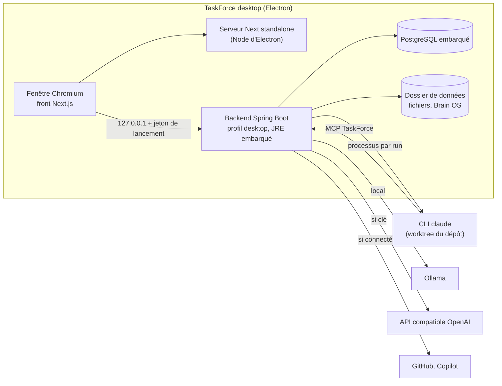

# Spécification de l'application desktop

**Version :** 0.1 (proposition, avant l'essai OSS-D.1)
**Date :** 18/10/2026
**Auteur(s) :** Pierre MICHEL

> Décision de cap : [[Journal_Decisions_ADR#ADR-021 - Application desktop locale, sur le modèle de Claude Desktop|ADR-021]].
> Ce document dit ce que l'app desktop fait, ce qu'elle ne fait pas ou mal, comment elle est construite, et ce que
> l'édition serveur (la webapp) pourrait combler. Les ordres de grandeur non mesurés sont signalés comme tels ; l'essai
> OSS-D.1 les remplace par des mesures.

## 0. En bref

- Une app desktop pour Windows, macOS et Linux, sur le modèle de Claude Desktop : pas de compte, pas de serveur, données
  sur le disque, IA locale (Ollama) ou par clé d'API.
- Même code que la webapp : un profil `desktop` remplace les briques serveur par des équivalents locaux.
- Architecture visée : coque Electron, front Next.js et backend Spring Boot existants lancés en local, base PostgreSQL
  embarquée. Claude Code est lancé directement par l'app.
- Ce qui disparaît : comptes, travail à plusieurs, e-mails, intégrations entrantes.
- La webapp peut rester, sans nouveaux développements, comme édition serveur pour les équipes (recommandé, §7).

## 1. Objectifs et principes

TaskForce desktop est un poste de pilotage personnel : on décrit le travail, on le découpe, on le confie à un agent
(Claude Code, Copilot) ou on le fait soi-même, et la mémoire du projet (Brain OS) reste sur sa machine.

Principes :

- **Comme Claude Desktop** : on installe, on ouvre, ça marche. Pas de compte, pas de serveur, pas de Docker.
- **Local d'abord** : données, fichiers et mémoire sur le disque de l'utilisateur ; l'app marche hors ligne, sauf pour
  ce qui appelle un service distant (modèle par clé d'API, GitHub, Copilot).
- **IA à la mesure de la machine** : modèle local par Ollama, ou clé d'API ; rien ne bloque sans IA.
- **Même code que la webapp** : un profil `desktop` remplace les briques serveur par des équivalents locaux.
- **Pas de fissure** : ce que le desktop ne sait pas faire est retiré de son interface, pas laissé en panne.

Hors objectifs de la 1re version : collaboration à plusieurs, synchronisation entre machines, application mobile,
modèles d'IA embarqués dans l'installateur.

## 2. Parcours de référence

1. Téléchargement depuis le site, installation, premier lancement (écran d'attente pendant le démarrage).
2. Premier lancement : nom et avatar ; détection d'Ollama et choix d'un modèle, ou saisie d'une clé d'API, ou
   « plus tard ».
3. Création d'un espace et d'un projet ; dossier de dépôt git facultatif.
4. Rédaction d'issues, page Brain OS, découpage par Cortex.
5. Délégation d'une issue à Claude Code : la chronologie suit le run en direct ; une demande d'autorisation apparaît,
   l'utilisateur accorde ou refuse ; la PR ou le commentaire de réponse s'affiche, l'issue passe en revue.
6. Mise à jour proposée par l'app au lancement suivant.

## 3. Périmètre fonctionnel

Légende : **Gardé** (identique), **Adapté** (change de forme), **Retiré** (absent du desktop), **Limité** (marche, avec
une contrainte).

| Domaine | Desktop | Ce qui change |
| ------- | ------- | ------------- |
| Compte, connexion, mot de passe, 2FA, connexion GitHub ou Google | Retiré | Pas de compte : l'app s'ouvre directement. Un seul utilisateur local, créé au premier lancement (nom, avatar). |
| Onboarding | Adapté | Nom, choix du fournisseur d'IA (Ollama détecté ou clé), dossier de dépôt optionnel. Plus d'invitations. |
| Workspaces et projets | Gardé | Plusieurs espaces et projets pour une même personne. |
| Issues (tableau, liste, backlog, cycles, roadmap, sous-tâches, relations, checklists, commentaires, temps passé) | Gardé | |
| Pièces jointes | Adapté | Fichiers dans un dossier de l'app au lieu de MinIO. |
| Brain OS (arbre de pages, éditeur, recherche, ingestion) | Gardé | Données locales ; recherche sémantique si un modèle d'embeddings est disponible, sinon lexicale. |
| Cortex (chat IA avec outils) | Limité | Qualité selon le modèle et la machine (§5.4). |
| Analyses IA, insights, suggestions de compétences | Limité | Idem ; désactivées proprement sans IA. |
| Smart Assign | Adapté | Voir §6 : plus de collègues à départager. |
| Analytics (débit, burndown, capacité) | Gardé | Capacité et charge réduites à une personne et ses agents. |
| Notifications dans l'app, « My work » | Gardé | Notifications du système (centre de notifications de l'OS) en plus. |
| Notifications par e-mail | Retiré | Pas de serveur de courrier. |
| Membres, équipes, invitations, rôles | Retiré | Mono-utilisateur. Revient avec l'édition serveur (§7). |
| Temps réel (mises à jour poussées) | Gardé | Courtier en mémoire de Spring, déjà utilisé en prod ; il n'y a pas de présence. |
| Délégation à Claude Code | Gardé, simplifié | Lancé directement par l'app (§5.5). |
| Délégation à Copilot | Limité | Réseau requis ; suivi par interrogation, pas par webhook. |
| Intégration GitHub (dépôts, PR, issues) | Limité | Connexion par device flow ; rafraîchissement par interrogation (le code n'a pas de webhook GitHub entrant aujourd'hui). |
| Intégration Slack | Limité ou retiré | La connexion OAuth de Slack demande une adresse de retour enregistrée ; voir §5.6. |
| Intégration Plane, connecteurs à clé d'API | Gardé | Appels sortants seulement. |
| Serveurs MCP (Cortex) | Adapté | Distants et, nouveau, locaux en stdio (§5.5). |
| Webhooks sortants | Limité | Envoyés seulement quand l'app est ouverte. |
| Export, import, RGPD | Adapté | Export complet (fichier), import depuis une instance serveur ; l'utilisateur est seul maître de ses données, les écrans RGPD de suppression de compte disparaissent. |
| Journal d'audit | Retiré | Pertinent à plusieurs ; l'historique des issues reste. |
| Palette de commandes, raccourcis, thèmes, accessibilité | Gardé | |
| Retours (« Give feedback »), statistiques d'usage | Adapté | Lien vers les issues GitHub ; aucune télémétrie par défaut. |

## 4. Ce qu'on ne peut pas faire, ou mal

- **Travailler à plusieurs** sur les mêmes données : impossible sans serveur d'équipe ou synchronisation (§7).
- **Recevoir des événements** de l'extérieur (webhooks, retours OAuth sur une adresse publique) : l'app n'a pas
  d'adresse publique et n'est pas toujours allumée. On interroge à la place, quand l'app est ouverte.
- **Envoyer des e-mails** : pas de serveur de courrier.
- **Ouvrir ses données depuis une autre machine ou un téléphone.**
- **IA lourde sur une petite machine** : sans GPU ni 16 Go de RAM, Cortex avec outils est lent et peu fiable ; la
  parade est une clé d'API.
- **Agents en arrière-plan quand l'app est fermée** : un run s'arrête avec l'app (reprise au relancement à prévoir).
- **Diffusion sans friction sans signature de code** : voir §5.8.

## 5. Technique

### 5.1 Architecture des processus

La coque Electron démarre les processus dans l'ordre (base, backend, serveur Next), attend que `/readyz` réponde,
puis ouvre la fenêtre. À la fermeture, elle arrête tout proprement. Chaque processus écoute sur 127.0.0.1, sur un port
libre tiré au lancement.

### 5.2 Briques serveur et leur remplaçant

Inventaire du code du 18/10/2026 (backend, front et IA, en lecture seule).

| Brique | Rôle aujourd'hui | Profil `desktop` | Effort |
| ------ | ---------------- | ---------------- | ------ |
| Keycloak | Connexion, inscription, jetons de l'API et du WebSocket, connexion GitHub ou Google, identité des runners. Le mot de passe, le prénom et le nom n'existent que chez lui (retirés de `users` en V2) : `/api/users/me` l'appelle à chaque lecture du profil | Plus de connexion : un utilisateur local unique et un filtre qui accepte le jeton de lancement (§5.7). L'identité (`KeycloakService`, `KeycloakAuthService`) passe derrière une interface, avec une implémentation locale qui lit `users` (nom stocké en base) | Le plus gros chantier backend |
| PostgreSQL + pgvector | Tout le stockage ; recherche de Brain OS | PostgreSQL embarqué (§5.3) | Moyen (empaquetage) |
| RabbitMQ | Rien par défaut : le relais STOMP est facultatif, la prod tourne déjà avec le courtier en mémoire de Spring | Rien | Nul |
| Redis | Limites de débit, cache des analytics, garde-débit IA (prod seulement) | Rien : chaque usage a déjà un repli local | Nul |
| MinIO | Pièces jointes des issues (liens présignés), avatars et fichiers Brain (servis par le backend) | Dossier local derrière `MinioService`, pièces jointes servies par une route du backend | Faible |
| SMTP | Codes d'inscription et de réinitialisation, bienvenue, invitations, notifications, demandes RGPD, retours | Coupé : les parcours qui l'utilisent disparaissent | Faible |
| Service Python (`ai-service`) | Simple relais : `POST /v1/chat` (compatible OpenAI, paliers, `/no_think` pour Qwen) et `POST /v1/embeddings` (Ollama, repli lexical) ; aucune dépendance de ML | Porté en Java : le backend appelle Ollama ou l'API directement | Faible |
| Tâches planifiées (4) | Purge des comptes (4 h), nettoyage (3 h 30), alertes d'échéance (8 h) et de surcharge (8 h 30) | Rattrapage au démarrage pour les échéances ; purge et surcharge sans objet pour une personne | Faible |
| Retours OAuth (GitHub, Slack, MCP, fournisseurs Keycloak) | Retour après consentement, sur une adresse publique | Device flow pour GitHub, retour sur 127.0.0.1 pour le MCP ; un secret d'application ne reste pas secret dans une app installée | Moyen |
| Runner et clients Keycloak | Délégation à Claude Code depuis un serveur distant | L'app lance l'agent elle-même (§5.5) | Moyen |
| `TF_ENCRYPTION_KEY` | Chiffrement des jetons et clés en base | Générée au premier lancement, gardée dans le trousseau | Faible |
| Serveur Next.js | Sert le front ; aucune donnée côté serveur (pas de route d'API, pas de middleware, tout passe par le navigateur) | Serveur `standalone` lancé par la coque (§5.1) | Moyen |

Côté front, l'export statique n'est pas possible sans refonte : 7 segments dynamiques sans `generateStaticParams`
(`[workspace]`, `[id]`, `[issueId]`…), 2 redirections côté serveur, `next/image` avec le chargeur par défaut. Le serveur
`standalone` actuel suffit. En revanche, l'URL de l'API est figée au build (`NEXT_PUBLIC_API_URL`, lue par 7 fichiers)
ainsi que les origines de la CSP : avec des ports tirés au lancement, elle doit devenir une configuration lue à
l'exécution (script injecté par le layout racine, ou relais same-origin par la coque). À trancher pendant l'essai.

### 5.3 Données et stockage

**Emplacement** : le dossier de données de l'app (`app.getPath('userData')` d'Electron : `%APPDATA%\TaskForce` sous
Windows, `~/Library/Application Support/TaskForce` sous macOS, `~/.local/share/TaskForce` sous Linux). Il contient la
base, les fichiers (pièces jointes, avatars, Brain OS), les journaux et les réglages.

**Base : PostgreSQL embarqué**, lancé par l'app comme un processus enfant. C'est le choix qui change le moins de code :
les 86 migrations, les 7 types enum natifs, le JSONB (y compris les requêtes `->>` des intégrations), les tableaux
`text[]`, la quinzaine de requêtes natives (CTE, `generate_series`, `FILTER`, `date_trunc`, `ON CONFLICT`) et les
verrous de ligne restent tels quels. SQLite ou H2 obligeraient à réécrire tout cela.

**pgvector, le point dur.** Une seule colonne vectorielle sert (`knowledge_nodes.embedding vector(1024)`, index HNSW,
recherche de Brain OS) ; les colonnes `vector(384)` de V32 et V33 ne sont lues ni écrites par aucun code. Mais
l'extension est créée par les migrations V32, V33, V52 et V59 : **sans pgvector dans la base embarquée, les migrations
échouent**. Deux sorties : livrer l'extension compilée pour les trois OS, ou une variante desktop de ces migrations avec
le repli lexical. C'est la première question de l'essai (§8).

**Sauvegarde et portabilité** : copie de la base avant chaque migration (donc avant chaque mise à jour) ; export
complet en un fichier (base et fichiers) ; import depuis une instance serveur, à partir de l'export de projet JSON
existant (`GET …/projects/{id}/export`). La base n'est pas chiffrée sur le disque : on recommande le chiffrement du
disque de l'OS ; les secrets, eux, sont dans le trousseau (§5.7).

### 5.4 IA sur la machine de l'utilisateur

**Fournisseurs.** Deux voies, choisies au premier lancement et modifiables dans les réglages :

- **Ollama** (local, gratuit, privé) : l'app le détecte sur `http://127.0.0.1:11434`, liste les modèles installés et
  propose d'en télécharger un si besoin. L'app n'embarque pas de modèle ni Ollama lui-même (plusieurs Go).
- **Clé d'API compatible OpenAI** (OpenAI, Groq, Mistral, OpenRouter, LM Studio, vLLM…) : URL de base, clé, modèle.
  La clé va dans le trousseau du système (§5.7).

Sans fournisseur, l'app reste pleinement utilisable en gestion de projet ; les fonctions IA affichent « IA non
configurée » au lieu d'échouer (OSS-4.4).

**Paliers de matériel.** Mesures réelles sur le poste de dev (RTX 5070, 8 Go de VRAM, 32 Go de RAM,
[[Benchmark_Modeles_IA]] §4bis) : un modèle 8B répond en environ 18 s, régulier, JSON propre ; un 14B déborde en RAM et
prend de 60 à 170 s, très variable. Ordres de grandeur pour la spec, à re-mesurer pendant l'essai :

| Machine | Modèle de chat conseillé | Ce qui marche bien | Ce qui marche mal |
| ------- | ------------------------ | ------------------ | ----------------- |
| Sans GPU, 8 Go de RAM | 3-4B quantifié, ou une clé d'API | Résumés courts, reformulation | Cortex avec outils (lent, appels d'outils peu fiables) |
| Sans GPU, 16 Go | 7-8B quantifié | Chat, résumés, découpage simple | Réponses en dizaines de secondes |
| GPU 8 Go ou Apple Silicon 16 Go | 8B | Cortex avec outils, analyses | Les 14B et plus (débordement mémoire) |
| GPU 12 Go et plus, ou Apple Silicon 32 Go | 14B | Raisonnement et découpage plus fins | |

**Choix des modèles par défaut.** Le palier « rapide » compte plus que la taille : mesure du 07/2026 (archives QA),
un scoring JSON prend environ 52 s avec `qwen3:8b` contre environ 2,4 s avec `qwen2.5:7b-instruct`. Le desktop part
donc d'un modèle rapide sans mode « réflexion » pour le palier rapide (lot 4).

**Embeddings.** Recherche sémantique de Brain OS et des issues : un petit modèle d'embeddings local (taille et choix à
fixer pendant l'essai ; `bge-m3` actuel pèse environ 1,2 Go). Sans modèle d'embeddings, la recherche bascule sur le
repli lexical existant. Défaut à corriger au lot 4 : `EmbeddingClient` stocke aussi les vecteurs du repli lexical
(il ignore le drapeau `real:false`) et ils ne sont jamais recalculés, puisque le rattrapage ne prend que les vecteurs
vides. Sur un poste où Ollama démarre après l'app, c'est le cas normal. Autre écart : le front abandonne un appel IA
à 200 s, le backend à 300 s.

**Règle de conception.** Tout ce qui n'a pas besoin d'un LLM n'en utilise pas : tri, filtres, analytics, liens,
historique. L'IA reste une aide, jamais un point de passage obligé.

### 5.5 Agents de code

**Claude Code, lancé directement.** Sur le desktop, l'app et le dépôt sont sur la même machine. Le modèle « pull »
(le runner réclame du travail au serveur) et le relais Keycloak n'existaient que parce que le serveur ne pouvait pas
joindre le poste (ADR-013) : ils disparaissent. Le runner actuel (`taskforce-runner`, Node, sans dépendance
d'exécution) se réutilise tel quel, lancé par la coque avec le Node d'Electron. L'app émet elle-même un jeton par run ;
la portée par run (`DeliverySessionScope` : lecture de l'espace, écriture sur les issues du seul projet du run, jamais
de suppression) reste, car elle borne ce qu'une injection de prompt dans le texte d'une issue peut faire.

L'app lance la CLI `claude` installée par l'utilisateur, avec son propre abonnement ou sa propre clé ; TaskForce ne
touche jamais aux identifiants Anthropic. Options de la CLI vérifiées sur la version 2.1.293 :

- `-p --output-format stream-json --verbose` : suivi en direct, affiché dans la chronologie de l'issue (OSS-5.3) ;
- `--mcp-config` et `--strict-mcp-config` : la session reçoit le serveur MCP de TaskForce (lecture du projet, de Brain
  OS, commentaires) et rien d'autre ;
- `--settings` et `--setting-sources user` : réglages de la session imposés par l'app, ceux du dépôt cloné ignorés
  (OSS-1.8). Aujourd'hui le runner lance l'agent en `--permission-mode dontAsk` avec une liste d'outils fixe. Avec
  le lot 5, la demande d'autorisation passera par un crochet `PermissionRequest` (ou `--permission-prompt-tool`) qui
  interroge l'API locale : l'utilisateur clique Autoriser ou Refuser dans l'app ; sans réponse, refus (OSS-5.4).

Le dépôt est un dossier choisi par l'utilisateur ; chaque run travaille dans un worktree git dédié, comme le runner
actuel. Le mode « sans dépôt » du runner (réponse en commentaire) est conservé.

**Copilot (agent cloud de GitHub).** Marche aussi depuis le desktop : il suffit d'un accès sortant à GitHub.
Connexion par le *device flow* d'OAuth GitHub (aucune adresse de retour à exposer), assignation de l'issue à l'agent,
suivi de la PR par interrogation périodique de l'API (pas de webhook entrant possible).

**MCP.** Deux sens, comme dans Claude Desktop :

- TaskForce **expose** son serveur MCP aux agents qu'il lance (stdio ou HTTP sur 127.0.0.1, passé par `--mcp-config`) ;
- Cortex **utilise** des serveurs MCP : distants en HTTP (existant), et locaux en stdio (à ajouter : lancer un
  processus déclaré dans les réglages, comme `claude_desktop_config.json`). Sur le desktop, la garde anti-SSRF du lot 1
  doit autoriser 127.0.0.1 (`MCP_ALLOW_PRIVATE_NETWORK`), puisque les serveurs locaux sont le cas normal.

### 5.6 Intégrations

| Intégration | Desktop | Comment |
| ----------- | ------- | ------- |
| GitHub (dépôts, issues, PR) | Gardé | Device flow d'OAuth : pas d'adresse de retour ni de secret d'application à cacher. Rafraîchissement par interrogation de l'API quand l'app est ouverte. |
| Copilot (agent de code) | Gardé | Même jeton GitHub ; le vrai agent cloud remplace le fournisseur actuel, qui n'est qu'un appel à GitHub Models (OSS-5.6). |
| Plane, connecteurs à clé d'API | Gardé | Appels sortants seulement. |
| Serveurs MCP distants | Gardé | Connexion OAuth avec retour sur 127.0.0.1. |
| Serveurs MCP locaux (stdio) | Nouveau | Voir §5.5. |
| Slack | Limité ou retiré | La connexion OAuth de Slack demande une adresse de retour enregistrée (HTTPS exigé, à vérifier). Alternative : jeton de bot saisi par l'utilisateur. Sinon, hors de la 1re version. |
| Webhooks sortants | Limité | Envoyés seulement quand l'app est ouverte ; la règle « jamais vers le réseau privé » reste. |
| Turnstile, PostHog | Retiré | Sans objet sur un poste local. |

### 5.7 Sécurité

- **API locale fermée** : le backend n'écoute que sur 127.0.0.1, sur un port libre tiré au lancement. La coque génère
  un jeton à chaque démarrage et le transmet à l'interface ; toute requête sans ce jeton est refusée. Le backend
  vérifie aussi l'en-tête `Host` (127.0.0.1 ou `localhost`) contre le rebinding DNS. Ce filtre remplace la validation
  des jetons Keycloak dans le profil `desktop`.
- **Secrets** : clés d'API, jetons GitHub et clé de chiffrement de la base (aujourd'hui `security.encryption-key`) sont
  gardés par le trousseau du système via `safeStorage` d'Electron (DPAPI sous Windows, Trousseau sous macOS, libsecret
  sous Linux). Rien en clair sur le disque.
- **Agents** : réglages du dépôt ignorés (`--setting-sources user`), autorisations demandées dans l'app, refus par
  défaut ; écritures MCP réservées comme sur le serveur (OSS-1.5).
- **Mises à jour** : paquets signés, vérifiés par l'outil de mise à jour avant installation.

### 5.8 Paquets, mises à jour, signature

- **Paquets** : installateur Windows (NSIS), image macOS (DMG, Apple Silicon et Intel), Linux (AppImage et `.deb`),
  produits par `electron-builder` dans la CI, publiés en GitHub Releases.
- **Mises à jour** : `electron-updater` depuis GitHub Releases. Les migrations Flyway s'appliquent au démarrage, comme
  aujourd'hui ; une sauvegarde de la base précède chaque migration.
- **Signature** : sans signature, Windows affiche l'avertissement SmartScreen (contournable) et macOS bloque l'app non
  notarisée (contournable à la main, rédhibitoire pour le grand public). La notarisation Apple exige un compte Apple
  Developer payant ; Windows demande un certificat de signature ou un service de signature. Choix et coût : décision du
  CEO (§10).

### 5.9 Budget de ressources (à mesurer pendant l'essai)

Ordres de grandeur avant mesure : Chromium et Electron environ 100 à 150 Mo de RAM pour l'interface, JVM et Spring
Boot 300 à 500 Mo, PostgreSQL embarqué 50 à 100 Mo, serveur Next 80 à 150 Mo. Soit environ 0,6 à 0,9 Go au repos,
hors modèle d'IA ; installation de 300 à 400 Mo. Démarrage : la JVM et Spring mettent quelques secondes (environ 18 s
pour le backend de dev en Docker le 18/10, à réduire : profil allégé, données de classes partagées, démarrage paresseux).
Écran d'attente pendant le démarrage.

### 5.10 Tests et CI

Les suites actuelles restent la base (le profil `desktop` ne change que les adaptateurs). À ajouter : tests des
adaptateurs locaux (stockage fichier, courtier en mémoire, filtre d'API locale), un test de démarrage de la coque par OS
dans la CI (paquet construit, app lancée, `/readyz` répond), et un test de migration d'une base de version précédente.

## 6. Smart Assign sur le desktop

Smart Assign recommande la bonne personne pour une issue : un pré-score heuristique (compétences 40 %, charge 25 %,
disponibilité 20 %, taux de résolution 15 %), puis un appel au modèle rapide qui note les cinq meilleurs, avec repli
sur l'heuristique seule en cas d'erreur ou de quota. Pas d'embeddings. Seul sur son poste, l'utilisateur n'a plus de
collègues à départager : la version actuelle perd son objet. Deux options :

| Option | Effort | Intérêt |
| ------ | ------ | ------- |
| La retirer du desktop, la garder dans l'édition serveur | Nul | Rien à maintenir côté desktop |
| La recentrer sur « qui fait ce ticket » entre moi, Claude Code et Copilot | Moyen | Sert l'usage desktop : router le travail vers le bon agent |

**Recommandation** : retirer la version « personnes » du desktop, et proposer plus tard une suggestion d'agent simple
(règles d'abord : dépôt lié, type d'issue, libellés ; modèle ensuite). L'algorithme actuel reste dans l'édition
serveur, si elle est gardée.

## 7. La webapp : que garder, que lui ajouter

Ce que le desktop ne sait pas faire, et que seule une édition serveur (la webapp actuelle, auto-hébergée) peut
combler :

| Trou du desktop | Ce que l'édition serveur apporte |
| --------------- | -------------------------------- |
| Travail à plusieurs (membres, invitations, droits, temps réel) | Tout cela existe déjà |
| Accès depuis une autre machine ou un téléphone | Navigateur |
| Connexions qui exigent une adresse publique (retour OAuth de Slack, futurs événements entrants) | Adresse publique |
| Notifications par e-mail | SMTP |
| Machine sans ressources pour l'IA | Un modèle partagé sur le serveur |

Options :

1. **Desktop seul.** On abandonne la webapp. Le plus simple ; TaskForce devient un outil personnel avec agents.
2. **Desktop + édition serveur en l'état** (recommandé). Même code, profil `server` : la webapp actuelle reste
   téléchargeable pour les équipes, sans nouveaux développements tant qu'aucun utilisateur ne la demande. Coût faible :
   les tests tournent déjà sur ce profil.
3. **Desktop connecté à un serveur d'équipe.** Le desktop sait aussi se brancher sur une instance serveur. Utile, mais à
   ne considérer qu'après l'option 2 et des retours d'usage.
4. **Synchronisation entre desktops.** Sans serveur central ; gros chantier (résolution de conflits), hors de portée.

## 8. Essai OSS-D.1 (deux à trois jours)

Questions à trancher, avec un critère chiffré pour chacune :

| Question | Critère de réussite |
| -------- | ------------------- |
| Le backend démarre-t-il hors Docker avec un JRE embarqué et une base embarquée ? | `/readyz` vert en moins de 15 s à froid sur le poste de dev |
| pgvector peut-il être livré avec la base embarquée sur les trois OS ? | Les 86 migrations passent ; sinon, variante desktop des migrations V32, V33, V52, V59 et repli lexical |
| La base embarquée garde-t-elle les requêtes natives ? | Suite d'intégration verte contre la base embarquée |
| Le serveur Next tourne-t-il dans Electron ? | Toutes les routes principales s'affichent |
| Poids et mémoire | Installateur sous 450 Mo, moins de 1 Go de RAM au repos |
| Claude Code lancé par l'app, autorisation dans l'app | Une issue déléguée de bout en bout, une autorisation accordée et une refusée |

Résultat attendu : un rapport court (mesures, problèmes, décision « on continue » ou non) ajouté à ce document.

## 9. Découpage en lots

L'ordre tient compte de ce qui sert les deux éditions :

| Lot | Contenu | Sert |
| --- | ------- | ---- |
| 3 | Coupes et anglais (en cours de plan) | Les deux |
| DA | Direction artistique du portfolio ([[Direction_Artistique_2026]]) | Les deux |
| 4 | IA générique compatible OpenAI, Ollama par défaut, état « IA non configurée » | Les deux, indispensable au desktop |
| D.1 | Essai (§8) | Desktop |
| D.2 | Profil `desktop` du backend : filtre d'API locale, utilisateur unique, stockage fichier, courtier en mémoire, caches locaux, pas de SMTP ; service Python remplacé par des appels Java directs | Desktop |
| D.3 | Base embarquée, emplacement des données, sauvegarde avant migration, export et import | Desktop |
| D.4 | Coque Electron : démarrage et arrêt des processus, écran d'attente, trousseau, notifications système | Desktop |
| D.5 | Claude Code lancé par l'app : worktrees, MCP passé par `--mcp-config`, autorisations dans l'app, chronologie en direct (reprend le lot 5) | Desktop |
| D.6 | Copilot et GitHub par device flow et interrogation | Les deux |
| D.7 | Interface : retrait des écrans multi-utilisateurs en profil `desktop`, onboarding local | Desktop |
| D.8 | Paquets, signature, mises à jour, page de téléchargement du site (reprend le lot 8) | Desktop |

Le lot 6 (intégrations) est réduit à ce qui marche sans adresse publique ; le lot 7 (Docker multi-OS) est gelé au
minimum (ADR-021).

## 10. Décisions attendues du CEO

1. **Rôle de la webapp** (§7) : desktop seul, ou desktop + édition serveur en l'état (recommandé).
2. **Smart Assign** (§6) : retiré du desktop (recommandé) ou recentré sur le choix d'agent.
3. **Signature de code** : compte Apple Developer et signature Windows, ou distribution non signée au début.
4. **Calendrier du jour J** : sortir la 1.0 web open source le jour des résultats puis le desktop en préversion, ou
   attendre le desktop.
