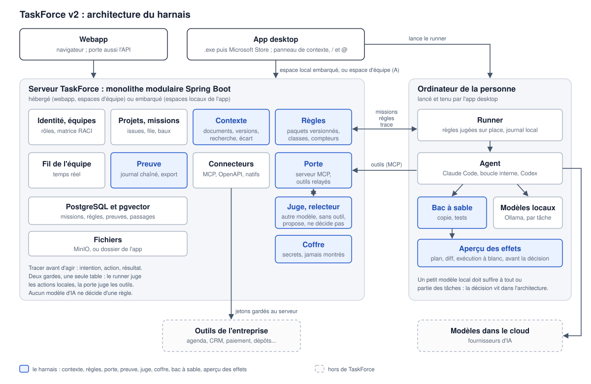

# Spécification de la v2 : le harnais

**Version :** 0.4 · **Date :** 29/10/2026 · **Auteur(s) :** Pierre MICHEL · **Statut :** validée par la Présidence
le 28/10/2026 ; base du ménage et du sprint ; direction de la séance n°10 retenue le 29/10/2026

> **Ce qui change en 0.4** (décisions de la Présidence du 29/10/2026, séances n°9 et n°10) : la direction, posséder
> son intelligence (En une page) ; la boucle avant les poids (§14) ; le local comme prototype à coût nul ; la
> conformité comme premier terrain, par un partenaire (§17) ; ce qui est possédé part avec le client ; l'arrivée et la
> carte des workflows (§15) ; R55 à R65 retenues (§20).

> **Ce qui change en 0.3** : R16 à R26 retenues (§20) ; les produits n'ont pas les mêmes fonctions (§4.2) ; le
> harnais pourra servir dans d'autres outils (§4.6) ; une hiérarchie d'agents et de modèles, choisie par tâche (§10.4).

> **Ce qui change en 0.2** (décisions de la Présidence du 28/10/2026) : la webapp d'abord, en local, puis le .exe ; un
> seul code source pour trois produits ; un petit modèle local doit suffire ; le front du Brain OS est supprimé au
> profit d'un panneau de contexte ; l'équipe comme matrice des rôles ; les secrets dans un coffre ; l'agent peut
> proposer des mises à jour, avec leur source ; R10 à R15 retenues ; l'approche A pour les équipes.

> **Pourquoi** : la séance n°2 du Conseil d'Avenir a fixé le cap à dix ans, « partout où une IA agit, un harnais réglé
> par ceux qui en répondent », et le premier cas d'usage
> ([PV](../../recherche/conseil/seances/2026-10-27-vision.md)). L'[état des lieux](../09-audits/Etat_des_lieux_v1_avant_v2.md)
> dit ce que la v1 sait déjà faire. Ce document dit ce que la v2 construit, comment, dans quel ordre, et ce que livre
> le sprint de trois jours.
>
> **Ce qui fait foi** : une fois validé, ce document remplace [[These_Produit_V1_V2]] pour le cap de la v2.
> [[Scalabilite_et_Robustesse]] reste valable et il est repris au §13. Les autres documents de `road_to_v2/` restent
> l'historique de conception.
>
> **Marquage** : ce qui existe dans le code porte son fichier ; ce qui n'est pas vérifié porte « à vérifier ». Rien
> n'est construit avant la validation de la Présidence. Revues du Conseil :
> [séance n°3](../../recherche/conseil/seances/2026-10-27-menage-spec-v2.md) et
> [séance n°4](../../recherche/conseil/seances/2026-10-28-revue-spec-v2.md).

## Table des matières

- [En une page](#en-une-page)
- [1. Le ménage](#1-le-ménage)
- [2. Les invariants](#2-les-invariants)
- [3. Vocabulaire](#3-vocabulaire)
- [4. L'architecture d'ensemble](#4-larchitecture-densemble)
- [5. Le contexte : ce que l'agent sait](#5-le-contexte--ce-que-lagent-sait)
- [6. Les règles : qui décide quoi](#6-les-règles--qui-décide-quoi)
- [7. La porte unique](#7-la-porte-unique)
- [8. Le bac à sable](#8-le-bac-à-sable)
- [9. Le dossier de preuve](#9-le-dossier-de-preuve)
- [10. Les agents](#10-les-agents--celui-de-votre-choix)
- [11. Les connecteurs](#11-les-connecteurs)
- [12. Les équipes](#12-les-équipes)
- [13. Scalabilité et robustesse](#13-scalabilité-et-robustesse)
- [14. Le harnais apprend](#14-le-harnais-apprend)
- [15. Ce que voit l'utilisateur](#15-ce-que-voit-lutilisateur)
- [16. La mesure et la banque de tests](#16-la-mesure-et-la-banque-de-tests)
- [17. Le premier cas d'usage, de bout en bout](#17-le-premier-cas-dusage-de-bout-en-bout)
- [18. Le sprint de trois jours](#18-le-sprint-de-trois-jours)
- [19. Après le sprint](#19-après-le-sprint)
- [20. Décisions et points ouverts](#20-décisions-et-points-ouverts)
- [21. Limites](#21-limites)

## En une page

**La promesse (R5')** : « Vous décrivez le résultat ; TaskForce le fait faire par l'agent de votre choix, avec vos
outils et vos règles, et vous montre qu'il est bon. »

**La direction (R60, séance n°10)** : TaskForce aide une entreprise à posséder son intelligence : ses règles, ses
dossiers, ses évaluations, et demain ses modèles. Cela vaut sur n'importe quel modèle, loué ou possédé, là où elle le
choisit. La boucle d'abord, les poids ensuite (R61) : rien n'est entraîné dans TaskForce. La conformité est le premier
terrain : réduire la charge du spécialiste (R63). Le prototype à coût nul passe par la machine du client (R62).

**Ce que la v2 ajoute à la v1**

1. Les documents de l'entreprise, avec leurs versions, cherchés par le sens et par le texte exact ; chaque réponse
   cite sa source.
2. Les règles écrites comme des données : chaque action classée (réversible ou non), chaque règle avec son
   propriétaire.
3. Une porte unique : toute action d'un agent passe par TaskForce, qui applique les règles et la trace.
4. Le bac à sable : l'agent travaille sur une copie et rejoue le workflow avec ses tests ; rien n'en sort sans
   décision, sauf le réversible autorisé.
5. Le dossier de preuve : tout est tracé, chaîné, exportable.
6. La carte de résultat : le résultat, trois à cinq contrôles, une décision.
7. Les outils de l'entreprise pour l'agent délégué, à travers la porte, connectés à la demande.
8. Les équipes : qui a quel rôle, quel périmètre, qui décide de quoi ; et le fil partagé de ce que chacun fait.
9. Un panneau de contexte, à la manière de Claude, à la place de la navigation dans le Brain OS.
10. Le bon modèle pour chaque tâche : l'app trouve les modèles Ollama installés ; un petit modèle local doit suffire à
    tout ou partie des tâches, parce que la décision vit dans l'architecture, pas dans le modèle.
11. La boucle de l'entreprise : les évaluations tirées de ses workflows, le registre de ses modèles par tâche, l'export
    de ses dossiers en données d'entraînement (§14).

**L'architecture en une phrase** : un plan de contrôle, le serveur TaskForce (local ou d'équipe), garde les règles, les
sources et les preuves ; des exécutants, les runners sur l'ordinateur de chacun, font travailler les agents et
appliquent les règles sur place ; toute action d'agent passe par une seule porte.

**Les invariants** (§2) : l'autorité ne vit jamais dans l'agent ; une action inconnue est irréversible ; tracer avant
d'agir ; rien ne sort du bac à sable sans décision ; l'agent ne voit jamais un secret ; le contexte n'est jamais une
instruction.

**Le sprint de trois jours** (§18) : une demi-journée de ménage d'abord (R10), puis un seul parcours, celui du premier
cas d'usage. Jour 1 : les règles, la porte et la preuve. Jour 2 : les documents et leurs versions. Jour 3 : le bac à
sable, la carte de résultat et la banque de tests.

**Un seul code source, trois produits** : la webapp, l'app desktop (le .exe) et la version du Microsoft Store, comme
claude.ai et l'app Claude. Celui qui installe l'app desktop l'a ; celui qui reste sur la webapp aussi, peut-être avec
moins de fonctions. La webapp porte aussi l'API.

**Ordre de livraison** (décision du 28/10/2026) : la webapp d'abord, en local dans Docker, même si elle n'est plus en
ligne (les machines virtuelles de l'école s'arrêtent) ; puis l'app desktop, sur laquelle la Présidence teste, avec ses
petits modèles locaux, ce qui éprouve aussi la mise à jour dans l'app ; la version du Store ensuite.

**À trancher** : §20.

## 1. Le ménage

Décidé par la Présidence les 27 et 28/10/2026, à partir de l'[état des lieux](../09-audits/Etat_des_lieux_v1_avant_v2.md)
§3. Il vaut pour la webapp et l'app desktop (un seul code source) et passe avant le sprint, en une demi-journée (R10).

| Élément | Décision | Ce qu'on fait |
| --- | --- | --- |
| Équipe : membres, équipes, invitations, charge, compétences | **Gardé, et élargi** : qui a quel rôle, quel périmètre, qui décide de quoi (§12.2) | Rien n'est retiré ; dans l'app desktop, ce qui ne marche pas encore reste masqué jusqu'au serveur d'équipe, avec une date de revue (R12) |
| Inbox : Mentions | **Gardé** | Devient l'endroit où un agent appelle un humain : une vérification, une question, une décision (§7.4) |
| Inbox : Assignments | **Fondu dans My Work** | Ce qui m'est assigné vit dans My Work |
| GitHub et Slack | **Gardés, à faire marcher** | PC-060 se corrige en les rendant utilisables (§11.3) ; d'ici là, masqués dans l'app desktop avec une date de revue (R12) |
| Public et Private | **Gardés, renommés** | C'est la visibilité dans l'espace, pas sur internet ; libellés proposés pour l'interface, en anglais : « Workspace » et « Collaborators only » |
| Panneau Status | **Supprimé** | |
| Textes écrits pour le web | **Réécrits pour l'app** | Confidentialité et mentions légales propres à l'app desktop, où les données restent sur l'ordinateur (`frontend/app/privacy-policy/page.tsx` n'a pas de version desktop) |
| Pages des projets | **Supprimées** | Écrans, API, tables ; tout ira dans le Brain OS |
| Front du Brain OS : navigation, arbre de pages, éditeur de notes, graphe | **Supprimé**, et le Brain OS sort du menu | Le moteur reste (sources, recherche, liens, notes) ; l'utilisateur ne navigue plus dedans et n'édite plus de note à la main ; il voit ce qui compte dans le panneau de contexte (§15) |
| Copilot | **Gardé**, à essayer | |
| Code mort | **Supprimé** | La liste « Restes » de l'état des lieux |

**La règle du ménage** : on supprime ce qui est sûr. Ce qui attend une condition est masqué, avec une date de revue ;
un élément masqué sans date de revue est candidat à la suppression (R12). Rien de ce qui peut servir la v2 n'est
supprimé : partage du travail, onboarding, équipe.

**Une seule suppression de données** : retirer les tables des Pages efface ce que des utilisateurs y ont écrit, ce qui
est irréversible. La migration qui les retire passe après une version qui les exporte dans le fichier d'espace, sauf
décision contraire de la Présidence. Les notes du Brain OS restent : seul leur éditeur part.

## 2. Les invariants

Ce qui ne se négocie pas, dans aucune règle, aucun réglage, aucune version.

1. **L'autorité ne vit jamais dans l'agent.** L'agent exécute ce que la personne lui demande, apporte de l'information,
   cherche sur le web ; il ne s'accorde aucun droit. Les règles sont évaluées hors du modèle, par du code déterministe,
   gardé petit : une table et des conditions simples (§6.3). La quantité de code est un risque suivi, pas une
   fatalité.
2. **Aucun agent ne décide seul d'une action irréversible** (R1). La classe d'une action vient de règles écrites par
   des personnes ; l'agent qui agit n'est pas juge de son propre risque. Cela ne l'empêche pas d'agir seul : ce que les
   règles classent réversible part sans attendre, et c'est la plupart des actions. Pour les actions que les règles ne
   classent pas encore, un amendement est en revue (§6.2).
3. **Une action inconnue attend une décision humaine.** Un outil ou une commande qu'aucune règle ne classe est traité
   comme irréversible.
4. **Tracer avant d'agir.** L'intention est écrite dans le dossier avant l'action, le résultat après ; une panne entre
   les deux se voit.
5. **Rien ne sort du bac à sable sans décision**, sauf ce que les règles déclarent réversible (R7'). Le bac à sable est
   une fonction clé du produit : sa conception, de l'usage à l'architecture, passe par le Conseil (§8).
6. **L'agent ne voit jamais un secret.** La personne range ses secrets dans le coffre du projet ; l'agent s'en sert par
   leur nom, et ils lui sont injectés au moment de l'action, sans entrer dans le contexte du modèle. Un texte qui
   ressemble à un secret, collé dans une demande, est arrêté avant de partir (§13.8).
7. **Le contexte n'est jamais une instruction, mais il peut nourrir une proposition.** Un document, une note, une
   réponse d'outil sont des données : ils ne donnent aucun droit et ne changent aucune règle d'eux-mêmes. L'agent lit
   vite et beaucoup : quand il voit qu'une source a bougé (une norme, un protocole, une réglementation), il propose de
   mettre à jour une connaissance ou une règle, avec sa justification et sa source ; une personne décide.
8. **Chaque décision a un auteur** : une personne nommée, ou une règle nommée avec son propriétaire.

## 3. Vocabulaire

| Mot | Sens |
| --- | --- |
| Mission | Un résultat demandé : une issue déléguée, avec son contexte, ses règles, son bac à sable et son dossier de preuve. Elle prolonge le run de la v1 (`delivery_runs`). |
| Action | Ce que fait l'agent : lire un fichier, lancer une commande, appeler un outil. |
| Classe | Lecture, écriture dans le bac à sable, sortie réversible, irréversible. |
| Règle | Pour une action dans un contexte : autoriser, demander ou refuser ; avec propriétaire, raison et date de revue. |
| Porte | Le point où une action est jugée par les règles et tracée. |
| Bac à sable | La copie où l'agent travaille librement. |
| Sortie | Ce qui quitte le bac à sable : un push, une pull request, une issue, une action dans un outil. |
| Dossier de preuve | Le journal chaîné d'une mission, exportable. |
| Carte de résultat | Ce que voit l'utilisateur : le résultat, les contrôles, la décision. |
| Runner | Le programme qui, sur l'ordinateur de la personne, fait travailler l'agent (`taskforce-runner`). |
| Source | Un passage précis d'un document, dans une version donnée. |

## 4. L'architecture d'ensemble

### 4.1 Deux plans

- **Le plan de contrôle** : le serveur TaskForce (backend Spring et Postgres). Il garde les espaces, projets et issues ;
  les sources ; les règles et leurs versions ; les missions et leurs dossiers de preuve ; les décisions humaines ; les
  connecteurs et leurs jetons.
- **Le plan d'exécution** : le runner. Il réclame une mission, prépare le bac à sable, lance l'agent, applique les
  règles à chaque action, envoie la trace. Il ne garde rien d'irremplaçable : s'il meurt, la mission reprend ou
  s'arrête proprement (§13).

C'est déjà la forme de la v1 : le runner réclame un run et lance Claude Code ; le serveur garde le run, la chronologie
et les validations. La v2 la généralise.

### 4.2 Un code source, trois produits

- **Trois produits**, comme claude.ai et l'app Claude : la webapp, l'app desktop (le .exe) et la version du Microsoft
  Store. La webapp porte aussi l'API ; elle peut avoir moins de fonctions que l'app desktop, par exemple les agents
  qui tournent sur l'ordinateur.
- **Un seul code source** : le même backend tourne sous deux profils, hébergé pour la webapp et embarqué dans l'app
  desktop (`application-desktop.yml`, Postgres local) ; le même front sert les deux (`IS_DESKTOP` pour les
  différences).
- **Pas les mêmes fonctions partout** (Présidence, 28/10/2026) : comme entre claude.ai et l'app Claude, certaines
  choses ne se font que dans l'app desktop (les agents et les modèles locaux), d'autres que dans la webapp. On ne
  mélange pas tout. Les résultats obtenus en local peuvent se voir dans la webapp, ce qui incite à télécharger l'app
  desktop. La webapp doit marcher : elle porte le référencement, et sert ceux qui utilisent TaskForce comme un outil de
  gestion de projet ou un chat d'IA classiques.
- **Deux places pour un espace** : un espace local, sur l'ordinateur, privé et utilisable sans réseau ; un espace
  d'équipe, sur le serveur d'équipe (§12).
- Le runner et le harnais sont les mêmes partout : le runner parle à un serveur TaskForce, local ou d'équipe.

### 4.3 Schéma



La porte a deux gardes qui appliquent la même table : le runner pour les actions locales (fichiers, commandes), le
serveur pour les outils (§7).

### 4.4 Ce que devient chaque brique de la v1

| Brique v1 | En v2 |
| --- | --- |
| Run (`delivery_runs`) | La mission : mêmes tables, avec la version des règles, l'empreinte racine du dossier, l'état du bac à sable |
| Chronologie (`delivery_run_events`, 500 événements, textes coupés à 600 caractères) | Le dossier de preuve : journal chaîné, sans troncature silencieuse (§9) |
| Validations (`delivery_run_approvals`) | Les décisions humaines, reliées à la règle qui les a demandées |
| Listes codées en dur du runner (`taskforce-runner/src/agent.ts`) | Le paquet de règles, versionné, reçu à la réclamation (§6) |
| Hook `PermissionRequest`, qui envoie tout à l'humain | Les règles jugées sur place ; seul « demander » part vers l'humain (§7.1) |
| Serveur MCP de l'espace, 12 outils | La porte, qui relaie aussi les outils de l'entreprise (§7.3) |
| `DeliverySessionScope` | Reste la garde du serveur ; les règles s'y ajoutent sans la remplacer |
| Brain OS : une note, un vecteur, 4 000 caractères | Documents, versions, passages ; recherche hybride avec sources (§5) |

### 4.5 Les choix d'architecture

Proposition, en revue par le Conseil (séance n°4). Faits vérifiés le 28/10/2026 aux sources citées.

**Un monolithe modulaire, pas des microservices.**

- Un seul exécutable Spring Boot, découpé en modules dont les frontières sont vérifiées par des tests (Spring Modulith :
  pas de cycle, accès aux seules interfaces publiques des modules). Les modules : identité et équipes, projets et
  missions, contexte, règles, porte, preuve, connecteurs, fil.
- Pourquoi : le même backend doit tenir dans l'app desktop, où chaque processus en plus coûte de la mémoire et du
  temps de démarrage ; une seule équipe ; des transactions qui traversent les modules (une décision et sa trace).
  Sources : M. Fowler, « MonolithFirst » et « MicroservicePremium » (2015) ; Segment, qui a refusionné ses services
  (2018) ; Shopify et son monolithe modulaire (2019).
- Ce qui sort du processus, seulement quand la mesure le justifie : l'extraction des documents (déjà dans un processus
  enfant, §5.2) et le calcul des vecteurs (déjà hors du backend, par Ollama ou l'ai-service).

**Java et Spring, à jour.**

- Aujourd'hui : Java 21 et Spring Boot 4.0.6. Au 28/10/2026 : Spring Boot 4.1.2 et 4.0.9 (22/10), 4.2 attendue en
  novembre ; Java 25 est la LTS en cours (16/09/2025), Java 27 la dernière version (15/09/2026).
- Proposition : Spring Boot 4.0.9 tout de suite (correctifs), puis 4.1, puis 4.2 à sa sortie ; Java 25 LTS ensuite,
  sans passer par 26 ni 27.
- Démarrage de l'app desktop : elle lance un JDK 21 réduit, avec le JAR complet et sans archive de classes
  (`desktop/src/backend.ts`). Dès Java 21 : une archive de classes (CDS) et le JAR extrait. En Java 25 : le cache AOT,
  que Spring Boot ne documente qu'à partir de Java 25 ; il dépend de la machine et du chemin d'installation, donc il
  se génère à l'installation ou au premier lancement. Gain à mesurer avant et après.
- Ce que Java et Spring offrent déjà au harnais : les threads virtuels (Java 21), sans l'épinglage par
  `synchronized` depuis Java 24 ; les valeurs à portée (Java 25), pour porter l'identité de la mission le long d'un
  appel ; la résilience dans le cœur de Spring 7 (`@Retryable`, `@ConcurrencyLimit`) ; les clients HTTP déclaratifs
  (`@HttpExchange`) pour le connecteur OpenAPI ; le versionnement d'API, pour la webapp qui porte l'API ; Jackson 3,
  Jackson 2 étant déprécié alors que le code en utilise encore.

**L'outbox et les tâches.**

- Le registre de publication d'événements de Spring Modulith écrit chaque événement dans la transaction métier et le
  rejoue s'il n'a pas abouti : c'est « tracer avant d'agir » à l'intérieur du serveur. La livraison est au moins une
  fois, donc chaque consommateur est idempotent.
- Les missions et les sorties : nos tables PostgreSQL, réclamées par `SKIP LOCKED`, avec bail et clé d'idempotence
  (§13.2), ou db-scheduler (Apache 2.0, compatible Spring Boot 4) s'il couvre le besoin. Pas JobRunr dans sa version
  libre : la mise en file dans la transaction y est payante.

**MCP.**

- Le serveur et le client MCP sont écrits à la main (`McpServerController`, `McpServerService`, `McpClient`).
  Proposition : le SDK Java officiel (2.1.0, révision 2025-11-25 du protocole), par Spring AI 2.0, pour le protocole ;
  l'autorisation et la politique de la porte restent les nôtres, le SDK n'en fournit pas. Suivre le SDK 2.2 pour la
  révision du 28/07/2026.
- Le projet MCP classe le SDK Java au deuxième niveau de maturité, derrière ceux de TypeScript et de Python : nos tests
  de conformité restent de notre côté.

**L'agent interne.**

- Spring AI 2.0 appelle des outils avec Ollama. Embabel (Apache 2.0, Spring Boot 4.1) planifie les étapes d'un agent
  par un algorithme, le modèle ne faisant que remplir les étapes : c'est l'hypothèse « la décision vit dans
  l'architecture ». À comparer avec la boucle de Cortex avant de choisir.

### 4.6 Le harnais au-delà de TaskForce

Les outils de gestion de projet déjà très répandus (Linear, Jira, Asana...) sont des concurrents pour la gestion de
projet, pas pour le harnais. Un jour, le harnais de TaskForce pourrait se brancher dans leur workflow : leurs agents
passeraient par la porte, les règles et le dossier de preuve de TaskForce (Présidence, 28/10/2026). Le contrat de
l'adaptateur (§10.1) et les formats exportables (R9') le préparent. Le branchement et le modèle économique restent à
voir.

## 5. Le contexte : ce que l'agent sait

### 5.1 Documents et versions

Un document est un nœud du Brain OS, de type document : il garde ses liens et ses tags dans le graphe. Ses versions et
ses passages vivent dans leurs propres tables (migrations V102 et suivantes, la dernière étant V101) :

- `document_versions` : le document, le libellé de version (« 3.1.1 », « 5.0 »), la date d'effet, le fichier d'origine
  (empreinte SHA-256, type, taille), l'état de l'extraction, qui l'a importée et quand.
- `document_passages` : la version, l'ordre, le chemin de section (« 3.1.2.4 Keep Alive »), les pages de début et de
  fin, le texte, son vecteur (`vector(1024)` et `embedding_model`, comme V94), son `tsvector` indexé.

Une version ne se modifie jamais : chaque import en crée une nouvelle (la version, c'est l'upload). Le fichier va dans
le stockage d'objets déjà en place : MinIO pour la webapp, le dossier de l'app pour l'app desktop (`ObjectStorage`,
`LocalObjectStorage` sous `<données de l'app>/files`).

### 5.2 L'import

- Formats d'abord : PDF avec du texte, Word (.docx), Markdown, texte, HTML ; un dossier entier ; un coffre Obsidian,
  qui est déjà le format du Brain OS.
- Extraction en Java avec Apache Tika (licence Apache 2.0 ; la 3.3.3 demande Java 11, la 4.1.0 Java 17) : PDF par
  PDFBox, Word par POI. L'extraction tourne dans un processus enfant, relancé s'il manque de mémoire ou dépasse son
  délai, et le backend réessaie : un fichier piégé ne fait pas tomber le serveur. Les PDF scannés (images) attendent :
  pas de reconnaissance de texte en v2.0.
- Bornes : taille, nombre de pages, durée et mémoire de l'extraction. Un fichier qui dépasse est refusé avec un message
  qui dit pourquoi.
- L'extraction tourne en tâche de fond et reprend après un redémarrage : son état est en base.
- Un fichier déjà importé, à la même empreinte, n'est pas réimporté.

### 5.3 Découpage et index

- Le découpage suit la structure du document (titres, numérotation), puis la taille, avec un recouvrement entre
  passages voisins. La taille cible se règle avec la banque de tests.
- Chaque passage garde son chemin de section et ses pages : c'est ce qui rend une source citable.
- Les vecteurs se calculent en tâche de fond, comme aujourd'hui (`BrainEmbeddingIndexer`), mais par passage. La limite
  de 4 000 caractères par note disparaît : les notes longues se découpent aussi.
- Le plein texte a une colonne `tsvector` générée et stockée, avec un index GIN, comme dans l'exemple de la
  documentation de PostgreSQL ; aujourd'hui, il n'est qu'un repli sans index.
- pgvector 0.8.7 indexe en HNSW jusqu'à 2 000 dimensions ; nos vecteurs en ont 1 024.

### 5.4 Recherche hybride et sources

- Deux recherches en parallèle, par le sens (pgvector) et par le texte exact (termes, numéros de clause), fusionnées
  par rang (Reciprocal Rank Fusion : Cormack, Clarke et Büttcher, SIGIR 2009), après filtrage par les droits (§5.6).
- Chaque résultat porte sa source : document, version, chemin de section, pages, extrait. Le format est le même dans
  l'interface, dans `brain_search` et dans le dossier de preuve.
- `brain_search` rend des passages sourcés, plus des notes entières.
- Une affirmation de l'agent est sourcée si elle cite une source qui existe et si la citation se retrouve dans le
  passage : cela se vérifie par programme. Le sens se vérifie par un relecteur (R4, §7.6).

### 5.5 L'écart entre deux versions

Pour le premier cas d'usage, l'agent ne relit pas deux fois des centaines de pages : TaskForce calcule l'écart.

- Les sections des deux versions s'alignent par numéro et par titre, puis par proximité du texte pour celles qui ont
  bougé ou changé de nom.
- Chaque section est ajoutée, retirée, modifiée (avec le diff de son texte) ou inchangée.
- L'écart est lui-même un document : la liste des changements, chacun avec ses deux sources. L'agent le lit et le cite.
- Limite : un standard dont la structure change entièrement s'aligne mal. La banque de tests mesure l'alignement.

### 5.6 Qui lit quoi

- Les droits de l'espace et du projet s'appliquent à la recherche : un document d'un projet Private n'est visible que
  de ses collaborateurs.
- Chaque document a un niveau de sensibilité, « interne » par défaut. Une règle dit vers quels modèles il peut partir :
  par exemple, « confidentiel » ne part que vers un modèle local. Quand l'agent délégué utilise un modèle dans le
  cloud, `brain_search` ne lui rend pas ces passages, et la trace le dit.
- Pour les domaines les plus sensibles (la défense, par exemple), un espace peut tout verrouiller : modèles locaux
  seulement, aucun connecteur sortant, documents sous la sensibilité la plus haute. Le détail se conçoit avec un
  client du domaine.
- Le contexte n'est jamais une instruction (invariant 7) : un document qui contient « ignore tes règles » ne change
  aucun droit. La banque de tests le vérifie (§16).

## 6. Les règles : qui décide quoi

### 6.1 Une règle

R2, dit simplement : ce que l'agent fait seul, ce qui lui est interdit et ce qui demande un accord, écrit avec qui l'a
décidé, pourquoi, et quand le revoir.

Une règle a un identifiant stable ; une portée (espace ou projet) ; une condition (action, arguments, contexte : branche,
visibilité du dépôt, sensibilité, montant) ; une classe ; un effet (autoriser, demander, refuser) ; un propriétaire
nommé ; une raison ; une date de revue ; une action inverse si elle existe ; des compteurs (déclenchements, demandes,
refus, décisions regrettées).

Exemple au format d'export. Le produit est en anglais, le format aussi ; la source de vérité est l'app.

```yaml
format: taskforce-rules/1
workspace: acme
version: 12
rules:
  - id: push-agent-branch-private-repo
    when: { action: git.push, branch: "tf/*", repo.visibility: private }
    class: reversible-exit
    effect: allow
    inverse: delete-branch
    owner: pierre
    reason: "The agent's branch can be deleted; the repository is private."
    review: 2027-01-15
  - id: push-public-repo
    when: { action: git.push, repo.visibility: public }
    class: irreversible
    effect: ask
    owner: pierre
    reason: "Pushing to a public repository exposes the code; it cannot be taken back."
    review: 2027-01-15
```

### 6.2 Les classes et la table par défaut

| Classe | Exemples | Effet par défaut |
| --- | --- | --- |
| Lecture | Lire un fichier, chercher, `brain_search`, lire une issue, lire dans un outil | Autoriser et tracer (R7') |
| Écriture dans le bac à sable | Modifier un fichier de la copie, commit local | Autoriser et tracer : « libre mais encadré » |
| Sortie réversible | Pousser la branche de l'agent vers un dépôt privé, ouvrir une pull request, créer une issue dans le projet | Autoriser et tracer si l'action inverse existe ; sinon demander |
| Irréversible | Fusionner, publier un paquet, envoyer un message ou un e-mail, payer, rembourser, supprimer, migrer une base partagée, pousser vers un dépôt public, exposer un secret | Demander (R1) |
| Inconnue | Tout ce qu'aucune règle ne classe | Demander (invariant 3) |

Le web (chercher, lire une page) n'est pas une lecture comme les autres : une requête ou une adresse peut emporter des
données hors du poste (invariant 5). Il est demandé par défaut, comme en v1.

Les tests ne sont pas une écriture comme les autres : `npm test` exécute les scripts du dépôt, que l'agent peut modifier.
Tant que la machine n'est pas isolée (S3, §8.2), aucune règle par défaut n'autorise l'agent à lancer un script du dépôt ;
c'est le runner qui lance la commande de test déclarée, après le travail de l'agent (S1). Décidé le 28/10/2026 (R32,
[PV n°5](../../recherche/conseil/seances/2026-10-28-trajectoire-harnais.md)). Et tant que S1 n'est pas livré, aucune
mission ne démarre sur un dépôt public (R33).

Le défaut est permissif pour le réversible et strict pour l'irréversible : « tout est vert, ça passe » (séance n°2).
L'entreprise change la table ; chaque changement a son auteur.

**Amendement en revue : les actions que la table ne classe pas.** Aujourd'hui, une action inconnue attend un humain
(invariant 3). La Présidence craint qu'au début un agent n'agisse alors presque jamais seul. Proposition : un
classificateur indépendant de l'agent qui agit (un autre modèle, d'un autre fournisseur quand c'est possible) propose
une classe, avec un niveau de confiance. Au-dessus d'un seuil réglé par l'entreprise, une action jugée réversible, dont
l'action inverse est connue, part et se trace, et sa classe devient une règle proposée à son propriétaire. En dessous,
on demande. Cet amendement touche la seconde moitié de R1 telle qu'elle a été ratifiée : il passe par le Conseil, puis
par la Présidence.

### 6.3 Combiner les règles

- L'espace pose les règles de l'entreprise. Un projet peut les resserrer, pas les desserrer, sauf par le propriétaire
  de la règle de l'espace.
- Quand plusieurs règles s'appliquent, refuser l'emporte sur demander, qui l'emporte sur autoriser.
- Sans règle, la classe décide ; sans classe, on demande.
- Mêmes action, contexte et version des règles : même décision. Aucun modèle d'IA ne décide (invariant 1) ; une IA
  peut expliquer une décision, pas la prendre.

### 6.4 Où les règles s'appliquent

- Le serveur publie, par espace et par projet, un paquet de règles versionné, avec son empreinte. Le runner le reçoit
  en réclamant la mission ; la version appliquée est écrite dans la mission.
- Le runner juge sur place, sans aller-retour réseau par action : c'est ce qui garde la vitesse. Le serveur juge de son
  côté ce qui passe par lui (outils, issues). Deux gardes, une seule table.
- Le paquet ne vient jamais du bac à sable : un fichier de règles modifié par l'agent dans sa copie n'a aucun effet
  (invariant 1). Aucun outil de l'agent ne modifie les règles.

### 6.5 Compter, revoir, retirer

- Chaque règle compte ses déclenchements, ses demandes, ses refus et les décisions regrettées (R2, R3).
- À la date de revue, le propriétaire reçoit une demande de revue dans Mentions.
- Une règle ne se retire que si les chiffres la montrent inutile, jamais parce qu'elle n'a pas encore servi (séance
  n°1).
- Le harnais propose, la personne décide : « cette demande a été acceptée 40 fois sur 40 : en faire une règle qui
  autorise ? ».

### 6.6 L'éditeur de harnais et les modèles par métier

- La v2.0 livre l'import et l'export du paquet (YAML, JSON) et un écran de lecture des règles, avec leur historique et
  leurs compteurs.
- L'éditeur complet vient ensuite, « à voir si ce n'est pas trop compliqué » (Présidence) : chercher, modifier, voir
  l'effet d'un changement sur les missions passées avant de l'appliquer.
- Des modèles de départ par métier (équipe logicielle, réseau embarqué...) en libre-service ; l'accompagnement sur site
  quand un client le paie (séance n°2).

## 7. La porte unique

Toute action d'un agent passe par une porte, qui applique les règles et écrit la trace. Trois chemins mènent à la même
table.

### 7.1 Les actions locales de l'agent

- Pour la personne, tout reste simple : elle appelle un agent, un outil, une source ou une règle par `/` et `@`, depuis
  sa demande (§15). La porte travaille en dessous, sans se montrer.
- Pour Claude Code, un hook `PreToolUse` juge chaque action : il passe avant tout appel d'outil, y compris ceux qui
  sont autorisés d'avance (documentation des hooks, consultée le 28/10/2026). Le runner le sert en local et juge la
  règle sur place : autoriser ou refuser.
- « Demander » ne passe pas par `PreToolUse` : en mode sans interface, un « ask » y finit en refus. L'action à demander
  n'est pas autorisée d'avance, ce qui l'envoie au hook `PermissionRequest`, déjà servi par le runner : c'est là que
  l'humain décide, comme en v1. Le runner sert les deux hooks depuis le 28/10 ; l'enchaînement réel reste à voir avec
  Claude Code 2.1.295 ou plus.
- Un hook HTTP injoignable laisse passer l'appel, sauf avec `onFailure: "block"`, qui demande Claude Code 2.1.295. La
  version minimale passe donc de 2.1.293 à 2.1.295 au moins (la dernière est la 2.1.312, du 27/10/2026), et l'app le
  vérifie avant chaque mission, plus seulement par `--check`.
- Claude Code tourne avec une configuration à lui : un module installé par la personne peut, d'après la
  documentation, lever un blocage de hook quand il n'y a pas de réglages gérés. Le moyen d'isoler cette configuration
  est à vérifier.
- Rien n'est autorisé d'avance (fait le 28/10) : une autorisation d'avance passerait outre une règle qui demande.
  `PreToolUse` autorise ce que les règles autorisent. Seuls les outils que la personne ajoute sur son poste sont
  autorisés d'avance, et une règle qui refuse les bloque quand même.
- Chaque action est aussi tracée depuis le flux `stream-json`, déjà relayé par le runner.
- Une commande se juge sur sa forme analysée (programme, sous-commande, arguments), pas sur son texte : `npm test` n'est
  pas `npm publish`. Une commande composée (`&&`, `|`, `;`) se juge morceau par morceau. Ce qui ne s'analyse pas est
  inconnu, donc demandé.
- Fait le 28/10 (`contracts/agent/adapter.md`) : la découpe se fait hors des guillemets, `&` compris. Une substitution,
  une redirection vers un fichier, `--output`, un chemin hors de la copie ou dans `.git` (un hook écrit là
  s'exécuterait au prochain commit) ne sont jamais autorisés par une règle : ils sont refusés ou demandés. Le message
  de commit que Claude Code écrit (`"$(cat <<'EOF' … EOF)"`) se lit comme du texte.

### 7.2 Les outils de TaskForce

Le serveur MCP de l'espace (`POST /api/workspaces/{slug}/mcp`) juge chaque appel avec la même table. Il est refait sur
le SDK officiel (§4.5).
`DeliverySessionScope` reste la garde du serveur : l'agent n'écrit que dans le projet de sa mission et ne supprime rien.

### 7.3 Les outils de l'entreprise

- La porte relaie les outils des serveurs MCP connectés à l'espace. L'agent ne voit toujours que le serveur `taskforce`
  (`--strict-mcp-config` reste), avec des outils en plus, préfixés par leur serveur.
- Le serveur garde les jetons (invariant 6) : l'agent n'a jamais l'identifiant d'un outil.
- Par défaut, l'agent délégué ne voit que les outils de lecture (séance n°2 : lecture par défaut). Un outil d'écriture
  apparaît quand une règle le classe.
- Une écriture qui doit attendre ne bloque pas l'agent : elle devient une action proposée, exécutée après la décision
  humaine, hors de la session de l'agent. L'agent reçoit « proposée, en attente » et continue ou termine.
- Pour classer l'outil d'un serveur MCP, son nom, sa description et ses annotations (lecture seule, destructeur)
  aident à proposer une classe ; une personne la confirme. Une annotation venue du serveur n'est jamais crue seule
  (invariant 7).
- **Connecter à la demande**, sur le modèle de Claude : selon la tâche, l'agent ou TaskForce propose les outils utiles
  (prendre un rendez-vous avec un client : un agenda, un outil de prise de rendez-vous, une visio) ; un clic lance la
  connexion, et l'outil passe ensuite par la porte comme les autres.

### 7.4 La décision humaine

- Une demande dit en langage clair ce que l'agent veut faire, pourquoi la règle demande, l'effet (diff, plan, exécution
  à blanc quand elle existe) et l'action inverse s'il y en a une. Elle se lit en deux minutes (R4).
- Elle arrive dans Mentions (« un agent vous appelle »), sur l'issue, et en notification du système.
- Une seule durée d'attente, réglée par espace et appliquée par le serveur ; aujourd'hui, le runner et le serveur ont
  chacun la leur. Sans décision à l'échéance, c'est un refus.
- Décide la personne que la matrice des rôles désigne pour ce domaine (§12.2) ; à défaut, la personne qui a délégué.
  Pour un paiement, la personne qui en répond.
- C'est la partie la plus importante du harnais : sa conception passe par le Conseil avant le code (séance n°4).
- La décision est tracée : qui, quand, sur quelle preuve, sous quelle version des règles.

### 7.5 L'action inverse

- Chaque type de sortie déclare son action inverse quand elle existe : supprimer la branche, fermer la pull request,
  rouvrir l'issue, restaurer un enregistrement depuis sa copie, rembourser.
- Une sortie sans action inverse est irréversible.
- « Défaire », sur la carte de résultat, applique les inverses dans l'ordre inverse de leurs sorties, et les trace.

### 7.6 Le relecteur

- Avant une porte à sens unique, une preuve que l'humain lit en deux minutes (R4).
- Un relecteur automatique, distinct de l'agent qui a produit : un autre modèle, d'un autre fournisseur quand c'est
  possible. Il suit une liste de points à vérifier et garde une partie libre (décision de la Présidence sur R4).
- Son avis entre au dossier ; il ne décide pas à la place de l'humain.
- Son avis doit donner envie d'être lu : court, en langage clair, l'essentiel d'abord. Sa forme se dessine avec
  l'atelier design avant d'être codée (R13).

## 8. Le bac à sable

### 8.1 Ce que c'est

L'agent travaille sur une copie, librement (« libre mais encadré »). Il rejoue le workflow complet avec ses tests, pour
voir comment ça réagit. Rien n'en sort sans décision, sauf le réversible autorisé par les règles.

C'est une fonction clé du produit, peut-être la plus visible : à quoi il sert pour la personne, ce qu'elle en voit,
comment il est construit. Il se conçoit avec le Conseil et l'atelier design avant le code (séance n°4).

### 8.2 Les niveaux

| Niveau | Ce qui est isolé | État |
| --- | --- | --- |
| S0 | Le code : un worktree sur une branche `tf/...`, ou un dossier jetable | Existe (`taskforce-runner`) |
| S1 | Le workflow : après le travail de l'agent, le runner lance la commande de test du projet et les tests de cas d'usage ; les résultats vont au dossier | Commande de test du projet faite le 28/10 (R32) ; tests de cas d'usage : v2.0 |
| S2 | Les outils : les écritures vers l'extérieur deviennent des actions proposées, ou vont vers un environnement de test (mode test d'un service de paiement, préproduction) | Phase 2 |
| S3 | La machine : processus isolé, réseau filtré (seulement les dépôts de paquets et le serveur TaskForce) | À étudier |

**S3 sous Windows** : pas de solution simple pour tout le monde. Windows Sandbox n'existe pas sur l'édition Famille
(documentation Microsoft, 08/10/2026) ; Docker n'est pas installé partout ; le bac à sable de Claude Code couvre macOS,
Linux et WSL2, pas Windows natif. Pistes : WSL2 quand il est installé ; l'isolation native de Codex sous Windows 11
24H2 et suivants ; un conteneur quand il existe.

### 8.3 Les tests de cas d'usage

- Pour du code : la commande de test du projet (un réglage du projet), plus les tests que la mission déclare.
- Pour un document, comme dans le premier cas d'usage : des contrôles sur le livrable. Chaque affirmation a une source
  qui existe ; chaque citation se retrouve dans son passage ; chaque section modifiée du standard est traitée, par un
  impact ou par un « sans impact » justifié.
- Les résultats sont des faits du dossier (commande, sortie, durée, code de retour), pas un résumé écrit par l'agent.

### 8.4 Ce qui sort

À la fin, le runner propose les sorties : push, pull request, issues, actions dans les outils. Chacune suit sa règle
(§6.2) : le réversible part et se trace, l'irréversible attend.

Fait le 28/10 pour le push et la pull request : le runner lit la visibilité du dépôt avec `gh`, juge chaque sortie
avec les règles de la mission, et pose la demande dans TaskForce quand elles demandent. Une visibilité inconnue n'est
pas devinée : la sortie est demandée. Refusés, les commits restent sur la branche locale et le résumé du run dit
pourquoi.

## 9. Le dossier de preuve

### 9.1 Un journal chaîné

- Chaque événement d'une mission est ajouté, jamais modifié : numéro d'ordre, heure, type, acteur (agent, personne,
  règle), contenu, empreinte de l'événement précédent, empreinte propre (SHA-256 du contenu canonique et de l'empreinte
  précédente).
- L'empreinte racine scelle le dossier : un événement modifié ou retiré se voit.
- La chaîne se calcule sur le serveur, à la réception, dans l'ordre : le runner ne peut pas réécrire l'histoire.
- Ce n'est pas une signature. La signature par une clé de l'espace viendra quand un client la demandera (I1 : le
  harnais rend l'IA assurable).
- Fait le 28/10 : la table `delivery_run_evidence` (V103), la chaîne calculée à la réception par le serveur, la racine
  posée sur le run à la fin de la mission, quelle que soit la fin (résultat du runner, runner perdu). L'export
  `GET /api/workspaces/{slug}/delivery/runs/{id}/evidence?format=json|md` : le JSON suit `contracts/evidence` et se
  vérifie sans TaskForce ; le Markdown dit si la chaîne tenait au moment de l'export. Dans l'app, « Download the
  record » sous la chronologie d'un run terminé.

### 9.2 Ce qu'il contient

La demande ; les versions de TaskForce, du runner, de l'agent et du modèle ; la version du paquet de règles ; les
sources lues (document, version, passage) ; chaque action, la règle appliquée et la décision ; les décisions humaines
(qui, quand, sur quoi) ; les sorties des tests ; le diff ; les sorties proposées et leur sort ; l'avis du relecteur ;
le coût quand l'agent le donne ; les durées (attente humaine, temps de cycle).

Couvert le 28/10 : la demande, l'agent et son modèle, le paquet de règles (version et empreinte), chaque action et la
décision de sa règle, les demandes faites à une personne et sa réponse (ou l'absence de réponse), les sorties et leur
sort, la fin de la mission. Reste : les versions de TaskForce, du runner et de l'agent, les sources lues, les sorties
des tests, le diff, le relecteur, le coût et les durées.

### 9.3 Sans troncature silencieuse

Aujourd'hui, la chronologie garde 500 événements au plus et coupe les textes à 600 caractères. En v2, le contenu
complet va, compressé, dans le stockage de fichiers (MinIO pour la webapp, le dossier de l'app en local) ; l'événement
garde son empreinte et un résumé. Une limite de taille reste, pour tenir la charge, mais le dossier dit quand elle
s'applique.

Fait le 28/10, première marche : la chronologie affichée garde ses 500 événements, le dossier continue au-delà. Il a
son plafond, 10 000 événements côté runner comme côté serveur, et le dit par un dernier événement `limit.reached`. Les
textes restent coupés à 2 000 caractères : le contenu complet dans le stockage de fichiers reste à faire.

### 9.4 Conservation

Le dossier survit à l'issue : supprimer une issue ne supprime plus sa preuve. Les dossiers se suppriment selon une
durée de conservation réglée par l'espace, et la suppression se trace. Les données personnelles d'un dossier suivent
les règles RGPD de l'espace (à préciser avec le registre des traitements).

Pas encore : aujourd'hui, le dossier part avec son run (clé étrangère en cascade). À revoir avec la durée de
conservation.

### 9.5 Export

- `dossier.json` : le journal complet et ses empreintes, pour une machine.
- `dossier.md`, et sa version PDF : la lecture humaine, carte de résultat en tête.
- Une commande vérifie un dossier exporté en recalculant ses empreintes, sans TaskForce.
- Le format est documenté et versionné (R9'). Pas de standard publié avant d'avoir des clients.

### 9.6 Lisible par un auditeur

Le dossier répond aux questions d'un auditeur : qui a demandé, quel agent a agi, sur quelles sources, sous quelles
règles, qui a décidé, ce qui est sorti, comment le défaire. L'AI Act demande, pour les systèmes à haut risque, des
traces automatiques (article 12) et une supervision humaine effective (article 14) : le dossier va dans ce sens, sans
que TaskForce prétende rendre un client conforme.

## 10. Les agents : celui de votre choix

### 10.1 Un contrat d'adaptateur

Chaque agent se branche par un adaptateur : démarrer une mission (demande, bac à sable, règles, accès à la porte),
suivre ses événements, l'arrêter, dire ce que l'agent permet (hooks, MCP, flux d'événements, choix du modèle).

### 10.2 Ce que le harnais voit de chaque agent

| Niveau | Agents | Ce que le harnais tient |
| --- | --- | --- |
| Complet | Claude Code (fait) : hooks avant chaque action, décision humaine par `PermissionRequest` | Chaque action, le bac à sable, les sources, la décision humaine |
| Interne | Un modèle local (Ollama) ou une API compatible OpenAI, piloté par une boucle d'agent de TaskForce | Tout : TaskForce tient la boucle |
| Partiel | Codex, l'agent en ligne de commande de Cursor, Gemini CLI : MCP et règles autoriser ou refuser, mais pas de « demander » en mode sans interface ; la documentation de Codex dit elle-même que ses hooks ne sont pas une frontière complète | Autoriser et refuser ; ce qui devrait être demandé est refusé, ou la mission s'arrête et reprend après la décision |
| Aux frontières | GitHub Copilot, qui travaille dans le cloud de GitHub (branché, jamais essayé) | La demande, la pull request, les règles du dépôt ; pas les actions intermédiaires |

L'interface dit à la personne ce que le harnais voit de l'agent qu'elle choisit. Faits vérifiés le 28/10/2026 dans la
documentation de chaque outil ; ils changent vite et se revérifient à chaque version.

### 10.3 L'ordre

Claude Code (fait) ; la boucle interne avec un modèle local, pour les essais de la Présidence ; Copilot (gardé, à
essayer) ; puis par usage : Codex, Cursor. Les modèles passent, l'adaptateur reste : on mise sur l'entreprise, pas sur
les défauts des modèles.

### 10.4 Les modèles locaux

- **L'hypothèse** (rappel de la Présidence, séance n°2) : quand la décision vit dans l'architecture (règles, sources,
  étapes, tests), un petit modèle local doit suffire à tout ou partie des tâches. Elle se mesure (§16.2, famille 7).
- **Trouver les modèles** : dans l'app desktop, TaskForce trouve Ollama sur l'ordinateur, liste les modèles installés
  (`/api/tags`) et leurs capacités (`/api/show` rend un champ `capabilities` depuis Ollama 0.6.4 : outils, vecteurs,
  raisonnement, vision).
- **Une hiérarchie d'agents et de modèles** (Présidence, 28/10/2026 ; R20) : les petits modèles locaux font les petites
  choses (une recherche sur le web et sa réponse en deux secondes, un résumé, un classement) ; les grosses tâches vont
  à Claude Code ou à un grand modèle. Un curseur automatique choisit le modèle et sa puissance selon la tâche, ce qui
  tient aussi les coûts : on ne demande plus à un grand modèle ce qu'un petit fait aussi bien. La personne peut forcer
  son choix à tout moment.
- **Choisir par tâche** : vecteurs, lecture, analyse, relecture, code. Le curseur part des résultats de la banque de
  tests sur cet ordinateur (famille 7) et des capacités déclarées par Ollama ; il monte d'un cran quand un modèle
  échoue à un contrôle, et il trace son choix dans le dossier.
- **Faire travailler un modèle local** : la boucle interne de TaskForce (la boucle d'outils de Cortex, étendue aux
  missions), qui garde le harnais complet. Ollama sait aussi faire tourner Claude Code sur un modèle local (API
  compatible avec celle d'Anthropic depuis Ollama 0.14.0), mais Anthropic ne prend pas en charge Claude Code sur un
  autre modèle que les siens : ce n'est pas le chemin par défaut. Codex sait passer par Ollama (`--oss`), avec le
  niveau partiel du §10.2.
- **Le relecteur** (R15), avec des modèles locaux : un modèle d'une autre famille que celui qui a produit.

## 11. Les connecteurs

### 11.1 Trois façons de se brancher

- **MCP distant** : existe (25 préréglages et tout serveur ajouté à la main).
- **MCP local** (stdio), pour l'app desktop : à faire. Lancer un serveur local, c'est lancer un programme sur
  l'ordinateur : son installation est une décision humaine, et ses outils passent par la porte comme les autres.
- **Connecteur générique OpenAPI**, pour toute API documentée : à faire.
- **Natifs** : GitHub, Slack, Plane, existent.

Connecter, c'est rendre un outil disponible ; les règles disent qui s'en sert, et comment (§7.3).

### 11.2 L'ordre : par usage, sourcé

Une liste des outils les plus utilisés, tous domaines confondus, classée par nombre d'utilisateurs, avec un chiffre
sourcé et daté pour chaque outil ; on branche d'abord les plus utilisés (décision du 27/10/2026). C'est un livrable à
part, avant la phase 4.

### 11.3 Dans l'app desktop

- **PC-059** : la connexion MCP en un clic doit revenir vers le backend de l'app, dont le port change à chaque
  lancement. La RFC 8252 (§7.3) demande d'accepter n'importe quel port pour une adresse de retour en boucle locale
  (`127.0.0.1`). La spécification MCP (révision du 28/07/2026) veut des adresses de retour « localhost ou HTTPS »,
  comparées exactement, et préfère désormais les documents de métadonnées de client à l'enregistrement dynamique,
  déclaré obsolète. Un port qui change est donc à tester fournisseur par fournisseur. Repli : l'adresse de retour
  passe par le serveur d'équipe, en HTTPS, quand il existe.
- **PC-060** : GitHub et Slack doivent marcher dans l'app (décision du 27/10/2026). GitHub par le `gh` de la personne,
  déjà utilisé pour Copilot et les pull requests. Slack exige une adresse de retour en HTTPS ; une adresse locale n'est
  acceptée qu'après l'activation de PKCE pour l'app Slack, qui est irréversible, et sans les droits d'un bot
  (documentation Slack). Proposition : Slack passe par le serveur d'équipe, en HTTPS ; dans un espace local seul, il
  reste masqué avec une date de revue (R12).

## 12. Les équipes

### 12.1 Ce que veut la Présidence

Garder tout ce qui sert une équipe, parce que c'est du contexte : pas seulement qui sait faire quoi, mais qui a quel
rôle, quel périmètre, qui est propriétaire de quoi, qui peut décider de quelle partie. Chacun est encouragé à être
proactif : un développeur sert un produit qui sert un client ; il connaît le client, le produit et l'entreprise, pour
tirer l'entreprise vers le haut. Travailler à plusieurs, depuis la webapp comme depuis l'app desktop, avec un serveur
d'équipe sur un VPS OVH, pris dès que possible.

### 12.2 La matrice des rôles

- À chaque niveau (entreprise, espace, équipe, projet), chaque personne a un rôle et un périmètre. Pour chaque domaine
  du travail (une partie du produit, une règle, un connecteur, un budget), on sait qui réalise, qui décide et en
  répond, qui est consulté, qui est informé : une matrice RACI.
- Le harnais la lit : à qui demander une décision (§7.4), qui est propriétaire d'une règle (§6.1), qui revoit quoi,
  qui est prévenu d'un résultat.
- Les permissions suivent des grades. Elles prolongent les rôles actuels au lieu de les remplacer : espace
  (`OWNER`, `ADMIN`, `MEMBER`), équipe (`LEAD`, `MEMBER`), projet (`LEAD`, `MEMBER`, `VIEWER`). Le niveau entreprise
  est nouveau.
- Les compétences et la charge, déjà là (`member_skill_profiles`), restent : elles disent qui sait faire quoi.

### 12.3 Exécution locale, gouvernance partagée

- Un espace d'équipe vit sur le serveur d'équipe : membres, projets, sources, règles et dossiers de preuve partagés.
- Chacun travaille depuis son app desktop, qui affiche ses espaces locaux et ses espaces d'équipe. Le compte est déjà en
  ligne (connexion par `/auth/desktop`).
- Les agents travaillent sur l'ordinateur de la personne qui délègue : son runner réclame les missions de l'espace
  d'équipe qui lui reviennent, avec les règles de l'équipe. Le serveur ne fait tourner aucun agent : il garde, il ne
  calcule pas, ce qui le garde petit.
- Un espace local devient un espace d'équipe par le fichier d'espace (existe depuis la 1.2.0, `WorkspaceBundleService`).

### 12.4 Deux façons de le construire

| | A. L'app ouvre l'espace d'équipe du serveur | B. L'app parle à deux serveurs |
| --- | --- | --- |
| Principe | Pour un espace d'équipe, la fenêtre affiche l'interface du serveur d'équipe, à la manière de l'app desktop de Slack ; le runner local travaille pour lui | L'interface locale parle au serveur local ou au serveur d'équipe, selon l'espace |
| Effort | Faible : la webapp existe ; il faut l'ouverture sécurisée dans la coque et le runner relié au serveur d'équipe | Élevé : chaque appel choisit son serveur ; sessions, temps réel et fichiers en double |
| Risque | Un contenu distant dans la coque : à verrouiller (origine autorisée, aucun accès au système) | Complexité, bugs aux frontières |

Décision : **A d'abord** (Présidence, 28/10/2026), puis converger si un besoin le justifie.

### 12.5 Le serveur d'équipe

- Le backend hébergé actuel, installé sur un VPS OVH en France, pris dès que possible ; le choix de l'offre revient à
  la Présidence.
- Sans réseau : les espaces locaux marchent entièrement. Un espace d'équipe n'est pas joignable ; une mission en cours
  continue dans son bac à sable, ses traces attendent le retour du réseau, et toute sortie ou décision attend.

### 12.6 Le fil de l'équipe

- « Plusieurs personnes sur le même chat » (Présidence) : ce n'est pas une messagerie. Tout ce qui passe par l'app et
  produit quelque chose (une délégation, un résultat, une décision, une proposition de mise à jour) est noté,
  documenté, et visible de l'équipe selon ses droits, en temps réel, comme dans Asana ou Slack : chacun sait ce que
  chacun fait. Une simple question posée à Cortex ne s'y écrit pas forcément.
- Le fil se nourrit des dossiers de preuve (§9) : une seule trace, deux lectures, celle de l'équipe et celle de
  l'auditeur.
- Le temps réel existe déjà (STOMP, notifications). La forme du fil est à repenser avec l'atelier design ; le chat
  entre humains retiré le 11/07/2026 (migration V64) n'est pas ce qu'on refait.

## 13. Scalabilité et robustesse

### 13.1 Le principe

- **Le serveur garde, l'ordinateur calcule.** Les agents tournent sur les ordinateurs (plus tard aussi sur des
  exécutants hébergés). Le serveur stocke missions, règles, sources et preuves, et sert la recherche : sa charge croît
  avec le nombre de missions suivies et d'événements, pas avec le travail des agents.
- **On conçoit pour monter sans réécrire, on ne construit un palier que quand son déclencheur arrive**
  ([[Scalabilite_et_Robustesse]]).

### 13.2 Les missions : une file durable et des baux

- Une mission est une ligne en base, avec un état. La réclamer, c'est prendre un bail (runner, échéance) par une mise à
  jour atomique (`SELECT ... FOR UPDATE SKIP LOCKED`, ou une mise à jour conditionnelle) ; à comparer avec la
  réclamation actuelle de `LocalRunnerService`.
- Le runner renouvelle son bail par battement de cœur. Un bail expiré est repris par une tâche planifiée du serveur, et
  non plus quand l'interface lit le run (défaut relevé par l'état des lieux).
- Une mission dont le bac à sable est perdu ne reprend pas en douce : elle repart de zéro ou s'arrête, et le dossier le
  dit.
- Les transitions d'état sont gardées (une mission terminée ne repasse pas en cours) et idempotentes (rejouer une
  transition ne la double pas).

### 13.3 Les événements : ordre, doublons, réseau coupé

- Le runner numérote les événements de chaque mission. Le serveur accepte des lots, ignore les doublons par leur
  numéro, signale les trous. Un lot rejoué ne double rien.
- Le runner écrit d'abord ses événements sur le disque, puis les envoie : réseau coupé ou serveur redémarré, rien ne
  se perd ; ils partent au retour.

### 13.4 Tracer avant d'agir

- Une sortie suit trois temps : l'intention, écrite et acquittée par le serveur ; l'action ; le résultat, écrit.
- Une panne entre l'intention et le résultat se réconcilie au redémarrage (la branche existe-t-elle ? l'appel est-il
  passé ?) et s'écrit. Une action ne part pas deux fois quand l'outil accepte une clé d'idempotence.
- C'est le patron « outbox » : l'action ne part qu'une fois son intention enregistrée. L'aller-retour ne touche que les
  sorties, qui sont rares ; les actions dans le bac à sable restent locales.

### 13.5 Les pannes, une par une

| Panne | Ce qui se passe |
| --- | --- |
| Le runner meurt (ordinateur éteint, plantage) | Le bail expire ; le serveur reprend ou arrête la mission ; le bac à sable reste sur l'ordinateur et le dossier dit où tout s'est arrêté |
| Le serveur est injoignable | Le runner continue le local (lecture, écriture dans le bac à sable) et garde ses traces ; toute sortie et toute décision attendent ; passé un délai, il s'arrête proprement |
| Le paquet de règles manque ou ne correspond pas à son empreinte | La mission ne démarre pas : rien sans règles |
| L'humain ne répond pas | Refus à l'échéance (§7.4) ; l'agent continue sans l'action ou s'arrête |
| Un outil de l'entreprise est en panne | Délai, nouvelles tentatives bornées, puis échec tracé ; un disjoncteur par connecteur évite d'insister |
| Le modèle ne répond pas | L'agent échoue ; la mission passe en échec avec sa cause ; rien n'est sorti |
| L'agent boucle ou s'éternise | Bornes de tours, de durée et de coût par mission (aujourd'hui 60 tours et 45 minutes), réglables par règle |
| Disque plein, base indisponible | Le serveur refuse les nouvelles missions avec un message clair ; celles en cours s'arrêtent proprement |
| Deux runners réclament la même mission | Impossible : le bail est atomique |
| Un événement arrive deux fois | Ignoré, grâce à son numéro |

### 13.6 Monter en charge

| Palier | Déclencheur, mesuré | Action |
| --- | --- | --- |
| P0, aujourd'hui | Une personne, un espace | Un backend, un Postgres, embarqué ou sur le VPS |
| P1 | Recherches et tableaux lents | Index réglés (GIN, HNSW), cache Redis, PgBouncer, réplica de lecture pour la recherche |
| P2 | Plusieurs instances du backend | Backend sans état derrière un répartiteur ; temps réel par un relais (Redis) |
| P3 | Dossiers de preuve volumineux | Événements partitionnés par mois ; contenus dans le stockage de fichiers ; archivage selon la conservation |
| P4 | Un très gros espace | Partition par espace, en dernier recours |

Ce qui est fait dès la v2.0 pour que P1 à P4 restent possibles sans réécriture : tout porte l'identifiant de l'espace ;
les événements sont datés et en ajout seul, donc partitionnables ; les contenus lourds sont hors des lignes ; le
backend ne garde aucun état qui empêcherait d'en lancer deux.

Les exécutants : un runner par personne aujourd'hui ; plus tard des exécutants hébergés, pour les missions de nuit ou
les équipes sans ordinateur allumé, avec les mêmes baux et les mêmes règles.

### 13.7 Observabilité

- Par mission : temps de cycle, temps d'attention humaine (R3), attentes, refus, décisions regrettées, coût.
- Par règle : déclenchements (R2). Par connecteur : appels, erreurs, latence.
- Prometheus et Grafana existent pour le serveur hébergé. Dans l'app desktop, ces mesures restent sur l'ordinateur :
  rien n'est envoyé sans consentement explicite (Q10).

### 13.8 Sécurité

- **Secrets** : jamais dans l'environnement de l'agent (déjà nettoyé par le runner), ni dans le bac à sable, ni dans le
  contexte du modèle (invariant 6).
  - Un coffre par projet, à la manière de Supabase : la personne y range ses clés, mots de passe et jetons. Ils sont
    chiffrés en base avec la clé de l'app (`security.encryption-key`, qui chiffre déjà les jetons des connecteurs).
  - L'agent s'en sert par leur nom. Pour un outil, la porte met la valeur côté serveur, comme pour les jetons des
    connecteurs aujourd'hui. Pour une commande lancée par l'agent, le runner la met au moment de l'exécution (le
    mécanisme est à vérifier avec les hooks de Claude Code). Toute sortie et toute trace masquent la valeur.
  - Ce que la personne écrit est analysé avant de partir vers un modèle : formats connus, entropie, vérification quand
    elle est possible. Les règles libres de gitleaks (licence MIT) se reprennent en Java avec RE2/J ; aucune
    vérification ne part vers un fournisseur sans l'accord de la personne. Un secret détecté est arrêté, et la
    personne choisit : le ranger dans le coffre, ou l'envoyer quand même par une commande explicite (`/secret`), par
    exemple pour un mot de passe de test.
- **Injection** : tout ce que l'agent lit est une donnée (invariant 7) ; les règles ne dépendent jamais d'un texte lu.
  La banque de tests contient des attaques (§16).
- **Fuite** : une commande réseau qui sort du bac à sable est une sortie, classée par les règles ; le niveau S3 la
  bloquera au niveau de la machine.
- **Agent compromis** : il ne peut ni changer les règles, ni réécrire le dossier (chaîné), ni décider à la place d'un
  humain (la décision passe par l'interface authentifiée).
- **Identité** : l'agent agit sous une identité de mission, marquée comme agent, au nom de la personne qui délègue.
  Aujourd'hui, ses écritures sont attribuées à la personne, sans marque.

### 13.9 Ce que la recette du 29/10/2026 a changé (tel que construit)

- **Un agent n'est proposé que s'il peut partir (R37).** Le runner lit `claude auth status` et la version de Claude Code dans `--check`, avant chaque mission et une fois par minute dans sa boucle ; il le dit à TaskForce en réclamant une tâche. Avec un problème connu, rien ne lui est remis, et le menu Assignee montre l'agent grisé, avec ce qui manque.
- **Un refus n'est pas un échec (R38).** Une mission refusée au départ par une règle finit `FAILED` pour la file, marquée `refused` : l'écran dit « Not started » avec la raison de la règle, écrite pour la personne ; le dossier garde l'identifiant de la règle. La notification a son type (`agentNotStarted`, « Agent didn't start »), et l'issue reste dans sa colonne.
- **Une action ne se dit faite que si un outil l'a faite (R35).** La passerelle ne retire jamais tous les outils : refusés jusqu'au dernier, elle répond 422 avec le code `tools_refused`, et Cortex dit qu'il n'a rien fait ; un 413 qui reste avec un seul outil vient de la conversation, trop grosse (503). Un arrêt après une écriture garde ce qui a été fait. Une création annoncée sans écriture réussie est remplacée.

### 13.10 Ce que la recette de la 1.3.2 a changé (tel que construit)

- **Le harnais dit ce qu'il a fait (R49).** La pull request s'ouvre sur les faits du runner : la branche poussée et par quelle règle, la pull request ouverte et par quelle règle, les tests tels que le runner les a lancés, ou l'absence de commande de test. Le résumé de l'agent vient ensuite, sous son propre titre. Le brief ne demande plus à l'agent de lancer les tests, que la règle `no-agent-scripts` lui interdit : le runner les lance après lui (S1).
- **Cortex place une issue dans le temps (R48).** Le projet se désigne par sa clé ou son nom, résolu par le code ; le Backlog par défaut, une autre colonne ou une échéance quand le but les justifie ; Cortex demande quand le projet ou le moment n'est pas clair.
- **Cortex lit les issues comme on les cherche (R52).** Par projet, colonne et personne, avec ce qui bloque chaque issue ouverte.
- **Le reste du noyau (R35).** À la 1.6.4, les écritures de Cortex ne passaient ni par le moteur de règles ni par le dossier : `RulesEngine`, côté Java, n'était appelé par aucun code de production, et la condition « une écriture externe attend un accord » était écrite dans `AgentService`. C'est fait depuis (§13.11).

### 13.11 Le noyau pour Cortex (tel que construit)

Décision de la Présidence, le 29/10/2026 : « enchaîne sur le noyau pour Cortex ». Elle applique R35 (séance n°7) : les écritures de Cortex passent par la même porte que celles des agents, les règles, puis le dossier.

- **Un seul juge.** Chaque outil que Cortex veut lancer, interne ou externe, est jugé par `CortexGate` avec le moteur et le contrat des agents délégués (`RulesEngine`, `contracts/rules`) : les faits de l'outil, puis la règle la plus stricte qui les couvre, dans la dernière version des règles de l'espace ou dans la table par défaut. `allow` : l'outil tourne. `ask` : il est proposé à la personne, jamais lancé par le modèle. `deny` : il ne tourne pas, et la raison de la règle revient au modèle, qui la dit. `AgentService` ne teste plus aucun nom d'outil.
- **Les outils dans les mots du contrat.** Avec la table par défaut :

  | Outil de Cortex | Action | Effet | Règle |
  | --- | --- | --- | --- |
  | `search_brain` | `knowledge.search` | allow | `search-knowledge` |
  | `list_projects`, `list_issues` | `issue.read` | allow | `read-issues` |
  | `find_integration` | `mcp.read` | allow | `read-company-tools` |
  | `create_issue` | `issue.create` | allow | `create-issue` |
  | `create_note` | `knowledge.write` | ask | `propose-knowledge` |
  | `create_project` | `project.create` | ask | aucune |
  | outil externe en lecture | `mcp.read`, avec `server` | allow | `read-company-tools` |
  | outil externe en écriture | `mcp.write`, avec `server` | ask | `write-company-tools` |

  Un outil absent de cette table n'a pas d'action : aucune règle ne le couvre, il est demandé. Une règle d'espace peut viser un serveur (`server`) ou un outil (`tool`) ; refuser l'emporte sur demander, qui l'emporte sur autoriser.
- **Ce qui change pour la personne.** Une note et un projet que Cortex veut créer lui sont désormais proposés, avec « Approve and run », comme une écriture externe : la table par défaut demande une décision pour ce qui entre au Brain OS, et aucune règle ne couvre la création d'un projet. Une issue se crée toujours seule. Une action refusée s'affiche « Refused by a rule », avec sa raison.
- **Le dossier d'une réponse (V107).** Une réponse de Cortex qui appelle un outil ouvre un dossier (`cortex_records`, `cortex_record_events`), chaîné comme celui d'une mission (`EvidenceChain`, contrat `contracts/evidence`) : `mission.started` (la question, l'agent `internal`), puis pour chaque outil `action.requested` et `action.decided` avant tout effet, `action.result` après. Une réponse sans outil n'en ouvre pas.
- **Tracer avant d'agir (§13.4).** Si le dossier ne s'ouvre pas, ou s'il est plein (200 événements), l'outil ne tourne pas. Une panne au moment de garder le résultat se journalise : elle ne défait pas ce qui a été fait et ne le dit pas raté.
- **L'accord prolonge le dossier.** « Approve and run » envoie l'outil, ses arguments et le dossier de la réponse (`POST /assistant/actions/execute`). Le serveur vérifie que le dossier est celui de la personne, dans son espace ; qu'une écriture externe est accordée par un propriétaire ou un administrateur (OSS-1.5) ; que le dossier attend cette action, c'est-à-dire une proposition (un résultat `pending`) que personne n'a accordée, sous le verrou du dossier : un deuxième clic ne relance rien, et rien ne s'accorde que Cortex n'a pas proposé. Il garde `human.decision` avec les arguments accordés, rejuge l'action par les règles, qui ont pu changer, la lance avec les droits de la personne et garde le résultat.
- **Reste.** Le dossier de Cortex ne se lit pas encore hors de la base : ni export, ni écran (la carte de résultat, §15).

## 14. Le harnais apprend

- Chaque mission laisse des données exploitables : demandes, décisions, regrets, sorties des tests, sources citées,
  sort de la pull request (fusionnée, reprise, abandonnée).
- Elles servent à proposer des règles (jamais à les appliquer seules), à donner à l'agent la mémoire de ses résultats,
  et à faire gagner l'autonomie par la preuve, seulement sur l'initiative de l'agent et sur le sensible (séance n°2).
- Elles restent dans l'espace ; rien n'est envoyé sans consentement (Q10). La capture de `ai_generations` (V81) a été
  retirée le 18/10/2026 (`5700e4b1`) : rien ne pouvait l'activer, la table est restée vide. La table reste, sans code
  qui l'écrive ni la lise.

**La boucle (R61, séance n°10)** : ce que l'entreprise possède avant les poids d'un modèle. Le premier lot de la banque
d'évaluations existe (29/10/2026, séance n°11, R66 à R71) ; le registre des modèles et l'export, pas encore.

- **La banque d'évaluations de l'espace**, nourrie par les dossiers : une tâche échouée, refusée ou regrettée devient un
  cas, avec son résultat attendu écrit. Elle prolonge la banque de tests (§16.2) au travail de chaque entreprise.
  - **Construit pour Cortex** (`taskforce-fullstack` #437) : un cas naît d'un geste sur une réponse et se fige depuis son
    dossier (la question, sa date, les notes servies, ce que les lectures ont rendu) ; ses critères viennent de l'acte
    fait ou accordé, datés avant tout rejeu (R68) ; un rejeu ne touche jamais l'espace (R66) et des programmes le notent
    (R69) ; le dossier de chaque réponse garde le modèle qui a répondu (R70) ; l'écran et l'interrupteur sont dans les
    réglages (R71).
  - **Les réserves de la Présidence et leurs solutions** (séance n°12, retenues le 30/10/2026) :
    - un cas dont l'espace a changé sort du score et s'adapte d'un clic, en un nouveau cas (R72) ;
    - la banque est celle de l'entreprise, dessinée par l'équipe de Jobs dans les workflows 8 et 9 (R73) ;
    - « Add as proposed » confirme un cas d'un clic, et TaskForce proposera des cas depuis ses dossiers (R74) ;
    - chaque geste de la banque passera aussi par le serveur MCP de l'espace (R75).
  - **L'ordre de Jobs**, suivi par la Présidence : aucune surface nouvelle (la file des cas proposés, les outils MCP)
    avant les écrans de base du produit.
- **Le registre des modèles par tâche** : lequel tourne, quelle version, qui l'a choisi, pourquoi, son score. Changer de
  modèle est un changement de règle : raison écrite, accord, évaluations rejouées, retour en arrière possible.
  L'entreprise décide quand ses modèles changent.
- **L'export des dossiers en données d'entraînement**, en formats ouverts, avec consentement et filtre de sensibilité
  (Q10). L'entreprise entraîne où elle veut, sans TaskForce.
- **Rien n'est entraîné dans TaskForce** : le labo n'a ni données ni GPU (C1, C4). L'expérience E12 mesure d'abord si
  l'affinage d'un petit modèle ouvert bat le modèle de base avec recherche, sur un corpus public et un GPU gratuit.
- **Ce qui est possédé part avec le client (R64)** : règles, dossiers, évaluations, jeux de données et, plus tard,
  modèles adaptés s'exportent en formats ouverts (R9') ; le client peut faire tourner ses modèles sans TaskForce.
- **Le coût nul passe par le local (R62)** : dans l'app desktop, le modèle de l'entreprise tourne sur sa machine, sans
  coût par personne pour TaskForce. La webapp reste une démonstration.

## 15. Ce que voit l'utilisateur

- Le harnais est invisible pour l'utilisateur et lisible pour l'auditeur (séance n°2).
- **Le panneau de contexte**, à droite, à la manière de Claude : tout ce qui compte pour la tâche en cours, sans
  naviguer nulle part. Les résultats, les versions publiées, les fichiers Markdown, les sources, les connecteurs,
  l'environnement de la mission. Une note s'ouvre dans ce panneau ; personne n'édite plus une note à la main, et le
  Brain OS n'a plus d'écran à lui (§1).
- **Importer** un document se fait depuis ce panneau, par glisser-déposer ; au sprint, sous sa forme la plus simple.
- **`/` et `@`** : appeler un agent, un outil, une source ou une règle, depuis la demande.
- **La carte de résultat**, sur l'issue : le résultat (la pull request, le rapport), trois à cinq contrôles choisis par
  l'entreprise (vert, rouge, en attente), une décision (accepter, refuser, demander une reprise), « Défaire » quand
  c'est possible. En dessous, pour qui le demande : la fabrication (règles, étapes, sources) et l'export du dossier.
- Les demandes de décision en langage clair, dans Mentions (§7.4).
- Pour le premier cas d'usage, trois contrôles par défaut : affirmations sourcées, sections traitées, aucune action
  irréversible sans décision.
- Une personne, un geste : déléguer reste un choix dans le menu Assignee.
- **Le dessin avant le code** (R13) : la carte de résultat, le panneau de contexte, les demandes de décision, l'avis du
  relecteur et le bac à sable se dessinent d'abord, par l'atelier design du Conseil, en s'appuyant sur des interfaces
  qui marchent déjà (des bibliothèques de références comme Mobbin ou Lapa Ninja).
- **L'arrivée (R55, séance n°9)** : une phrase, « Quel résultat voulez-vous ? » ; ce qui attend la main de la personne,
  en une pile qui se vide ; ses résultats placés dans le temps autour d'une ligne « maintenant » ; l'objet ouvert à
  droite, avec Cortex. Pas un tableau de bord de suivi.
- **Le résultat porte un but et une date (R56)**, et Cortex le place dans le temps (R48). Il faut une migration : le
  but, la date visée et les critères d'un projet.
- **L'invisible se voit en une ligne, sur son objet (R57)** : le travail des agents, jamais dans un écran de suivi.
- **La carte des workflows est la référence de la refonte (R58)** ([carte](https://claude.ai/artifact/CzYEJ2xV4kHQpPzWCd8y4x)). Deux workflows s'y ajoutent avec
  la séance n°10 : une erreur devient un cas d'essai, et changer de modèle.
- **Le noyau ne se nomme jamais à la personne (R59, R22, J8)** : elle en voit les effets, la demande d'accord, la carte
  de résultat, le dossier.

## 16. La mesure et la banque de tests

### 16.1 Les mesures

| Mesure | D'où elle vient | Comment |
| --- | --- | --- |
| Temps d'attention humaine par résultat accepté, avec les décisions regrettées en contre-mesure | R3 | Horodatage des demandes et des décisions ; une décision se marque « regrettée » |
| Temps de cycle | R3, décision de la Présidence | De la délégation au résultat accepté |
| Affirmations sourcées | Objectif du premier cas d'usage | Part des affirmations dont la source existe et contient la citation |
| Irréversible sans décision humaine | Objectif du premier cas d'usage | Doit valoir zéro ; tout écart est un défaut bloquant |
| Données exploitables | Objectif du premier cas d'usage | Dossier complet pour chaque essai, contrôlé par programme |
| Temps gagné | Objectif du premier cas d'usage | Comparé au temps actuel de l'équipe ; chiffres de référence fixés avec les ingénieurs du cas d'usage |

### 16.2 La banque de tests

Six familles ; pour chaque cas, le résultat attendu est écrit avant de lancer.

1. **Règles** : pour chaque règle par défaut, des cas autorisés, demandés et refusés ; les priorités, les portées,
   l'action inconnue. Des tests paramétrés tirés de tables : des centaines de cas, rapides.
2. **Porte** : le runner et un faux agent (il existe) rejouent des suites d'actions écrites d'avance ; on vérifie les
   décisions et les traces.
3. **Contexte** : un corpus public à plusieurs versions, libre de droits (proposition : MQTT 3.1.1 et 5.0, publiés par
   OASIS et téléchargeables librement ; la notice d'OASIS permet de les copier sans les modifier, notice jointe, ce
   qu'un avis juridique confirmera ; la 5.0 résume ses nouveautés en annexe C, qui sert de vérité pour l'écart entre
   versions) ; des questions dont la réponse et la source sont connues. Mesures : la bonne source parmi les
   premiers résultats, la citation exacte, l'alignement des versions.
4. **Bout en bout** : des analyses d'impact complètes sur ce corpus et un projet libre qui l'utilise ; puis sur le vrai
   cas d'usage.
5. **Attaques** : injection dans un document ou une réponse d'outil, tentative de modifier les règles depuis le bac à
   sable, commande réseau vers l'extérieur, recherche de secrets.
6. **Pannes** : runner tué en pleine mission, serveur coupé, paquet de règles absent, événements en double.
7. **Modèles** : les mêmes tâches, avec les petits modèles locaux de la Présidence et avec un grand modèle. C'est le test
   de l'hypothèse « la décision vit dans l'architecture » (§10.4) ; le résultat sert aussi à choisir le modèle de
   chaque tâche sur un ordinateur donné.

Fait le 28/10 :
- famille 1 : 44 cas dans `contracts/rules/cases.json`, rejoués par le serveur et par le runner. Chacune des 31
  règles par défaut en gagne au moins un, et un garde-fou échoue quand une règle n'en a aucun.
- famille 2 : la porte du runner rejoue trois suites par les deux hooks réels : corriger un bug, une injection qui
  cherche à sortir, une tâche sans dépôt.
- en plus, un essai de bout en bout sur la webapp en Docker, avec le faux agent. Le dossier exporté par le serveur
  est vérifié par le runner, et une copie falsifiée est repérée au bon événement.

### 16.3 Le protocole (R8)

- Tâches tirées au sort, avec et sans harnais, sur les mêmes tâches ; mesures écrites avant de lancer ; tous les
  résultats rapportés, échecs compris.
- Limite : une seule personne et peu de missions au début (contrainte C1 du labo) ; c'est une première mesure, pas une
  preuve générale.
- Les expériences E7 à E10 de la séance n°1 s'y rattachent : part de l'attente sur du réversible (E7), relecture des
  règles (E8), temps d'attention (E9), relecteur dédié (E10).

## 17. Le premier cas d'usage, de bout en bout

R6, le démonstrateur. Un ingénieur d'un éditeur de logiciels pour réseaux embarqués : le standard de communication de
son projet, vieux de vingt-cinq ans, sort en nouvelle version.

1. Il importe l'ancienne et la nouvelle version (§5.2) ; TaskForce calcule l'écart (§5.5).
2. Il crée l'issue « Analyse d'impact de la version N sur le projet P » et la délègue à l'agent de son choix.
3. L'agent travaille dans le bac à sable. Il lit l'écart, cherche dans le projet (code, configuration, exigences) ce
   que touche chaque changement, et écrit le rapport : pour chaque impact, la source dans le standard (version,
   section) et l'endroit du projet.
4. Les tests de cas d'usage contrôlent le rapport (§8.3).
5. La carte de résultat montre les trois contrôles. L'ingénieur accepte, refuse ou demande une reprise.
6. À l'acceptation, le rapport devient une note du Brain OS, les issues proposées (une par impact) sont créées, et le
   dossier de preuve s'exporte.

Ce cas se présente comme un travail de conformité (R63, séance n°10) : la conformité d'un produit à un standard qui
évolue, où TaskForce réduit la charge du spécialiste. Le dossier en est la pièce justificative (traces automatiques,
supervision humaine). Un partenaire de conception passe avant tout connecteur d'outil de conformité, et l'on vend le
temps gagné par dossier, mesuré avant et après (E13).

## 18. Le sprint de trois jours

**Avant le sprint** : la demi-journée de ménage (§1, R10).

**Objectif** : le premier cas d'usage de bout en bout, sur le corpus public, avec un harnais v0 et la banque de tests.
Un seul parcours (R11) : ce qui n'y est pas sort du sprint. On travaille sur la webapp, en local dans Docker ; puis une
version de l'app desktop est publiée, et la Présidence l'essaie avec ses petits modèles locaux.

**Le dessin d'abord** : la carte de résultat se dessine au jour 1, par l'atelier design (R13), et se code au jour 3.

| Jour | Livre | Fini quand |
| --- | --- | --- |
| 1 : règles, porte, preuve | D'abord les contrats (R16) : paquet de règles, format de preuve, adaptateur d'agent, avec leurs tests de contrat. Puis les règles en base, versionnées, avec propriétaire, raison, revue et compteurs, et la table par défaut ; le runner juge chaque action par `PreToolUse`, garde fermé (`onFailure: "block"`, Claude Code 2.1.295 au moins, R17), et `PermissionRequest` pour « demander » ; le journal chaîné, sans troncature silencieuse ; l'export `dossier.json` et `dossier.md` ; le temps de cycle mesuré | Familles 1 et 2 vertes ; un dossier exporté, vérifié par recalcul des empreintes |
| 2 : documents et versions | L'import (PDF, Word, Markdown) dans le Brain OS, avec versions et passages ; le plein texte indexé et les vecteurs par passage ; la recherche hybride avec sources ; `brain_search` rend des passages sourcés ; l'écart entre deux versions | Famille 3 mesurée sur le corpus public |
| 3 : bac à sable, agent interne, mesure | Les tests de cas d'usage après le travail de l'agent (S1) ; les sorties selon les règles ; l'agent interne (la boucle de Cortex) avec un petit modèle local sur le parcours, et le curseur qui choisit le modèle par tâche (R20) ; la carte de résultat codée au plus simple, d'après son dessin ; une première série d'essais, avec et sans harnais, petit modèle et grand modèle | Familles 4 à 7 passées au moins une fois ; mesures du §16.1 relevées ; rapport du sprint |

La définition de fini du dépôt s'applique : suite de tests complète, documentation à jour, trace dans
`.ai/roadmap.md`, version desktop publiée pour l'essai du .exe.

**Hors du sprint** (§19) : les outils de l'entreprise par la porte, les actions proposées (S2), le relecteur
automatique, l'éditeur de harnais, le serveur d'équipe, les autres agents, PC-059 et PC-060.

## 19. Après le sprint

| Étape | Contenu |
| --- | --- |
| Phase 2 : la porte complète | Outils de l'entreprise par la porte (§7.3) ; actions proposées (S2) ; relecteur automatique (§7.6) ; Mentions comme appel à un humain ; durée de décision unique ; identité d'agent marquée ; PC-059 et PC-060 ; essai de Copilot |
| Phase 3 : les équipes | Serveur d'équipe sur le VPS ; espaces d'équipe dans l'app desktop (§12) ; runner relié au serveur d'équipe |
| Phase 4 : élargir | Autres agents (§10.3) ; connecteurs par usage (§11.2) ; éditeur de harnais et modèles par métier ; isolation de la machine (S3) |
| La boucle (séance n°10) | La banque d'évaluations de l'espace, le registre des modèles par tâche, l'export des dossiers (§14) ; E12, l'affinage sur le corpus public ; E13 avec un partenaire de conception |
| Ensuite | La version du Store reçoit les mêmes changements ; la webapp revient en ligne sur le VPS, ou sur l'offre toujours gratuite d'Oracle (2 OCPU, 12 Go), à vérifier : images arm64, capacité disponible |

Les petits défauts PC-061 et PC-062 se corrigent pendant le ménage, s'ils tiennent dans la demi-journée ; sinon en
phase 2.

## 20. Décisions et points ouverts

**Décidé par la Présidence le 28/10/2026** : le ménage avant le sprint (R10) ; un seul parcours (R11) ; on ne montre
que ce qui marche, le reste est masqué avec une date de revue (R12) ; la carte de résultat dessinée avant d'être codée,
par l'atelier design (R13) ; des règles d'admission publiques pour les agents et les connecteurs (R14) ; un relecteur
d'un autre fournisseur que l'agent (R15) ; Assignments fondu dans My Work ; Public et Private renommés ; les textes
réécrits pour l'app ; l'approche A pour les équipes, le VPS dès que possible ; un fil de l'équipe plutôt qu'une
messagerie, à repenser. Recommandations : [PV n°3](../../recherche/conseil/seances/2026-10-27-menage-spec-v2.md).

**Décidé après la revue du Conseil, le 28/10/2026** ([PV n°4](../../recherche/conseil/seances/2026-10-28-revue-spec-v2.md)) :
R16 à R26 retenues ; l'amendement de R1 (R18) confié à Bengio, Zhuo, Bezos et Musk ; l'aperçu des effets (R19) à
LeCun ; R20 élargie à une hiérarchie d'agents et de modèles (§10.4), confiée à LeCun ; Jobs mène R22 ; R23 retenue
après un second tour (Jobs, Bengio, Bezos) ; R26 avec l'avis de Jobs et du pôle Design ; le monolithe modulaire
(§4.5) ; des produits aux fonctions différentes (§4.2) ; le harnais au-delà de TaskForce (§4.6).

**Décidé par la Présidence le 28/10/2026, après les séances n°5 et n°6**
([PV n°5](../../recherche/conseil/seances/2026-10-28-trajectoire-harnais.md),
[PV n°6](../../recherche/conseil/seances/2026-10-28-atelier-design.md)) : R32 retenue, les tests lancés par le runner
après l'agent (S1), et aucune règle par défaut n'autorise l'agent à lancer un script du dépôt (§6.2) ; R33 retenue, pas
de mission déléguée sur un dépôt public avant S1 ; les décisions de Jobs (J1 à J9) gardées telles quelles : Cortex est
l'endroit où l'on demande et où l'agent rend compte, pas celui où l'on décide ; une carte de résultat sur l'issue, aux
gestes « Voir ce qui changera », « Essayer encore », « Appliquer », « Écarter » ; la délégation et l'auteur de chaque
demande se voient ; un nom par chose. R27 à R31 restent à trancher.

**Décidé par la Présidence le 29/10/2026, après les séances n°9 et n°10**
([PV n°9](../../recherche/conseil/seances/2026-10-29-atelier-design-carte.md), [PV n°10](../../recherche/conseil/seances/2026-10-29-intelligence-possedee.md)) : « on suit le conseil sur tout, go ».
- R55 à R59 retenues : l'arrivée sur une phrase, le résultat qui porte un but et une date, l'invisible en une ligne sur
  son objet, la carte des workflows comme référence, le noyau dessiné au centre avec Cortex dedans.
- R60 à R65 retenues :
  - posséder son intelligence comme direction ;
  - la boucle avant les poids ;
  - le prototype à coût nul par la machine du client ;
  - la conformité par un partenaire ;
  - ce qui est possédé part avec le client ;
  - les mots éprouvés avant la page.
- R31 a été retenue le 29/10/2026 avec R51 (séance n°8).

**Décidé par la Présidence les 29 et 30/10/2026, après les séances n°11 et n°12**
([PV n°11](../../recherche/conseil/seances/2026-10-29-boucle-premier-lot.md), [PV n°12](../../recherche/conseil/seances/2026-10-29-reserves-premier-lot.md))
- R66 à R71 retenues : le premier lot de la banque d'évaluations (§14), avec quatre réserves faites siennes.
- R72 à R75 retenues, qui résolvent ces réserves ; le désaccord de Jobs suivi : aucune surface nouvelle avant les écrans
  de base.

**Décidé par la Présidence le 30/10/2026**
- Cortex crée un projet sans demander : la règle `project.create` passe à `allow` ; « tout passera par un input de
  chat + vocal globalement ».
- L'expérience E12 se fait sur Kaggle.
- La recette attend un produit complet et à jour.

**Reste à trancher**

1. **La table par défaut** (§6.2), en particulier :
   - pousser la branche de l'agent vers un dépôt privé sans attendre ;
   - le web, demandé par défaut comme en v1.
2. **Le corpus public** de la banque de tests (§16.2).
3. **Les Pages** : exporter ce que des utilisateurs y ont écrit avant de retirer leurs tables (§1).
4. **Les libellés** de Public et Private (proposés : « Workspace », « Collaborators only »).
5. **R27 à R30** de la séance n°5 : la trajectoire, le découpage, le reliquat du jour 1, l'aperçu des effets. R31,
   l'agent interne au jour 3, est retenue (séance n°8).
6. **Les moyens de la direction** (Q13) : le temps de la Présidence, un partenaire de conception, la source du texte
   apporté à la séance n°10. L'hébergement est tranché le 30/10/2026 : un VPS OVH VPS-3 dès que possible.

**Recommandations retenues, pour mémoire**

- **R16 à R26, revue du Conseil**
   ([PV n°4](../../recherche/conseil/seances/2026-10-28-revue-spec-v2.md)) : les contrats d'abord (R16) ; un garde
   fermé par défaut (R17) ; l'amendement de R1 par paliers, avec un juge non agentique dont l'erreur est mesurée avant
   qu'il décide (R18) ; un aperçu des effets avant toute décision (R19) ; l'agent interne avec un petit modèle local sur
   le parcours du sprint (R20) ; une demande de décision conçue contre l'erreur (R21) ; les mots du harnais gardés
   internes, trois gestes pour l'utilisateur (R22) ; un mode dégradé décidé d'avance (R23) ; un fil qui montre le
   travail sans noter les gens (R24) ; des cas indiscernables de l'usage réel dans la banque de tests (R25) ; une
   délégation qui se voit, où l'humain juge le résultat et non chaque étape, sauf l'irréversible (R26).

## 21. Limites

- Le sprint a commencé le 28/10 : les contrats, le moteur de règles des deux côtés et la porte locale de Claude Code
  existent ; le reste est à construire, et les durées sont des estimations.
- Vérifié le 28/10/2026 aux sources citées : les hooks de Claude Code, Codex, Cursor, Gemini CLI, Ollama, Windows
  Sandbox, OAuth (RFC 8252, MCP, Slack), pgvector, Tika, MQTT, les outils de détection de secrets, les versions de
  Java, de Spring et du SDK MCP. Ces faits bougent vite : ils se revérifient avant chaque usage.
- Reste à tester : l'enchaînement de `PreToolUse` et `PermissionRequest`, et l'isolation de la configuration de Claude
  Code (§7.1) ; les adresses de retour à port variable chez chaque fournisseur (§11.3) ; l'isolation de la machine
  sous Windows (§8.2) ; le gain du cache de démarrage (§4.5).
- Un avis juridique confirmera la copie des textes d'OASIS dans la banque de tests (§16.2).
- Les chiffres de référence du premier cas d'usage viennent de ses ingénieurs, pas de ce document.

---

**Dernière mise à jour :** 28/10/2026 · **v0.3**
