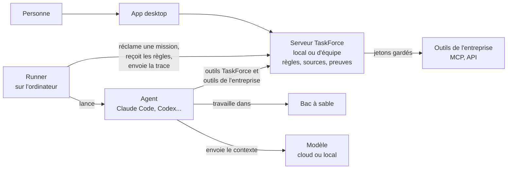

# Spécification de la v2 : le harnais

**Version :** 0.1 · **Date :** 27/10/2026 · **Auteur(s) :** Pierre MICHEL · **Statut :** brouillon, à relire par la
Présidence

> **Pourquoi** : la séance n°2 du Conseil d'Avenir a fixé le cap à dix ans, « partout où une IA agit, un harnais réglé
> par ceux qui en répondent », et le premier cas d'usage
> ([PV](../../recherche/conseil/seances/2026-10-27-vision.md)). L'[état des lieux](../09-audits/Etat_des_lieux_v1_avant_v2.md)
> dit ce que la v1 sait déjà faire. Ce document dit ce que la v2 construit, comment, dans quel ordre, et ce que livre
> le sprint de trois jours.
>
> **Ce qui fait foi** : une fois validé, ce document remplace [[These_Produit_V1_V2]] pour le cap de la v2.
> [[Scalabilite_et_Robustesse]] reste valable et il est repris au §13. Les autres documents de `road_to_v2/` restent
> l'historique de conception.
>
> **Marquage** : ce qui existe dans le code porte son fichier ; ce qui n'est pas vérifié porte « à vérifier ». Rien
> n'est construit avant la validation de la Présidence. Revue du Conseil : [PV de la séance
> n°3](../../recherche/conseil/seances/2026-10-27-menage-spec-v2.md).

## Table des matières

- [En une page](#en-une-page)
- [1. Le ménage de l'app desktop](#1-le-ménage-de-lapp-desktop)
- [2. Les invariants](#2-les-invariants)
- [3. Vocabulaire](#3-vocabulaire)
- [4. L'architecture d'ensemble](#4-larchitecture-densemble)
- [5. Le contexte : ce que l'agent sait](#5-le-contexte--ce-que-lagent-sait)
- [6. Les règles : qui décide quoi](#6-les-règles--qui-décide-quoi)
- [7. La porte unique](#7-la-porte-unique)
- [8. Le bac à sable](#8-le-bac-à-sable)
- [9. Le dossier de preuve](#9-le-dossier-de-preuve)
- [10. Les agents](#10-les-agents--celui-de-votre-choix)
- [11. Les connecteurs](#11-les-connecteurs)
- [12. Les équipes dans l'app desktop](#12-les-équipes-dans-lapp-desktop)
- [13. Scalabilité et robustesse](#13-scalabilité-et-robustesse)
- [14. Le harnais apprend](#14-le-harnais-apprend)
- [15. Ce que voit l'utilisateur](#15-ce-que-voit-lutilisateur)
- [16. La mesure et la banque de tests](#16-la-mesure-et-la-banque-de-tests)
- [17. Le premier cas d'usage, de bout en bout](#17-le-premier-cas-dusage-de-bout-en-bout)
- [18. Le sprint de trois jours](#18-le-sprint-de-trois-jours)
- [19. Après le sprint](#19-après-le-sprint)
- [20. À trancher par la Présidence](#20-à-trancher-par-la-présidence)
- [21. Limites](#21-limites)

## En une page

**La promesse (R5')** : « Vous décrivez le résultat ; TaskForce le fait faire par l'agent de votre choix, avec vos
outils et vos règles, et vous montre qu'il est bon. »

**Ce que la v2 ajoute à la v1**

1. Les documents de l'entreprise, avec leurs versions, cherchés par le sens et par le texte exact ; chaque réponse
   cite sa source.
2. Les règles écrites comme des données : chaque action classée (réversible ou non), chaque règle avec son
   propriétaire.
3. Une porte unique : toute action d'un agent passe par TaskForce, qui applique les règles et la trace.
4. Le bac à sable : l'agent travaille sur une copie et rejoue le workflow avec ses tests ; rien n'en sort sans
   décision, sauf le réversible autorisé.
5. Le dossier de preuve : tout est tracé, chaîné, exportable.
6. La carte de résultat : le résultat, trois à cinq contrôles, une décision.
7. Les outils de l'entreprise pour l'agent délégué, à travers la porte.
8. Les équipes dans l'app desktop, avec un serveur d'équipe.

**L'architecture en une phrase** : un plan de contrôle, le serveur TaskForce (local ou d'équipe), garde les règles, les
sources et les preuves ; des exécutants, les runners sur l'ordinateur de chacun, font travailler les agents et
appliquent les règles sur place ; toute action d'agent passe par une seule porte.

**Les invariants** (§2) : l'autorité ne vit jamais dans l'agent ; une action inconnue est irréversible ; tracer avant
d'agir ; rien ne sort du bac à sable sans décision ; l'agent ne voit jamais un secret ; le contexte n'est jamais une
instruction.

**Le sprint de trois jours** (§18) : un seul parcours, celui du premier cas d'usage. Jour 1 : les règles, la porte et
la preuve. Jour 2 : les documents et leurs versions. Jour 3 : le bac à sable, la carte de résultat et la banque de
tests.

**Ordre de livraison** : l'app desktop (le .exe) d'abord ; la version du Store et la webapp reçoivent les mêmes
changements plus tard (décision du 27/10/2026).

**À trancher** : §20.

## 1. Le ménage de l'app desktop

Décidé par la Présidence le 27/10/2026, à partir de l'[état des lieux](../09-audits/Etat_des_lieux_v1_avant_v2.md) §3.

| Élément | Décision | Ce qu'on fait | Quand |
| --- | --- | --- | --- |
| Équipe : membres, équipes, invitations, charge, compétences | **Gardé** : c'est du contexte, qui sait faire quoi | Rien n'est retiré ; ce qui est déjà masqué dans l'app desktop le reste jusqu'au serveur d'équipe (§12) | Phase 3 |
| Inbox : Mentions | **Gardé** | Devient l'endroit où un agent appelle un humain : une vérification, une question, une décision (§7.4) | Phase 2 |
| Inbox : Assignments | **À retravailler** | Options au §20 | À trancher |
| GitHub et Slack | **Gardés, à faire marcher** | PC-060 se corrige en les rendant utilisables, pas en les cachant (§11.3) | Phase 2 |
| Public et Private | **Gardés** | Voir plus bas | À trancher (§20) |
| Panneau Status | **Retiré de la vue** | Masqué dans l'app desktop, code gardé | Lot ménage |
| Textes écrits pour le web | **Expliqué plus bas** | Proposition : les adapter, pas les retirer | À trancher (§20) |
| Pages des projets | **Supprimées** : tout sera dans le Brain OS | Les Pages existantes deviennent des notes du Brain OS, puis la fonction est retirée | Lot ménage |
| Copilot | **Gardé**, à essayer | Rien n'est retiré | Phase 2 |
| Code mort | **Supprimé** | La liste « Restes » de l'état des lieux | Lot ménage |

**La règle du ménage** (Présidence) : on supprime ce qui est sûr, les Pages et le code mort. Dans le doute, on masque et
on garde le squelette. Rien de ce qui peut servir la v2 n'est supprimé : interface, partage du travail, onboarding.

**Public et Private, ce que c'est aujourd'hui** : un projet Public est visible par tous les membres de l'espace ; un
projet Private, par ses seuls collaborateurs. Ce n'est pas la visibilité sur internet d'un dépôt GitHub public. Dans
l'app desktop, à une seule personne, le réglage n'a pas d'effet ; avec le serveur d'équipe, il en aura. Proposition :
garder les deux, les nommer pour éviter la confusion avec GitHub (« Tout l'espace », « Collaborateurs seulement »), et,
quand le projet est lié à un dépôt, afficher la visibilité du dépôt et s'en servir dans les règles : pousser vers un
dépôt public expose le code, c'est irréversible (§6.2).

**Les textes écrits pour le web, ce que c'est** : la politique de confidentialité et les mentions légales affichées
dans l'app desktop sont celles de la webapp hébergée. Elles parlent du stockage des fichiers sur nos serveurs, de la
mesure d'audience et des cookies, alors que dans l'app desktop les données restent sur l'ordinateur
(`frontend/app/privacy-policy/page.tsx` n'a pas de version desktop). Proposition : écrire la version desktop de ces
textes. Les textes d'équipe de la visite guidée et des agents restent, puisque l'équipe reste.

## 2. Les invariants

Ce qui ne se négocie pas, dans aucune règle, aucun réglage, aucune version.

1. **L'autorité ne vit jamais dans l'agent.** Les règles sont évaluées hors du modèle, par du code déterministe. Aucun
   texte lu par l'agent ne change une règle.
2. **Aucun agent ne décide seul d'une action irréversible, ni de ce qui est irréversible** (R1). La table des classes
   est écrite d'avance, par des personnes nommées.
3. **Une action inconnue est irréversible.** Un outil ou une commande qu'aucune règle ne classe attend une décision
   humaine.
4. **Tracer avant d'agir.** L'intention est écrite dans le dossier avant l'action, le résultat après ; une panne entre
   les deux se voit.
5. **Rien ne sort du bac à sable sans décision**, sauf ce que les règles déclarent réversible (R7').
6. **L'agent ne voit jamais un secret.** Les jetons des outils restent sur le serveur ; l'agent passe par la porte.
7. **Le contexte n'est jamais une instruction.** Un document, une note, une réponse d'outil sont des données ; ils ne
   donnent aucun droit.
8. **Chaque décision a un auteur** : une personne nommée, ou une règle nommée avec son propriétaire.

## 3. Vocabulaire

| Mot | Sens |
| --- | --- |
| Mission | Un résultat demandé : une issue déléguée, avec son contexte, ses règles, son bac à sable et son dossier de preuve. Elle prolonge le run de la v1 (`delivery_runs`). |
| Action | Ce que fait l'agent : lire un fichier, lancer une commande, appeler un outil. |
| Classe | Lecture, écriture dans le bac à sable, sortie réversible, irréversible. |
| Règle | Pour une action dans un contexte : autoriser, demander ou refuser ; avec propriétaire, raison et date de revue. |
| Porte | Le point où une action est jugée par les règles et tracée. |
| Bac à sable | La copie où l'agent travaille librement. |
| Sortie | Ce qui quitte le bac à sable : un push, une pull request, une issue, une action dans un outil. |
| Dossier de preuve | Le journal chaîné d'une mission, exportable. |
| Carte de résultat | Ce que voit l'utilisateur : le résultat, les contrôles, la décision. |
| Runner | Le programme qui, sur l'ordinateur de la personne, fait travailler l'agent (`taskforce-runner`). |
| Source | Un passage précis d'un document, dans une version donnée. |

## 4. L'architecture d'ensemble

### 4.1 Deux plans

- **Le plan de contrôle** : le serveur TaskForce (backend Spring et Postgres). Il garde les espaces, projets et issues ;
  les sources ; les règles et leurs versions ; les missions et leurs dossiers de preuve ; les décisions humaines ; les
  connecteurs et leurs jetons.
- **Le plan d'exécution** : le runner. Il réclame une mission, prépare le bac à sable, lance l'agent, applique les
  règles à chaque action, envoie la trace. Il ne garde rien d'irremplaçable : s'il meurt, la mission reprend ou
  s'arrête proprement (§13).

C'est déjà la forme de la v1 : le runner réclame un run et lance Claude Code ; le serveur garde le run, la chronologie
et les validations. La v2 la généralise.

### 4.2 Le même code en local et en équipe

Le backend tourne déjà sous deux profils : embarqué dans l'app desktop (`application-desktop.yml`, Postgres local) et
hébergé (la webapp). La v2 garde un seul code, et un espace vit à l'un de deux endroits :

- **un espace local**, sur l'ordinateur : privé, utilisable sans réseau ;
- **un espace d'équipe**, sur le serveur d'équipe (§12).

Le runner et le harnais sont les mêmes dans les deux cas : le runner parle à un serveur TaskForce, local ou d'équipe.

### 4.3 Schéma



La porte a deux gardes qui appliquent la même table : le runner pour les actions locales (fichiers, commandes), le
serveur pour les outils (§7).

### 4.4 Ce que devient chaque brique de la v1

| Brique v1 | En v2 |
| --- | --- |
| Run (`delivery_runs`) | La mission : mêmes tables, avec la version des règles, l'empreinte racine du dossier, l'état du bac à sable |
| Chronologie (`delivery_run_events`, 500 événements, textes coupés à 600 caractères) | Le dossier de preuve : journal chaîné, sans troncature silencieuse (§9) |
| Validations (`delivery_run_approvals`) | Les décisions humaines, reliées à la règle qui les a demandées |
| Listes codées en dur du runner (`taskforce-runner/src/agent.ts`) | Le paquet de règles, versionné, reçu à la réclamation (§6) |
| Hook `PermissionRequest`, qui envoie tout à l'humain | Les règles jugées sur place ; seul « demander » part vers l'humain (§7.1) |
| Serveur MCP de l'espace, 12 outils | La porte, qui relaie aussi les outils de l'entreprise (§7.3) |
| `DeliverySessionScope` | Reste la garde du serveur ; les règles s'y ajoutent sans la remplacer |
| Brain OS : une note, un vecteur, 4 000 caractères | Documents, versions, passages ; recherche hybride avec sources (§5) |

## 5. Le contexte : ce que l'agent sait

### 5.1 Documents et versions

Un document est un nœud du Brain OS, de type document : il garde ses liens et ses tags dans le graphe. Ses versions et
ses passages vivent dans leurs propres tables (migrations V102 et suivantes, la dernière étant V101) :

- `document_versions` : le document, le libellé de version (« 3.1.1 », « 5.0 »), la date d'effet, le fichier d'origine
  (empreinte SHA-256, type, taille), l'état de l'extraction, qui l'a importée et quand.
- `document_passages` : la version, l'ordre, le chemin de section (« 3.1.2.4 Keep Alive »), les pages de début et de
  fin, le texte, son vecteur (`vector(1024)` et `embedding_model`, comme V94), son `tsvector` indexé.

Une version ne se modifie jamais : on en importe une nouvelle.

### 5.2 L'import

- Formats d'abord : PDF avec du texte, Word (.docx), Markdown, texte, HTML ; un dossier entier ; un coffre Obsidian,
  qui est déjà le format du Brain OS.
- Extraction en Java, avec Apache Tika (licence Apache 2.0), dans le backend : pas de nouveau service. Les PDF scannés
  (images) attendent : pas de reconnaissance de texte en v2.0.
- Bornes : taille, nombre de pages, durée et mémoire de l'extraction. Un fichier qui dépasse est refusé avec un message
  qui dit pourquoi.
- L'extraction tourne en tâche de fond et reprend après un redémarrage : son état est en base.
- Un fichier déjà importé, à la même empreinte, n'est pas réimporté.

### 5.3 Découpage et index

- Le découpage suit la structure du document (titres, numérotation), puis la taille, avec un recouvrement entre
  passages voisins. La taille cible se règle avec la banque de tests.
- Chaque passage garde son chemin de section et ses pages : c'est ce qui rend une source citable.
- Les vecteurs se calculent en tâche de fond, comme aujourd'hui (`BrainEmbeddingIndexer`), mais par passage. La limite
  de 4 000 caractères par note disparaît : les notes longues se découpent aussi.
- Le plein texte a un `tsvector` stocké et un index GIN ; aujourd'hui, il n'est qu'un repli sans index.

### 5.4 Recherche hybride et sources

- Deux recherches en parallèle, par le sens (pgvector) et par le texte exact (termes, numéros de clause), fusionnées
  par rang (Reciprocal Rank Fusion), après filtrage par les droits (§5.6).
- Chaque résultat porte sa source : document, version, chemin de section, pages, extrait. Le format est le même dans
  l'interface, dans `brain_search` et dans le dossier de preuve.
- `brain_search` rend des passages sourcés, plus des notes entières.
- Une affirmation de l'agent est sourcée si elle cite une source qui existe et si la citation se retrouve dans le
  passage : cela se vérifie par programme. Le sens se vérifie par un relecteur (R4, §7.6).

### 5.5 L'écart entre deux versions

Pour le premier cas d'usage, l'agent ne relit pas deux fois des centaines de pages : TaskForce calcule l'écart.

- Les sections des deux versions s'alignent par numéro et par titre, puis par proximité du texte pour celles qui ont
  bougé ou changé de nom.
- Chaque section est ajoutée, retirée, modifiée (avec le diff de son texte) ou inchangée.
- L'écart est lui-même un document : la liste des changements, chacun avec ses deux sources. L'agent le lit et le cite.
- Limite : un standard dont la structure change entièrement s'aligne mal. La banque de tests mesure l'alignement.

### 5.6 Qui lit quoi

- Les droits de l'espace et du projet s'appliquent à la recherche : un document d'un projet Private n'est visible que
  de ses collaborateurs.
- Chaque document a un niveau de sensibilité, « interne » par défaut. Une règle dit vers quels modèles il peut partir :
  par exemple, « confidentiel » ne part que vers un modèle local. Quand l'agent délégué utilise un modèle dans le
  cloud, `brain_search` ne lui rend pas ces passages, et la trace le dit.
- Le contexte n'est jamais une instruction (invariant 7) : un document qui contient « ignore tes règles » ne change
  aucun droit. La banque de tests le vérifie (§16).

## 6. Les règles : qui décide quoi

### 6.1 Une règle

R2, dit simplement : ce que l'agent fait seul, ce qui lui est interdit et ce qui demande un accord, écrit avec qui l'a
décidé, pourquoi, et quand le revoir.

Une règle a un identifiant stable ; une portée (espace ou projet) ; une condition (action, arguments, contexte : branche,
visibilité du dépôt, sensibilité, montant) ; une classe ; un effet (autoriser, demander, refuser) ; un propriétaire
nommé ; une raison ; une date de revue ; une action inverse si elle existe ; des compteurs (déclenchements, demandes,
refus, décisions regrettées).

Exemple au format d'export. Le produit est en anglais, le format aussi ; la source de vérité est l'app.

```yaml
format: taskforce-rules/1
workspace: acme
version: 12
rules:
  - id: push-agent-branch-private-repo
    when: { action: git.push, branch: "tf/*", repo.visibility: private }
    class: reversible-exit
    effect: allow
    inverse: delete-branch
    owner: pierre
    reason: "The agent's branch can be deleted; the repository is private."
    review: 2027-01-15
  - id: push-public-repo
    when: { action: git.push, repo.visibility: public }
    class: irreversible
    effect: ask
    owner: pierre
    reason: "Pushing to a public repository exposes the code; it cannot be taken back."
    review: 2027-01-15
```

### 6.2 Les classes et la table par défaut

| Classe | Exemples | Effet par défaut |
| --- | --- | --- |
| Lecture | Lire un fichier, chercher, `brain_search`, lire une issue, lire dans un outil | Autoriser et tracer (R7') |
| Écriture dans le bac à sable | Modifier un fichier de la copie, commit local, lancer les tests | Autoriser et tracer : « libre mais encadré » |
| Sortie réversible | Pousser la branche de l'agent vers un dépôt privé, ouvrir une pull request, créer une issue dans le projet | Autoriser et tracer si l'action inverse existe ; sinon demander |
| Irréversible | Fusionner, publier un paquet, envoyer un message ou un e-mail, payer, rembourser, supprimer, migrer une base partagée, pousser vers un dépôt public, exposer un secret | Demander (R1) |
| Inconnue | Tout ce qu'aucune règle ne classe | Demander (invariant 3) |

Le défaut est permissif pour le réversible et strict pour l'irréversible : « tout est vert, ça passe » (séance n°2).
L'entreprise change la table ; chaque changement a son auteur.

### 6.3 Combiner les règles

- L'espace pose les règles de l'entreprise. Un projet peut les resserrer, pas les desserrer, sauf par le propriétaire
  de la règle de l'espace.
- Quand plusieurs règles s'appliquent, refuser l'emporte sur demander, qui l'emporte sur autoriser.
- Sans règle, la classe décide ; sans classe, on demande.
- Mêmes action, contexte et version des règles : même décision. Aucun modèle d'IA ne décide (invariant 1) ; une IA
  peut expliquer une décision, pas la prendre.

### 6.4 Où les règles s'appliquent

- Le serveur publie, par espace et par projet, un paquet de règles versionné, avec son empreinte. Le runner le reçoit
  en réclamant la mission ; la version appliquée est écrite dans la mission.
- Le runner juge sur place, sans aller-retour réseau par action : c'est ce qui garde la vitesse. Le serveur juge de son
  côté ce qui passe par lui (outils, issues). Deux gardes, une seule table.
- Le paquet ne vient jamais du bac à sable : un fichier de règles modifié par l'agent dans sa copie n'a aucun effet
  (invariant 1). Aucun outil de l'agent ne modifie les règles.

### 6.5 Compter, revoir, retirer

- Chaque règle compte ses déclenchements, ses demandes, ses refus et les décisions regrettées (R2, R3).
- À la date de revue, le propriétaire reçoit une demande de revue dans Mentions.
- Une règle ne se retire que si les chiffres la montrent inutile, jamais parce qu'elle n'a pas encore servi (séance
  n°1).
- Le harnais propose, la personne décide : « cette demande a été acceptée 40 fois sur 40 : en faire une règle qui
  autorise ? ».

### 6.6 L'éditeur de harnais et les modèles par métier

- La v2.0 livre l'import et l'export du paquet (YAML, JSON) et un écran de lecture des règles, avec leur historique et
  leurs compteurs.
- L'éditeur complet vient ensuite, « à voir si ce n'est pas trop compliqué » (Présidence) : chercher, modifier, voir
  l'effet d'un changement sur les missions passées avant de l'appliquer.
- Des modèles de départ par métier (équipe logicielle, réseau embarqué...) en libre-service ; l'accompagnement sur site
  quand un client le paie (séance n°2).

## 7. La porte unique

Toute action d'un agent passe par une porte, qui applique les règles et écrit la trace. Trois chemins mènent à la même
table.

### 7.1 Les actions locales de l'agent

- Pour Claude Code, la liste des outils autorisés d'avance (`--allowedTools`) se construit depuis le paquet de règles
  (lecture, écriture dans le bac à sable) au lieu d'être codée en dur.
- Le reste arrive au hook `PermissionRequest`, déjà servi par le runner. Le runner juge la règle sur place : il
  autorise ou refuse seul, et ne transmet à l'humain que « demander ».
- Chaque action, autorisée d'avance ou non, est tracée depuis le flux `stream-json`, déjà relayé par le runner.
- Un mode strict, pour les espaces qui le demandent : un hook `PreToolUse` juge aussi les actions autorisées d'avance.
  À vérifier sur Claude Code 2.1.293 et suivants : l'enchaînement avec `PermissionRequest` et le temps ajouté.
- Une commande se juge sur sa forme analysée (programme, sous-commande, arguments), pas sur son texte : `npm test` n'est
  pas `npm publish`. Une commande composée (`&&`, `|`, `;`) se juge morceau par morceau. Ce qui ne s'analyse pas est
  inconnu, donc demandé.

### 7.2 Les outils de TaskForce

Le serveur MCP de l'espace (`POST /api/workspaces/{slug}/mcp`) juge chaque appel avec la même table.
`DeliverySessionScope` reste la garde du serveur : l'agent n'écrit que dans le projet de sa mission et ne supprime rien.

### 7.3 Les outils de l'entreprise

- La porte relaie les outils des serveurs MCP connectés à l'espace. L'agent ne voit toujours que le serveur `taskforce`
  (`--strict-mcp-config` reste), avec des outils en plus, préfixés par leur serveur.
- Le serveur garde les jetons (invariant 6) : l'agent n'a jamais l'identifiant d'un outil.
- Par défaut, l'agent délégué ne voit que les outils de lecture (séance n°2 : lecture par défaut). Un outil d'écriture
  apparaît quand une règle le classe.
- Une écriture qui doit attendre ne bloque pas l'agent : elle devient une action proposée, exécutée après la décision
  humaine, hors de la session de l'agent. L'agent reçoit « proposée, en attente » et continue ou termine.
- Pour classer l'outil d'un serveur MCP, son nom, sa description et ses annotations (lecture seule, destructeur)
  aident à proposer une classe ; une personne la confirme. Une annotation venue du serveur n'est jamais crue seule
  (invariant 7).

### 7.4 La décision humaine

- Une demande dit en langage clair ce que l'agent veut faire, pourquoi la règle demande, l'effet (diff, plan, exécution
  à blanc quand elle existe) et l'action inverse s'il y en a une. Elle se lit en deux minutes (R4).
- Elle arrive dans Mentions (« un agent vous appelle »), sur l'issue, et en notification du système.
- Une seule durée d'attente, réglée par espace et appliquée par le serveur ; aujourd'hui, le runner et le serveur ont
  chacun la leur. Sans décision à l'échéance, c'est un refus.
- Décide la personne qui a délégué, ou le propriétaire désigné par la règle (pour un paiement, la personne qui en
  répond).
- La décision est tracée : qui, quand, sur quelle preuve, sous quelle version des règles.

### 7.5 L'action inverse

- Chaque type de sortie déclare son action inverse quand elle existe : supprimer la branche, fermer la pull request,
  rouvrir l'issue, restaurer un enregistrement depuis sa copie, rembourser.
- Une sortie sans action inverse est irréversible.
- « Défaire », sur la carte de résultat, applique les inverses dans l'ordre inverse de leurs sorties, et les trace.

### 7.6 Le relecteur

- Avant une porte à sens unique, une preuve que l'humain lit en deux minutes (R4).
- Un relecteur automatique, distinct de l'agent qui a produit : un autre modèle, d'un autre fournisseur quand c'est
  possible. Il suit une liste de points à vérifier et garde une partie libre (décision de la Présidence sur R4).
- Son avis entre au dossier ; il ne décide pas à la place de l'humain.

## 8. Le bac à sable

### 8.1 Ce que c'est

L'agent travaille sur une copie, librement (« libre mais encadré »). Il rejoue le workflow complet avec ses tests, pour
voir comment ça réagit. Rien n'en sort sans décision, sauf le réversible autorisé par les règles.

### 8.2 Les niveaux

| Niveau | Ce qui est isolé | État |
| --- | --- | --- |
| S0 | Le code : un worktree sur une branche `tf/...`, ou un dossier jetable | Existe (`taskforce-runner`) |
| S1 | Le workflow : après le travail de l'agent, le runner lance la commande de test du projet et les tests de cas d'usage ; les résultats vont au dossier | v2.0 |
| S2 | Les outils : les écritures vers l'extérieur deviennent des actions proposées, ou vont vers un environnement de test (mode test d'un service de paiement, préproduction) | Phase 2 |
| S3 | La machine : processus isolé, réseau filtré (seulement les dépôts de paquets et le serveur TaskForce) | À étudier |

**S3 sous Windows** : pas de solution simple pour tout le monde. Windows Sandbox n'existe pas sur l'édition Famille, et
Docker n'est pas installé partout. Pistes à vérifier : l'isolation proposée par l'agent lui-même, WSL, un conteneur
quand il existe.

### 8.3 Les tests de cas d'usage

- Pour du code : la commande de test du projet (un réglage du projet), plus les tests que la mission déclare.
- Pour un document, comme dans le premier cas d'usage : des contrôles sur le livrable. Chaque affirmation a une source
  qui existe ; chaque citation se retrouve dans son passage ; chaque section modifiée du standard est traitée, par un
  impact ou par un « sans impact » justifié.
- Les résultats sont des faits du dossier (commande, sortie, durée, code de retour), pas un résumé écrit par l'agent.

### 8.4 Ce qui sort

À la fin, le runner propose les sorties : push, pull request, issues, actions dans les outils. Chacune suit sa règle
(§6.2) : le réversible part et se trace, l'irréversible attend.

## 9. Le dossier de preuve

### 9.1 Un journal chaîné

- Chaque événement d'une mission est ajouté, jamais modifié : numéro d'ordre, heure, type, acteur (agent, personne,
  règle), contenu, empreinte de l'événement précédent, empreinte propre (SHA-256 du contenu canonique et de l'empreinte
  précédente).
- L'empreinte racine scelle le dossier : un événement modifié ou retiré se voit.
- La chaîne se calcule sur le serveur, à la réception, dans l'ordre : le runner ne peut pas réécrire l'histoire.
- Ce n'est pas une signature. La signature par une clé de l'espace viendra quand un client la demandera (I1 : le
  harnais rend l'IA assurable).

### 9.2 Ce qu'il contient

La demande ; les versions de TaskForce, du runner, de l'agent et du modèle ; la version du paquet de règles ; les
sources lues (document, version, passage) ; chaque action, la règle appliquée et la décision ; les décisions humaines
(qui, quand, sur quoi) ; les sorties des tests ; le diff ; les sorties proposées et leur sort ; l'avis du relecteur ;
le coût quand l'agent le donne ; les durées (attente humaine, temps de cycle).

### 9.3 Sans troncature silencieuse

Aujourd'hui, la chronologie garde 500 événements au plus et coupe les textes à 600 caractères. En v2, le contenu
complet va, compressé, dans le stockage de fichiers (MinIO pour la webapp, le dossier de l'app en local) ; l'événement
garde son empreinte et un résumé. Une limite de taille reste, pour tenir la charge, mais le dossier dit quand elle
s'applique.

### 9.4 Conservation

Le dossier survit à l'issue : supprimer une issue ne supprime plus sa preuve. Les dossiers se suppriment selon une
durée de conservation réglée par l'espace, et la suppression se trace. Les données personnelles d'un dossier suivent
les règles RGPD de l'espace (à préciser avec le registre des traitements).

### 9.5 Export

- `dossier.json` : le journal complet et ses empreintes, pour une machine.
- `dossier.md`, et sa version PDF : la lecture humaine, carte de résultat en tête.
- Une commande vérifie un dossier exporté en recalculant ses empreintes, sans TaskForce.
- Le format est documenté et versionné (R9'). Pas de standard publié avant d'avoir des clients.

### 9.6 Lisible par un auditeur

Le dossier répond aux questions d'un auditeur : qui a demandé, quel agent a agi, sur quelles sources, sous quelles
règles, qui a décidé, ce qui est sorti, comment le défaire. L'AI Act demande, pour les systèmes à haut risque, des
traces automatiques (article 12) et une supervision humaine effective (article 14) : le dossier va dans ce sens, sans
que TaskForce prétende rendre un client conforme.

## 10. Les agents : celui de votre choix

### 10.1 Un contrat d'adaptateur

Chaque agent se branche par un adaptateur : démarrer une mission (demande, bac à sable, règles, accès à la porte),
suivre ses événements, l'arrêter, dire ce que l'agent permet (hooks, MCP, flux d'événements, choix du modèle).

### 10.2 Ce que le harnais voit de chaque agent

| Niveau | Agents | Ce que le harnais tient |
| --- | --- | --- |
| Complet | Agents en ligne de commande, avec hooks et MCP, lancés par le runner : Claude Code (fait) ; Codex et l'agent en ligne de commande de Cursor (à vérifier) | Chaque action, le bac à sable, les sources |
| Aux frontières | Agents qui travaillent dans le cloud d'un fournisseur : GitHub Copilot (branché, jamais essayé) | La demande, la pull request, les règles du dépôt ; pas les actions intermédiaires |
| Interne | Un modèle local ou une API compatible OpenAI, piloté par une boucle d'agent de TaskForce | Tout : TaskForce tient la boucle |

L'interface dit à la personne ce que le harnais voit de l'agent qu'elle choisit.

### 10.3 L'ordre

Claude Code (fait) ; Copilot (gardé, à essayer) ; puis par usage : Codex, Cursor, un modèle local par la boucle interne
(Ollama). Les modèles passent, l'adaptateur reste : on mise sur l'entreprise, pas sur les défauts des modèles.

## 11. Les connecteurs

### 11.1 Trois façons de se brancher

- **MCP distant** : existe (25 préréglages et tout serveur ajouté à la main).
- **MCP local** (stdio), pour l'app desktop : à faire. Lancer un serveur local, c'est lancer un programme sur
  l'ordinateur : son installation est une décision humaine, et ses outils passent par la porte comme les autres.
- **Connecteur générique OpenAPI**, pour toute API documentée : à faire.
- **Natifs** : GitHub, Slack, Plane, existent.

Connecter, c'est rendre un outil disponible ; les règles disent qui s'en sert, et comment (§7.3).

### 11.2 L'ordre : par usage, sourcé

Une liste des outils les plus utilisés, tous domaines confondus, classée par nombre d'utilisateurs, avec un chiffre
sourcé et daté pour chaque outil ; on branche d'abord les plus utilisés (décision du 27/10/2026). C'est un livrable à
part, avant la phase 4.

### 11.3 Dans l'app desktop

- **PC-059** : la connexion MCP en un clic doit revenir vers le backend de l'app, dont le port change à chaque
  lancement. Piste : une adresse de retour en boucle locale (`127.0.0.1`), que la RFC 8252 prévoit pour les
  applications natives ; à vérifier avec les fournisseurs du catalogue.
- **PC-060** : GitHub et Slack doivent marcher dans l'app (décision du 27/10/2026). GitHub par le `gh` de la personne,
  déjà utilisé pour Copilot et les pull requests ; Slack par son OAuth, avec la même adresse de retour locale (à
  vérifier : Slack l'accepte-t-il ?).

## 12. Les équipes dans l'app desktop

### 12.1 Ce que veut la Présidence

Garder tout ce qui sert une équipe (membres, équipes, invitations, charge, compétences), parce que c'est du contexte ;
travailler à plusieurs depuis l'app desktop ; un serveur derrière s'il le faut, sur un VPS OVH.

### 12.2 Proposition : exécution locale, gouvernance partagée

- Un espace d'équipe vit sur le serveur d'équipe : membres, projets, sources, règles et dossiers de preuve partagés.
- Chacun travaille depuis son app desktop, qui affiche ses espaces locaux et ses espaces d'équipe. Le compte est déjà en
  ligne (connexion par `/auth/desktop`).
- Les agents travaillent sur l'ordinateur de la personne qui délègue : son runner réclame les missions de l'espace
  d'équipe qui lui reviennent, avec les règles de l'équipe. Le serveur ne fait tourner aucun agent : il garde, il ne
  calcule pas, ce qui le garde petit.
- Un espace local devient un espace d'équipe par le fichier d'espace (existe depuis la 1.2.0, `WorkspaceBundleService`).

### 12.3 Deux façons de le construire

| | A. L'app ouvre l'espace d'équipe du serveur | B. L'app parle à deux serveurs |
| --- | --- | --- |
| Principe | Pour un espace d'équipe, la fenêtre affiche l'interface du serveur d'équipe, à la manière de l'app desktop de Slack ; le runner local travaille pour lui | L'interface locale parle au serveur local ou au serveur d'équipe, selon l'espace |
| Effort | Faible : la webapp existe ; il faut l'ouverture sécurisée dans la coque et le runner relié au serveur d'équipe | Élevé : chaque appel choisit son serveur ; sessions, temps réel et fichiers en double |
| Risque | Un contenu distant dans la coque : à verrouiller (origine autorisée, aucun accès au système) | Complexité, bugs aux frontières |

Recommandation : **A**, puis converger si un besoin le justifie.

### 12.4 Le serveur d'équipe

- Le backend hébergé actuel, installé sur un VPS OVH en France ; le choix de l'offre revient à la Présidence.
- Sans réseau : les espaces locaux marchent entièrement. Un espace d'équipe n'est pas joignable ; une mission en cours
  continue dans son bac à sable, ses traces attendent le retour du réseau, et toute sortie ou décision attend.

## 13. Scalabilité et robustesse

### 13.1 Le principe

- **Le serveur garde, l'ordinateur calcule.** Les agents tournent sur les ordinateurs (plus tard aussi sur des
  exécutants hébergés). Le serveur stocke missions, règles, sources et preuves, et sert la recherche : sa charge croît
  avec le nombre de missions suivies et d'événements, pas avec le travail des agents.
- **On conçoit pour monter sans réécrire, on ne construit un palier que quand son déclencheur arrive**
  ([[Scalabilite_et_Robustesse]]).

### 13.2 Les missions : une file durable et des baux

- Une mission est une ligne en base, avec un état. La réclamer, c'est prendre un bail (runner, échéance) par une mise à
  jour atomique (`SELECT ... FOR UPDATE SKIP LOCKED`, ou une mise à jour conditionnelle) ; à comparer avec la
  réclamation actuelle de `LocalRunnerService`.
- Le runner renouvelle son bail par battement de cœur. Un bail expiré est repris par une tâche planifiée du serveur, et
  non plus quand l'interface lit le run (défaut relevé par l'état des lieux).
- Une mission dont le bac à sable est perdu ne reprend pas en douce : elle repart de zéro ou s'arrête, et le dossier le
  dit.
- Les transitions d'état sont gardées (une mission terminée ne repasse pas en cours) et idempotentes (rejouer une
  transition ne la double pas).

### 13.3 Les événements : ordre, doublons, réseau coupé

- Le runner numérote les événements de chaque mission. Le serveur accepte des lots, ignore les doublons par leur
  numéro, signale les trous. Un lot rejoué ne double rien.
- Le runner écrit d'abord ses événements sur le disque, puis les envoie : réseau coupé ou serveur redémarré, rien ne
  se perd ; ils partent au retour.

### 13.4 Tracer avant d'agir

- Une sortie suit trois temps : l'intention, écrite et acquittée par le serveur ; l'action ; le résultat, écrit.
- Une panne entre l'intention et le résultat se réconcilie au redémarrage (la branche existe-t-elle ? l'appel est-il
  passé ?) et s'écrit. Une action ne part pas deux fois quand l'outil accepte une clé d'idempotence.
- C'est le patron « outbox » : l'action ne part qu'une fois son intention enregistrée. L'aller-retour ne touche que les
  sorties, qui sont rares ; les actions dans le bac à sable restent locales.

### 13.5 Les pannes, une par une

| Panne | Ce qui se passe |
| --- | --- |
| Le runner meurt (ordinateur éteint, plantage) | Le bail expire ; le serveur reprend ou arrête la mission ; le bac à sable reste sur l'ordinateur et le dossier dit où tout s'est arrêté |
| Le serveur est injoignable | Le runner continue le local (lecture, écriture dans le bac à sable) et garde ses traces ; toute sortie et toute décision attendent ; passé un délai, il s'arrête proprement |
| Le paquet de règles manque ou ne correspond pas à son empreinte | La mission ne démarre pas : rien sans règles |
| L'humain ne répond pas | Refus à l'échéance (§7.4) ; l'agent continue sans l'action ou s'arrête |
| Un outil de l'entreprise est en panne | Délai, nouvelles tentatives bornées, puis échec tracé ; un disjoncteur par connecteur évite d'insister |
| Le modèle ne répond pas | L'agent échoue ; la mission passe en échec avec sa cause ; rien n'est sorti |
| L'agent boucle ou s'éternise | Bornes de tours, de durée et de coût par mission (aujourd'hui 60 tours et 45 minutes), réglables par règle |
| Disque plein, base indisponible | Le serveur refuse les nouvelles missions avec un message clair ; celles en cours s'arrêtent proprement |
| Deux runners réclament la même mission | Impossible : le bail est atomique |
| Un événement arrive deux fois | Ignoré, grâce à son numéro |

### 13.6 Monter en charge

| Palier | Déclencheur, mesuré | Action |
| --- | --- | --- |
| P0, aujourd'hui | Une personne, un espace | Un backend, un Postgres, embarqué ou sur le VPS |
| P1 | Recherches et tableaux lents | Index réglés (GIN, HNSW), cache Redis, PgBouncer, réplica de lecture pour la recherche |
| P2 | Plusieurs instances du backend | Backend sans état derrière un répartiteur ; temps réel par un relais (Redis) |
| P3 | Dossiers de preuve volumineux | Événements partitionnés par mois ; contenus dans le stockage de fichiers ; archivage selon la conservation |
| P4 | Un très gros espace | Partition par espace, en dernier recours |

Ce qui est fait dès la v2.0 pour que P1 à P4 restent possibles sans réécriture : tout porte l'identifiant de l'espace ;
les événements sont datés et en ajout seul, donc partitionnables ; les contenus lourds sont hors des lignes ; le
backend ne garde aucun état qui empêcherait d'en lancer deux.

Les exécutants : un runner par personne aujourd'hui ; plus tard des exécutants hébergés, pour les missions de nuit ou
les équipes sans ordinateur allumé, avec les mêmes baux et les mêmes règles.

### 13.7 Observabilité

- Par mission : temps de cycle, temps d'attention humaine (R3), attentes, refus, décisions regrettées, coût.
- Par règle : déclenchements (R2). Par connecteur : appels, erreurs, latence.
- Prometheus et Grafana existent pour le serveur hébergé. Dans l'app desktop, ces mesures restent sur l'ordinateur :
  rien n'est envoyé sans consentement explicite (Q10).

### 13.8 Sécurité

- **Secrets** : jamais dans l'environnement de l'agent (déjà nettoyé par le runner) ni dans le bac à sable ; les jetons
  des outils restent sur le serveur (invariant 6).
- **Injection** : tout ce que l'agent lit est une donnée (invariant 7) ; les règles ne dépendent jamais d'un texte lu.
  La banque de tests contient des attaques (§16).
- **Fuite** : une commande réseau qui sort du bac à sable est une sortie, classée par les règles ; le niveau S3 la
  bloquera au niveau de la machine.
- **Agent compromis** : il ne peut ni changer les règles, ni réécrire le dossier (chaîné), ni décider à la place d'un
  humain (la décision passe par l'interface authentifiée).
- **Identité** : l'agent agit sous une identité de mission, marquée comme agent, au nom de la personne qui délègue.
  Aujourd'hui, ses écritures sont attribuées à la personne, sans marque.

## 14. Le harnais apprend

- Chaque mission laisse des données exploitables : demandes, décisions, regrets, sorties des tests, sources citées,
  sort de la pull request (fusionnée, reprise, abandonnée).
- Elles servent à proposer des règles (jamais à les appliquer seules), à donner à l'agent la mémoire de ses résultats,
  et à faire gagner l'autonomie par la preuve, seulement sur l'initiative de l'agent et sur le sensible (séance n°2).
- Elles restent dans l'espace ; rien n'est envoyé sans consentement (Q10). La table `ai_generations` (V81) est un point
  de départ ; son usage actuel est à vérifier.

## 15. Ce que voit l'utilisateur

- Le harnais est invisible pour l'utilisateur et lisible pour l'auditeur (séance n°2).
- **La carte de résultat**, sur l'issue : le résultat (la pull request, le rapport), trois à cinq contrôles choisis par
  l'entreprise (vert, rouge, en attente), une décision (accepter, refuser, demander une reprise), « Défaire » quand
  c'est possible. En dessous, pour qui le demande : la fabrication (règles, étapes, sources) et l'export du dossier.
- Les demandes de décision en langage clair, dans Mentions (§7.4).
- Pour le premier cas d'usage, trois contrôles par défaut : affirmations sourcées, sections traitées, aucune action
  irréversible sans décision.
- Une personne, un geste : déléguer reste un choix dans le menu Assignee.

## 16. La mesure et la banque de tests

### 16.1 Les mesures

| Mesure | D'où elle vient | Comment |
| --- | --- | --- |
| Temps d'attention humaine par résultat accepté, avec les décisions regrettées en contre-mesure | R3 | Horodatage des demandes et des décisions ; une décision se marque « regrettée » |
| Temps de cycle | R3, décision de la Présidence | De la délégation au résultat accepté |
| Affirmations sourcées | Objectif du premier cas d'usage | Part des affirmations dont la source existe et contient la citation |
| Irréversible sans décision humaine | Objectif du premier cas d'usage | Doit valoir zéro ; tout écart est un défaut bloquant |
| Données exploitables | Objectif du premier cas d'usage | Dossier complet pour chaque essai, contrôlé par programme |
| Temps gagné | Objectif du premier cas d'usage | Comparé au temps actuel de l'équipe ; chiffres de référence fixés avec les ingénieurs du cas d'usage |

### 16.2 La banque de tests

Six familles ; pour chaque cas, le résultat attendu est écrit avant de lancer.

1. **Règles** : pour chaque règle par défaut, des cas autorisés, demandés et refusés ; les priorités, les portées,
   l'action inconnue. Des tests paramétrés tirés de tables : des centaines de cas, rapides.
2. **Porte** : le runner et un faux agent (il existe) rejouent des suites d'actions écrites d'avance ; on vérifie les
   décisions et les traces.
3. **Contexte** : un corpus public à plusieurs versions, libre de droits (proposition : MQTT 3.1.1 et 5.0, publiés par
   OASIS, à vérifier) ; des questions dont la réponse et la source sont connues. Mesures : la bonne source parmi les
   premiers résultats, la citation exacte, l'alignement des versions.
4. **Bout en bout** : des analyses d'impact complètes sur ce corpus et un projet libre qui l'utilise ; puis sur le vrai
   cas d'usage.
5. **Attaques** : injection dans un document ou une réponse d'outil, tentative de modifier les règles depuis le bac à
   sable, commande réseau vers l'extérieur, recherche de secrets.
6. **Pannes** : runner tué en pleine mission, serveur coupé, paquet de règles absent, événements en double.

### 16.3 Le protocole (R8)

- Tâches tirées au sort, avec et sans harnais, sur les mêmes tâches ; mesures écrites avant de lancer ; tous les
  résultats rapportés, échecs compris.
- Limite : une seule personne et peu de missions au début (contrainte C1 du labo) ; c'est une première mesure, pas une
  preuve générale.
- Les expériences E7 à E10 de la séance n°1 s'y rattachent : part de l'attente sur du réversible (E7), relecture des
  règles (E8), temps d'attention (E9), relecteur dédié (E10).

## 17. Le premier cas d'usage, de bout en bout

R6, le démonstrateur. Un ingénieur d'un éditeur de logiciels pour réseaux embarqués : le standard de communication de
son projet, vieux de vingt-cinq ans, sort en nouvelle version.

1. Il importe l'ancienne et la nouvelle version (§5.2) ; TaskForce calcule l'écart (§5.5).
2. Il crée l'issue « Analyse d'impact de la version N sur le projet P » et la délègue à l'agent de son choix.
3. L'agent travaille dans le bac à sable. Il lit l'écart, cherche dans le projet (code, configuration, exigences) ce
   que touche chaque changement, et écrit le rapport : pour chaque impact, la source dans le standard (version,
   section) et l'endroit du projet.
4. Les tests de cas d'usage contrôlent le rapport (§8.3).
5. La carte de résultat montre les trois contrôles. L'ingénieur accepte, refuse ou demande une reprise.
6. À l'acceptation, le rapport devient une note du Brain OS, les issues proposées (une par impact) sont créées, et le
   dossier de preuve s'exporte.

## 18. Le sprint de trois jours

**Objectif** : le premier cas d'usage de bout en bout, sur le corpus public, avec un harnais v0 et la banque de tests,
dans l'app desktop. Un seul parcours : ce qui n'y est pas sort du sprint.

| Jour | Livre | Fini quand |
| --- | --- | --- |
| 1 : règles, porte, preuve | Les règles en base, versionnées, avec propriétaire, raison, revue et compteurs, et la table par défaut ; le runner construit `--allowedTools` et juge `PermissionRequest` depuis le paquet, sur place ; le journal chaîné, sans troncature silencieuse ; l'export `dossier.json` et `dossier.md` ; le temps de cycle mesuré | Familles 1 et 2 vertes ; un dossier exporté, vérifié par recalcul des empreintes |
| 2 : documents et versions | L'import (PDF, Word, Markdown) dans le Brain OS, avec versions et passages ; le plein texte indexé et les vecteurs par passage ; la recherche hybride avec sources ; `brain_search` rend des passages sourcés ; l'écart entre deux versions | Famille 3 mesurée sur le corpus public |
| 3 : bac à sable, carte, mesure | Les tests de cas d'usage après le travail de l'agent (S1) ; les sorties selon les règles ; la carte de résultat sur l'issue ; une première série d'essais, avec et sans harnais | Familles 4, 5 et 6 passées au moins une fois ; mesures du §16.1 relevées ; rapport du sprint |

La définition de fini du dépôt s'applique : suite de tests complète, documentation à jour, trace dans
`.ai/roadmap.md`, version desktop publiée pour l'essai du .exe.

**Hors du sprint** (§19) : les outils de l'entreprise par la porte, les actions proposées (S2), le relecteur
automatique, l'éditeur de harnais, le serveur d'équipe, les autres agents, PC-059 et PC-060.

## 19. Après le sprint

| Étape | Contenu |
| --- | --- |
| Lot ménage | Panneau Status masqué ; Pages migrées vers le Brain OS puis retirées ; code mort supprimé ; PC-061 et PC-062 corrigés |
| Phase 2 : la porte complète | Outils de l'entreprise par la porte (§7.3) ; actions proposées (S2) ; relecteur automatique (§7.6) ; Mentions comme appel à un humain ; durée de décision unique ; identité d'agent marquée ; PC-059 et PC-060 ; essai de Copilot |
| Phase 3 : les équipes | Serveur d'équipe sur le VPS ; espaces d'équipe dans l'app desktop (§12) ; runner relié au serveur d'équipe |
| Phase 4 : élargir | Autres agents (§10.3) ; connecteurs par usage (§11.2) ; éditeur de harnais et modèles par métier ; isolation de la machine (S3) |
| Ensuite | La version du Store, puis la webapp, reçoivent les mêmes changements |

## 20. À trancher par la Présidence

1. **Le ménage avant ou après le sprint.** La revue du Conseil recommande avant, en une demi-journée (R10 du
   [PV n°3](../../recherche/conseil/seances/2026-10-27-menage-spec-v2.md)).
2. **Assignments** : (a) le fondre dans My Work, ce qui m'est assigné ; (b) en faire « qui fait quoi » de l'équipe,
   humains et agents ; (c) le masquer jusqu'au serveur d'équipe.
3. **Public et Private** : les nouveaux noms, et le lien avec la visibilité du dépôt (§1).
4. **Les textes de confidentialité et les mentions légales** : en écrire une version desktop (§1).
5. **Les équipes** : approche A ou B (§12.3), et le moment du VPS.
6. **« Plusieurs personnes sur le même chat »** : une conversation avec Cortex partagée entre membres, ou une
   messagerie d'équipe ? Le chat temps réel a été retiré le 11/07/2026 (migration V64).
7. **La table par défaut** (§6.2) : en particulier, pousser la branche de l'agent vers un dépôt privé sans attendre.
8. **Le corpus public** de la banque de tests (§16.2).
9. **Les recommandations R10 à R15** de la revue du Conseil ([PV n°3](../../recherche/conseil/seances/2026-10-27-menage-spec-v2.md)).

## 21. Limites

- Rien n'est construit ; les durées du sprint sont des estimations.
- À vérifier avant de s'en servir : l'enchaînement des hooks de Claude Code (§7.1) ; Codex et l'agent de Cursor
  (§10.2) ; l'adresse de retour locale chez les fournisseurs OAuth et chez Slack (§11.3) ; l'isolation de la machine
  sous Windows (§8.2) ; le corpus public (§16.2) ; l'usage actuel de `ai_generations` (§14).
- Les chiffres de référence du premier cas d'usage viennent de ses ingénieurs, pas de ce document.

---

**Dernière mise à jour :** 27/10/2026 · **v0.1**
